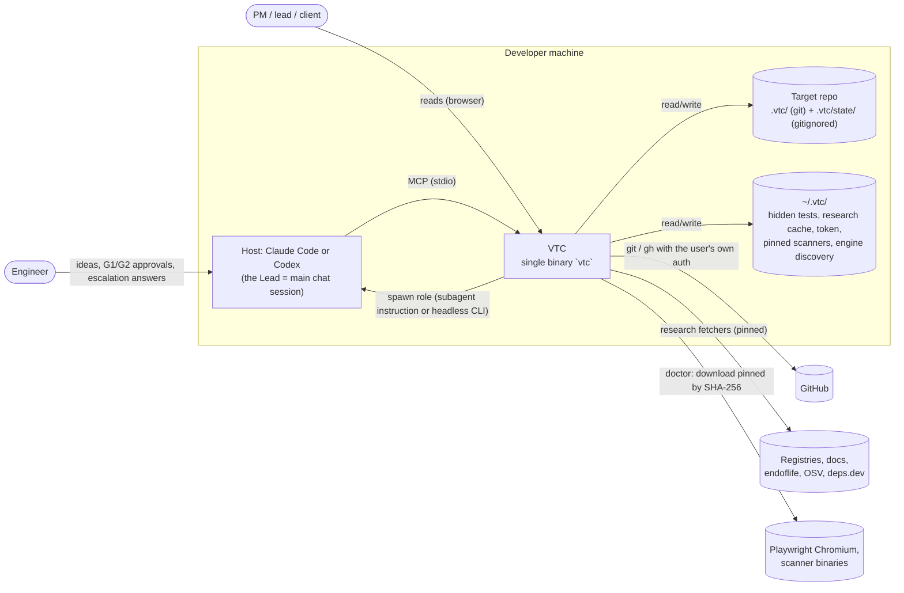
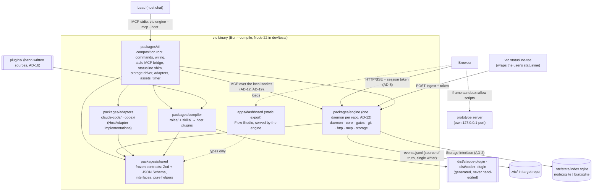

# VTC architecture spine (VTC's own code)

- **Status:** Phase 1 foundation, fix round 3 (the closing round of the phase-1 review). Frozen for the parallel build of sub-projects
  **1, 2, 3 and 6** (spec §19: 2 and 3 build on 1, 6 needs only 1's events; this spine freezes the
  contracts between them so all four can start together). Sub-projects 4, 5 and 7–9 follow §19's
  order and extend these contracts through the change process (§6 below).
- **Deviation from §19, pending confirmation:** §19 puts sub-project 0 (the feasibility spike)
  before everything and recommends building only after it. This spine starts 1, 2, 3 and 6 in
  parallel with the spike instead (§5 reading 8). Every contract that rests on host behaviour the
  spike verifies is listed in §7 **Provisional contracts** with the spike check that unfreezes it.
- **Wave-1 integration (2026-10-13):** the three wave-1 teams' contract proposals are merged
  as `CONTRACTS_VERSION` 4.1.0 (MINOR, additive). The Lead's answers to their questions are §5
  readings 18–37, marked "Lead decision 2026-10-13, pending human review". Round 1 of the spike
  updated §7.
- **Date:** 2026-10-13
- **Source of truth:** `docs/superpowers/specs/2026-10-12-vtc-system-design.md` (the spec). Section
  numbers (§n) below refer to it. Where this document and the spec disagree, the spec wins, and
  this document gets fixed. Where the spec is silent or ambiguous, §5 records the reading used.
- **Scope:** the architecture of **VTC's own code**. It does not describe the spine that VTC's
  Architect role writes for a _target_ project (spec §8), although it uses the same format.
- **Format:** C4 L1/L2, then decisions `AD-n`, each with **Binds / Prevents / Rule / Check**
  (spec §8.5). Every Check is automated: a dependency-cruiser rule, a lint rule, or a test.

Run every Check locally with:

```sh
pnpm install && pnpm verify   # typecheck, lint, deps:check, test, format:check, then build
```

---

## 1. C4 Level 1: system context



VTC never handles credentials (D2, §12.5). The model providers are reached only through the
user's own, unmodified host CLI.

## 2. C4 Level 2: containers



| Container                     | Responsibility (§4.1)                                                                                                                                                                               | May depend on                                   |
| ----------------------------- | --------------------------------------------------------------------------------------------------------------------------------------------------------------------------------------------------- | ----------------------------------------------- |
| `packages/shared`             | Contracts (§16), interfaces, pure helpers. Runtime-agnostic, browser-safe.                                                                                                                          | Nothing internal; `zod`, `@noble/hashes`        |
| `packages/engine`             | Modules (AD-13): `daemon` (composition, AD-19), `core` (state, events, scheduler, loops, budgets, triage, escalation, merge queue, tracing), `gates` (Gate Runner), `git`, `http`, `mcp`, `storage` | `shared` only                                   |
| `packages/adapters`           | `claude-code/`, `codex/`: install, spawn, parse events, resume, sandbox, usage                                                                                                                      | `shared` only                                   |
| `packages/compiler`           | Neutral role/skill sources → Claude agent `.md`, Codex TOML + SKILL.md                                                                                                                              | `shared` only                                   |
| `packages/cli`                | `vtc` commands (§4.1, §4.4); wires everything (AD-1 rule 4)                                                                                                                                         | `shared`, `engine`, `adapters`, `compiler`      |
| `apps/dashboard`              | Read-only Flow Studio (§17) plus design-review pins                                                                                                                                                 | `shared` (contracts only); engine over HTTP/SSE |
| `tooling/arch-tests`          | Proves every architecture Check fires (planted violations)                                                                                                                                          | dev tooling only                                |
| `fixtures/golden-run`         | Recorded run + expected API responses (AD-5, AD-7)                                                                                                                                                  | data only                                       |
| `roles/`, `skills/`, `gates/` | Sources and pins, no code                                                                                                                                                                           | n/a                                             |
| `plugins/`                    | Hand-written host plugin sources: Lead skill, `/vtc` commands, hooks, MCP entry (AD-16)                                                                                                             | n/a                                             |

---

## 3. Decisions

### AD-1 Package boundaries and dependency direction

- **Binds:** every file under `packages/` and `apps/`.
- **Prevents:** the engine growing host-specific code (by import, or by starting a host CLI
  itself); adapters reaching into engine state; the dashboard bypassing the localhost security
  checks by importing engine code; cycles between packages; deep imports that freeze another
  package's internals; imports of another package's build output that slip past every rule.
- **Rule:**
  1. `shared` imports no other VTC package or app.
  2. `adapters` and `compiler` import `shared` only. `adapters/claude-code` and `adapters/codex`
     never import each other.
  3. `engine` imports `shared` only. It sees hosts through the `HostAdapter` **interface** in
     `shared`; the cli injects the concrete adapters.
  4. `cli` is the composition root. Nothing imports `cli`.
  5. `apps/dashboard` may import `shared` contracts and nothing else from `packages/`. It talks to
     the engine only over HTTP/SSE (AD-5).
  6. Packages never import from `apps/`.
  7. Imports into another package, from `packages/` or `apps/`, go through its entry
     (`src/index.ts`), never deep paths.
  8. No dependency cycles. Every npm import is declared in the importing package's `package.json`.
  9. dependency-cruiser resolves `.ts`, `.tsx`, `.js`, `.jsx`, `.mjs`, `.cjs`, `.json` and the
     dashboard's `@/` alias (`apps/dashboard/src/*`), so the Next.js app is checked from its first
     commit without weakening any rule.
  10. Nothing imports build output (`dist/`, `out/`, `.next/`) of any package or app. Build output
      is cruised as an import target (never excluded, which would hide such imports from every
      rule) and never followed.
  11. The engine never starts a host process itself: every `claude`/`codex` run goes through a
      `HostAdapter`. Engine code refers to hosts only through variables, never a host literal.
- **Check:** `pnpm deps:check` (`.dependency-cruiser.cjs`), rules
  `AD1-shared-has-no-internal-deps`, `AD1-adapters-depend-only-on-shared`,
  `AD1-adapter-families-are-isolated`, `AD1-engine-uses-adapter-interfaces-only`,
  `AD1-compiler-depends-only-on-shared`, `AD1-nothing-imports-the-cli`,
  `AD1-dashboard-talks-to-engine-over-http-only`, `AD1-no-package-imports-apps`,
  `AD1-no-imports-of-build-output`, `AD1-no-deep-imports-across-packages`, `no-circular`,
  `no-undeclared-deps`, `not-to-unresolvable`. Blocking. `tooling/arch-tests` plants one violation
  per rule (including `.tsx` files, an `apps/` deep import and an import of a planted
  `engine/dist/index.js`) and fails if any rule stops firing or if a rule exists without a planted
  violation. Rule 11: ESLint `ENGINE_RESTRICTED_SYNTAX` on `packages/engine/src` (a literal naming
  a host binary), proven by `eslint-rules.test.ts`.

### AD-2 Runtime, storage and asset abstraction

- **Binds:** `packages/shared`, `packages/engine/src/storage/`, the cli's driver and asset wiring.
- **Prevents:** a dev/test dependency on Bun (not installed in phase 1); a native SQLite addon
  that breaks the single-file binary (§4.4); `shared` code that cannot run in the browser; code
  that runs on Node but not inside the Bun binary.
- **Rule:**
  1. Development and tests run on **Node ≥ 22.13** (`.nvmrc` = 22). The shipped binary runs on
     **Bun** (`bun build --compile`). Nothing in phase 1 requires Bun.
  2. The engine uses SQLite only through the `Storage` interface in `@vtc/shared`: synchronous,
     positional `?` parameters, rows as plain objects, non-re-entrant synchronous transactions,
     "no row" = `undefined` (the Bun driver maps Bun's `null`). It is the common subset of
     `node:sqlite` and `bun:sqlite`.
  3. `node:sqlite` is imported only by `engine/src/storage/node-sqlite.ts`; `bun:*` only by
     `engine/src/storage/bun-sqlite.ts`. The Bun driver typechecks under Node through a minimal
     ambient declaration (`bun-sqlite-module.d.ts`, referenced by path). Drivers are loaded
     **lazily** by the engine entry only (`loadNodeSqliteStorage()`, `loadBunSqliteStorage()`); the
     cli picks one with `loadStorage()` (`"Bun" in globalThis`). A runtime never evaluates the
     other runtime's driver. Whether `bun build --compile` keeps the lazy `import()` lazy is a
     sub-project 0 check (§7). The named fallback if it does not: the binary build (in
     `packages/cli`, AD-20) replaces `storage/node-sqlite.ts` with a stub module through a Bun
     build plugin, so the compiled binary contains no `node:sqlite` import at all.
  4. The SQLite index (`.vtc/state/index.sqlite`) is a **cache** rebuildable from the event log
     (AD-7). Losing it loses nothing.
  5. `packages/shared` uses no Node or Bun built-ins **or globals** (`Buffer`, `process`,
     `__dirname`, `setImmediate`…); hashing uses `@noble/hashes`.
  6. Engine, cli, adapters and compiler import only Node built-ins Bun also implements
     (`RUNTIME_SAFE_BUILTINS` in `.dependency-cruiser.cjs`: fs, path, os, child_process, http, net,
     crypto, url, events, stream, readline, timers, util, zlib, assert, buffer, process,
     string_decoder). Anything else goes behind an interface like `Storage`.
  7. Embedded files (the dashboard's static export, the compiled plugin templates) reach packages
     only through the `AssetBundle` interface (`@vtc/shared`), which the cli builds: from disk in
     development (`ASSET_SOURCES`: `apps/dashboard/out`, `dist/claude-plugin`,
     `dist/codex-plugin`), from Bun-embedded files in the binary. Packages never import `apps/` or
     `dist/`. Serving and the build order are AD-20.
  8. Production npm dependencies are pure JS or WASM: no native addon (`binding.gyp`, `*.node`),
     no install script. `pnpm-workspace.yaml` sets `onlyBuiltDependencies: []`, so no dependency
     script ever runs.
- **Check:** dependency-cruiser `AD2-shared-is-runtime-agnostic`, `AD2-runtime-builtins-allowlist`,
  `AD2-node-sqlite-only-in-its-driver`, `AD2-bun-builtins-only-in-bun-driver`,
  `AD2-storage-drivers-loaded-by-the-entry-only`; ESLint `no-restricted-globals` /
  `no-restricted-properties` on `packages/shared/src` (proven by `tooling/arch-tests`); the
  storage contract suite `packages/engine/test/storage-contract.ts` (`runStorageContract`), which
  **every driver must pass unchanged** (node:sqlite now; bun:sqlite in the binary's own test job,
  sub-project 0), exported to other packages only as `@vtc/engine/test-support` (§5 reading 68,
  `AD1-test-support-through-the-sanctioned-entry`); `cli.test.ts` asserts Node selects `node:sqlite`. Rule 8:
  `tooling/arch-tests/test/supply-chain.test.ts` walks every workspace package's production
  dependency closure and fails on a native file or an install script.

### AD-3 Frozen contracts live in `@vtc/shared`

- **Binds:** every data shape that crosses a package, process, file or host boundary. The full list
  is `CONTRACT_SCHEMAS` (`json-schema.ts`): Run, Task, TaskDraft, PlanFileFrontmatter, Feature,
  Finding, FindingDraft, Question, Escalation, Event, EventPayloads, RoleResult, RoleContract,
  AssertionProvenance, TaskPack, TraceabilityReport, EvidenceBundle, DesignScreensFile
  (`.vtc/design/screens.yaml`), PluginManifest (`vtc-manifest.json`), ProjectConfig, UserConfig
  (`~/.vtc/config.yaml`), GatesConfig,
  ScannerPins, GateAllowlist, GateRunRequest, GateResult (incl. `ToolFinding`), GateReport,
  WriteScopeReport, TestInventory, UsageSnapshot, UsageReport, StatuslineIngest,
  WorkflowNode/Edge/Graph, HostOutcome, SubagentInstruction, EngineDiscovery, EngineSocketHello,
  EngineSocketWelcome, every MCP tool input and output (AD-4) and every HTTP request and response
  (AD-5). Interfaces: `HostAdapter`, `Storage`, `GateRunner`, `GateSandbox`, `GitOps` (AD-13),
  `PullRequestService`, `AssetBundle`,
  `AutoResumeScheduler`, and the composition seam (`EngineDeps`, `RunDaemon`, `ServeSnapshot`,
  `CreateGateRunner`, `CreateGitOps`, `EngineClient`; AD-19).
- **Prevents:** parallel teams drifting apart; hand-written JSON Schemas diverging from runtime
  validation; AI output accepted without validation (§3 principle 3).
- **Rule:**
  1. **Zod is the single source.** TypeScript types are `z.infer`; JSON Schemas (draft 2020-12)
     come from `jsonSchemas()` / `jsonSchemaFor(name)`. Never hand-write either.
  2. Contracts are **strict objects** (`additionalProperties: false`): a **writer** never emits,
     and no input from a trust boundary (MCP tool inputs, HTTP bodies, host structured output,
     role results, the socket hello) may carry, an unknown key. **Readers of persisted data**
     (event logs, `project.yaml`, `gates.yml`, evidence bundles, traceability reports, test
     inventories, discovery and allowlist files) parse with `parsePersisted`, which drops keys
     the reader does not know and reports where (`stripped`; `parseEventLog` reports
     `strippedLines`, which is not corruption and raises no incident), and applies every other
     rule. Teammates' clones run other vtc versions (D8), so this is what keeps "adding an
     optional field" MINOR (rule 4) for git-shared data. A MAJOR change to a persisted format
     bumps its `v`/`version`. Persisted and wire data use **snake_case**; TypeScript APIs
     (interfaces, functions) use camelCase. Example: spec `spawn_role` = `HostAdapter.spawnRole`.
  3. Cross-field rules use `superRefine`. JSON Schema cannot express them, so after a host returns
     structured output the engine **always re-validates with Zod** (`fromStructuredOutput`).
  4. `CONTRACTS_VERSION` is semver. Adding an optional field or an enum value that consumers may
     ignore is MINOR. Anything else is MAJOR and needs an architecture review and every consumer
     updated in the same change. Every version's schema hash is appended to
     `packages/shared/schemas/contracts-ledger.json` by hand: a schema change without a new
     version entry fails the test even after `vitest -u`. (2.0.0 = fix round 1, 3.0.0 = fix
     round 2, 4.0.0 = fix round 3; nothing consumed the earlier versions; 4.1.0 = the wave-1
     proposals, additive; 4.2.0 = the wave-2 proposals, additive except an optional
     `ResolvedModel.model` and the narrower write-scope globs, which §5 readings 51 and 63
     justify as MINOR; 4.3.0 = the hardening round, §5 readings 69–79, additive.)
  5. Open vocabularies stay open on purpose: event `type` (pattern `<entity>.<verb>`; the core
     set has typed payloads, AD-7), role ids, artifact types, stack packs. Consumers ignore unknown
     values.
  6. Pure helpers that define shared semantics live here too: `fingerprintFinding`,
     `normalizeSeverity`, `weightedSeverity`, `openHighRuleFires`, `routeForFinding`,
     `riskRuleForPark`, `checkResultAgainstContract`, `planDispatch`, `redactSecrets` /
     `redactJson` / `dotenvValues`, `estimateTokens` (summary cap 1,500 tokens = 6,000 chars),
     `findUnguardedCycle`, `remainingPct`, `windowKindFromMinutes`, `usageFromStatuslineIngest`,
     `gateReportVerdict`, `gateExpectationMet`, `escalationFromQuestion`, `resolveRoleMode`,
     `agentNameFor`, `splitRolePrompt`, `renderTaskPack`, `formatReqTag` / `parseReqTags`,
     `formatProvenance` / `parseProvenance`, `sseEventId` / `parseSseEventId`, `engineRepoKey`,
     `engineSocketFile`, `isServableArtifactPath`, `engineMcpServer`, `findForbiddenHostArgs`,
     `findForbiddenInText`, `capForRisk` (caps come only from `project.yaml`), `parsePersisted`,
     `checkParkRiskRule`, `integrationBranchFor`, `runRequestPath`, `gateCommandAllowed`,
     `gateAllowlistFile`, `contractsCompatible`, `encodeSocketLine`, `resolveDashboardAsset`,
     `dashboardAssetHeaders`, `extractedPluginDir`, `promptShaFor` (the prompt version, §13),
     `prototypeStatePath`, `vtcHookCommand`, `isKnownArtifactType`, `finalReviewStepsCovered`,
     `statuslineTeeCommand` / `shellQuoteWord`, `hostCredentialDenyReadPaths` /
     `isHostCredentialDenyRead`, `isSecurityClass`, `claudeSessionSandboxSettings` /
     `claudeSessionSandboxState`, `inSessionDispatchAllowed`, `isHumanOnlyTool` /
     `humanChannelRequired`, `gatesAllowUnsandboxed`, `gatesConfigNotCommitted`. Shared paths
     and constants:
     `ROLE_CONTRACTS_ASSET`, `PLUGIN_MANIFEST_ASSET`, `DESIGN_SCREENS_PATH`, `VTC_HOOK`,
     `KNOWN_ARTIFACT_TYPES` (the known names of the open artifact vocabulary, rule 5),
     `STATUSLINE_TEE`, `HOST_CREDENTIAL_DENY_READ`, `ROLE_DENIED_VTC`, `SECURITY_CLASS_CATEGORIES`,
     `DEFAULT_INSTALL_SCOPE`, `USER_CONFIG_FILE`, `SESSION_DEFAULT_MODEL`, `HUMAN_ONLY_TOOLS`,
     `GATE_SANDBOX`, `GATES_CONFIG_FILE`, `SESSION_SANDBOX_OFF_REASON`.
  7. Spine extensions to §16 are named here: the finding route `out_of_scope` (an Engineer
     `out_of_scope_fault` whose guards passed, §6.3 step 3); `RequirementRef` (`REQ-3.AC-2`)
     in `Finding.req_ids`; the Visual QA verdict `unchecked` (§7.5); `FindingDraft.kind` (the
     routing signal, AD-8 rule 6); `RoleResult.verdicts` (one verdict per subject with evidence,
     replacing §16's scalar `verdict`, AD-8 rule 2); `Task.risk_tags`; the `subject` of a
     dispatch (the AC of a Spec-Verifier call).
  8. Hosts receive the **structured-output** form, `jsonSchemaFor(name, { target:
"structured-output" })`: object root (a root union is merged into one object with a
     discriminator enum), every property required with optional ones nullable, no `default`, and
     no `$schema` or `$id` (Claude Code rejects a `--json-schema` that names the draft-2020-12
     meta-schema; spike round 1, §7), so both hosts take the same document.
  9. **One evidence vocabulary.** Findings, claims, verdicts, questions and escalations all cite
     `Evidence` (`EvidenceTypeSchema`, whose doc comment defines each `ref` format and when it
     resolves). There is no second claim vocabulary.
- **Check:** `packages/shared/test/*.test.ts` (valid and invalid examples for every schema and
  helper, including an invalid payload for every core event type and every HTTP response
  contract); the JSON Schema **file snapshot** `packages/shared/schemas/contracts.json` and the
  **version ledger** `contracts-ledger.json` (`json-schema.test.ts`): a contract change fails until
  the snapshot is updated **and** a new `CONTRACTS_VERSION` with the new schema hash is appended
  (versions strictly increasing, one hash each); `json-schema.test.ts` also asserts the
  structured-output shape and that structured-output contracts have no nullable field (so `null`
  always means "absent"). Rule 2: `event.test.ts` ("an older reader of a newer MINOR log": the
  writer rejects unknown keys; replay drops them from the envelope and from nested payloads and
  reports the line; a real error on the same line stays invalid) and `config.test.ts` (an older
  reader of `project.yaml`).

### AD-4 Engine MCP tool surface

- **Binds:** `packages/engine/src/mcp`, the stdio bridge, host plugins (`/vtc …` commands), the
  Lead prompt.
- **Prevents:** the flow drifting because the Lead improvises (§4.2); agents setting state the
  engine owns (`done`, caps, budgets); teams negotiating tool output shapes.
- **Rule:** the Lead reaches the engine through `vtc engine --mcp --host <host>`
  (`engineMcpServer(host)`), a **stdio** MCP server registered by each host plugin (AD-16) that
  bridges to the repo's engine daemon (AD-12) and tags its session with the host it runs in (the
  `host` of its `EngineSocketHello`, AD-12 rule 3), so the engine knows which adapter and model
  map apply. The cli control commands are MCP clients of
  the same daemon socket (AD-19). The official MCP TypeScript SDK, pinned. Lead-facing tools
  (frozen in `ENGINE_MCP_TOOLS`, each with an `input` and `output` contract):

  | Tool             | Purpose                                                                         | Input → output                               |
  | ---------------- | ------------------------------------------------------------------------------- | -------------------------------------------- |
  | `start`          | Start a run with the Lead's INTAKE classification (track, repo, UI, risk hints) | `StartInput` → `StartResult`                 |
  | `next`           | Next actions: `spawn_role`, `ask_human`, `approve_gate`, `wait`, `done`         | `RunScopedInput` → `NextResult`              |
  | `submit`         | A role result, or why the run did not finish (`limit`/`auth`/`error`)           | `SubmitInput` → `SubmitResult`               |
  | `status`         | Run summary: phase, tasks by state, parked items, budget, usage                 | `RunScopedInput` → `StatusResult`            |
  | `escalations`    | Open escalations (batched) with evidence and options                            | `RunScopedInput` → `EscalationList`          |
  | `answer`         | Record the human's answer (incl. `who_should_have_caught`) and resume           | `AnswerInput` → `NextResult`                 |
  | `approve`        | G1 / G2 decision; freezes each shown artifact at its own hash                   | `ApproveInput` → `NextResult`                |
  | `change_request` | Open a CR against a frozen spec, architecture or design (becomes an escalation) | `ChangeRequestInput` → `ChangeRequestResult` |
  | `consult`        | Dispatch an advisor the human asked for (§5.4; logged, priced, budgeted)        | `ConsultInput` → `ConsultResult`             |
  | `pause`          | Kill switch: stop dispatching and merging                                       | `RunScopedInput` → `RunControlResult`        |
  | `resume`         | Resume a paused/interrupted run, rebuilding state from the event log            | `RunScopedInput` → `RunControlResult`        |
  1. The Lead dispatches **only** actions returned by `next`, plus the one `spawn_role` a
     `consult` returns for an advisor (§5 reading 25). `submit` must echo the `action_id`;
     unknown, stale, duplicate or out-of-order results are rejected with a `RejectReason`
     (§4.2 step 4).
  2. Tool results are compact (§11: coarse tools, ≤ 1.5k-token returns).
  3. Role-facing tools (repo map, research fetchers, fact lookups) are added by the sub-projects
     that own them (3, 4) as a MINOR contract change.
  4. **Dispatch:** `spawn_role` is always a subagent spawn the Lead performs with the action's
     `agent`, `prompt`, `background`, optional `resume` session, optional `subject` (the one
     AC a Spec-Verifier call judges) and optional `model` (the model id the engine resolved,
     after a tier escalation or a budget drop; the Lead passes it where the host's spawn takes
     a model). Headless runs are **launched by the engine** through
     `HostAdapter.spawnRole`, are never Lead actions, show as `wait` to the Lead, and happen only
     where `planDispatch` allows them (AD-17: never in the default plugin-only mode).
  5. A subagent that hit a limit, lost auth or crashed is reported with `submit` `kind: failure`
     and the normalised outcome, so limit parking (§6.9) and spend capture (§11) cover subagent
     runs too. Successful runs report `usage` (model, tokens, cost) and the host `session_ref`
     alongside the result; the engine records the session as `task.session_updated`, so fix
     rounds and answers resume it (§6.3 step 8, §6.5).

- **Check:** `engine-api.test.ts` in shared: tool names unique and include the §4.2 loop; every
  tool names existing input and output contracts; valid and invalid cases for every input and
  output. Sub-project 1 adds a tool-level contract test per tool (valid input accepted, invalid
  input rejected with a schema error, out-of-order `submit` rejected).

### AD-5 Engine HTTP/SSE API (localhost hardening)

- **Binds:** `packages/engine/src/http`, `apps/dashboard`, `vtc statusline-tee`.
- **Prevents:** other websites or DNS-rebinding pages reading run data or injecting data (§15);
  other servers on 127.0.0.1 (including target dev, prototype and Storybook servers VTC itself
  starts) receiving a credential, because cookies are not port-isolated (RFC 6265 §8.5); the
  install token ending up in a URL or browser history; agent-written HTML running on the API's
  origin; the dashboard becoming a control surface (it is read-only, D7); the dashboard team
  inventing response shapes.
- **Rule:**
  1. Bind **127.0.0.1 only**. Built on `node:http` (implemented by both Node and Bun); no web
     framework.
  2. **Tokens, never cookies.** A per-install token (256 random bits, `~/.vtc/token` =
     `ENGINE_INSTANCE.tokenFile`, mode 0600, never in a repo, a discovery file or a URL)
     authenticates the cli and the statusline shim. Only the cli creates the file, and only the
     cli and the dashboard's dev-only proxy (rule 8) read it
     (`ensureInstallToken`: one race-free exclusive create of a complete file; `readInstallToken`
     refuses a file group or others can read); the daemon receives the value as
     `EngineDeps.installToken` / `SnapshotDeps.installToken`.
     Browsers get a **session token** instead: `vtc dashboard` mints a single-use nonce
     (`POST /api/session/nonce` with the install token, or `RunningSnapshot.mintNonce()`; valid
     60 s) and opens `http://127.0.0.1:<port>/#nonce=<nonce>` (a fragment, never sent to a
     server); the page exchanges it (`POST /api/session`) for a random session token that is
     never the install token, expires after `ENGINE_SESSION.sessionTtlMs` (12 h) and dies with the
     daemon. The page keeps it in memory or `sessionStorage` (origin-scoped, so other ports
     cannot read it) and sends `Authorization: Bearer <session>`, including for SSE, which it reads
     with `fetch` streaming. Each route's `auth` says which credential it takes (`token`,
     `install`, `nonce`). The static dashboard files hold no run data and need no token.
  3. **Host** must be `127.0.0.1:<port>` or `localhost:<port>`; **Origin**, when present, must equal
     the server's own origin. Otherwise `403`. No CORS headers are ever sent.
  4. Routes are frozen in `ENGINE_HTTP`, each with its response contract (errors use `HttpError`):

     | Route                                   | Auth    | Response                |
     | --------------------------------------- | ------- | ----------------------- |
     | `GET /api/health`                       | token   | `HealthResult`          |
     | `GET /api/status`                       | token   | `StatusResult`          |
     | `GET /api/runs`                         | token   | `RunList`               |
     | `GET /api/runs/:run/events?after&limit` | token   | `EventPage`             |
     | `GET /api/runs/:run/tasks`              | token   | `TaskList`              |
     | `GET /api/runs/:run/tasks/:task`        | token   | `TaskDetail`            |
     | `GET /api/runs/:run/tasks/:task/diff`   | token   | `TaskDiff`              |
     | `GET /api/runs/:run/features`           | token   | `FeatureList`           |
     | `GET /api/runs/:run/artifacts?path`     | token   | `ArtifactContent`       |
     | `GET /api/runs/:run/graph?scope&task`   | token   | `WorkflowGraph`         |
     | `GET /api/runs/:run/escalations`        | token   | `EscalationList`        |
     | `GET /api/usage`                        | token   | `UsageReport`           |
     | `GET /api/stream` (SSE over fetch)      | token   | `Event` messages        |
     | `POST /api/session/nonce`               | install | `SessionNonceResult`    |
     | `POST /api/session`                     | nonce   | `SessionExchangeResult` |
     | `POST /api/ingest/claude-statusline`    | install | `IngestResult`          |
     | `POST /api/design/reviews`              | token   | `DesignReviewResult`    |

     plus the static dashboard at `/`, served from the injected `AssetBundle` by the AD-20 rules
     (`resolveDashboardAsset`, `dashboardAssetHeaders`).

  5. Exactly **two data writes**, both size-limited (`maxBodyBytes`) and validated (`request`
     contract), and neither can execute anything: the statusline ingest (`StatuslineIngest`,
     usage data only) and design-review pins (`DesignReviewCommentInput`, spec §17), which the
     engine appends to `.vtc/design/reviews/<screen>.jsonl` and nowhere else. Approval still
     happens in the Lead chat. The two session routes write nothing to disk. No route takes a
     human-only tool (`HUMAN_ONLY_TOOLS`, §5 reading 71); if one is ever added it takes the
     browser session token only, never the install token, which the shim and the cli send
     without a TTY check.
  6. SSE: each message is one `Event` (AD-7) as JSON; `id: <run>:<seq>` (`sseEventId`);
     reconnects resume from `Last-Event-ID` (`parseSseEventId`).
  7. **Snapshot mode.** When no engine runs for the repo, `vtc dashboard` serves the **same
     routes** read-only from the committed `.vtc/` snapshot, built by the engine's own replay code
     (`HealthResult.mode = "snapshot"`). It takes no lock, writes no event, publishes no discovery
     file, and answers the statusline ingest with `snapshot_mode` (design pins still append).
  8. **Dashboard development.** The dashboard team builds against `fixtures/golden-run/` (recorded
     `events.jsonl` + the expected response of every read route, all three graph zoom levels, an
     artifact and a diff). Against a live engine, `next dev` uses a dev-only proxy for `/api/*`
     that injects the token, sets `Host` and drops `Origin`, so the browser sees one origin and
     the engine's checks stay unchanged. The proxy reads `~/.vtc/token` at runtime with the cli's
     checks (mode 0600, format); it is dev tooling, never part of the shipped bundle, and the
     bundle never reads the token (§5 reading 35).
  9. **Prototype origin.** Design review shows `.vtc/design/prototype/` (agent-written HTML/JS)
     from a **separate listener** on its own 127.0.0.1 port (`HealthResult.prototype_url`,
     `EngineDiscovery.prototype_port`). It serves only that directory, exposes no API, needs no
     token (the files are git-tracked, no run data), checks Host, and sends `PROTOTYPE_CSP`
     (`sandbox allow-scripts`, `connect-src 'none'`, `frame-ancestors http://127.0.0.1:*`) on
     every response. The dashboard embeds it only in `<iframe sandbox="allow-scripts">`, never
     with `allow-same-origin`.
  10. **Artifacts.** `GET /api/runs/:run/artifacts?path=` serves git-tracked run artifacts under
      `.vtc/` only, never `.vtc/state/` (`isServableArtifactPath`, plus a symlink-resolved real
      path check), always as JSON (`ArtifactContent`, `X-Content-Type-Options: nosniff`, binary as
      base64, at most `ARTIFACT_MAX_BYTES`), so nothing is ever rendered on the API origin.
- **Check:** `engine-api.test.ts` (loopback bind host; every route under `/api/`; exactly two
  writes, both with a request contract and a body limit; every route names an existing response
  contract; design-review results confined to `.vtc/design/reviews/`); `golden-run.test.ts`
  (every snapshot validates as its route's response and agrees with the log); `engine-api.test.ts`
  also asserts no route mentions a cookie, the per-route `auth`, the session TTLs, the artifact
  path rule and the prototype CSP. Sub-project 1 adds HTTP tests that must pass before the server
  ships: the listening address is `127.0.0.1`; requests with a missing/wrong token, a foreign
  `Host`, or a foreign `Origin` get `403`; responses carry no `Access-Control-Allow-*` headers and
  no `Set-Cookie`; a `Cookie` header never authenticates; the install token is refused on the
  `nonce` route and a session token on `install` routes; a nonce works once and not after 60 s; a
  session token expires and dies with the daemon; oversized bodies get `413`; a design-review write
  with a path-escaping screen id is rejected; the artifacts route refuses `.vtc/state/`, `..`, `.`
  segments and a symlink pointing outside `.vtc/`; every prototype response carries
  `PROTOTYPE_CSP` and the prototype port serves no `/api/` route; snapshot mode refuses the
  ingest; static serving follows AD-20 against `fixtures/dashboard-export/`. `cli.test.ts`
  proves the token file: created once at mode 0600, concurrent creators agree, a group- or
  world-readable or malformed file is refused.

### AD-6 Host adapter interface

- **Binds:** `packages/adapters/*`, the engine's dispatcher, the cli's adapter wiring.
- **Prevents:** host differences leaking into engine logic; enforcement that only works on one
  host (§3 principle 8, §12.2); orphaned host processes (§15).
- **Rule:** both adapters implement `HostAdapter` (`@vtc/shared`), mapping spec §4.1 names:

  | Spec              | TypeScript                              | Notes                                                                                                         |
  | ----------------- | --------------------------------------- | ------------------------------------------------------------------------------------------------------------- |
  | `install`         | `install(InstallRequest)`               | Plugin/agents/MCP registration; Codex also writes `.codex/agents/*.toml`; Claude wires `vtc statusline-tee`   |
  | `spawn_role`      | `spawnRole(SpawnRoleRequest)`           | `SubagentInstruction` for the Lead, or an engine-launched `HeadlessRun` with a hard timeout and kill (§15)    |
  | (argv)            | `headlessCommand(request, session?)`    | **Pure.** The exact `HostCommand` a headless run or resume executes; `HeadlessRun.command` records it         |
  | `parse_events`    | `parseEvents(lines)`                    | **Pure.** Normalises any stream to `HostOutcome`: `done \| limit \| auth \| error` (with partial spend)       |
  | `resume`          | `resume(SessionRef, SpawnRoleRequest)`  | Same session + worktree, new input (§6.5, §6.9)                                                               |
  | `sandbox_profile` | `sandboxProfile(SandboxProfileRequest)` | **Pure.** Host settings + what the host itself enforces                                                       |
  | `read_usage`      | `readUsage?()`, `watchUsage?(cb)`       | Optional: hosts with an adapter-owned source (Codex `codex app-server`). Unknown stays `null`, never 0 (§6.9) |
  | (lifecycle)       | `dispose()`                             | Stops every child process and subscription the adapter owns. The cli calls it on shutdown.                    |
  1. `capabilities` declares what the host enforces and supports (§12.1), including `subagents`
     (the Lead can dispatch role subagents) and `headless`. Write scope, caps, budgets, gate
     order, schema validation and limit parking are **always** enforced by the engine, whatever
     the host claims (§12.2). `parseEvents` also returns the stream's latest SDK usage
     (`ParsedStream.usage`, `source: "sdk_event"`) and retry notice, so the host-agnostic engine
     never parses host events itself.
  2. Model ids come from the engine (role tier/effort + project overrides): `SpawnRoleRequest.model`
     is a `ResolvedModel` with the engine's `model` id, or none when nothing names one for the
     host and tier (the session's default, §5 readings 26 and 51). Adapters do not pick models.
  3. Adapters never read credentials and never pass permission-bypass flags (AD-9).
  4. **Usage ownership.** The engine owns the usage store (`UsageReport`). Claude usage arrives
     as a push: `vtc statusline-tee` turns the statusline JSON into a `StatuslineIngest` body with
     the adapter's pure `statuslineIngestFromClaude` and POSTs it; the engine stores
     `usageFromStatuslineIngest(body)` and merges SDK events from runs it launched. Codex usage
     comes from the adapter's managed `codex app-server` child (`watchUsage`, stopped by
     `dispose`). The shim's command line is frozen as `statuslineTeeCommand` (§5 reading 61). The
     auto-resume timer is the `AutoResumeScheduler` interface: the engine decides when; the cli
     implements it (wake records plus one launchd agent on macOS, installed only by
     `vtc install --auto-resume`, §5 reading 59). A `HostAdapter` never installs the timer or any
     other non-host file; the Claude local marketplace under `<vtcHome>/claude-marketplace/`
     (`InstallRequest.vtcHome`, default `<home>/.vtc`) is the host's registration form (§5
     readings 60 and 83).
  5. `install` writes user-scope files only under `InstallRequest.home` and VTC-owned files under
     `InstallRequest.vtcHome` (both injected, so tests use temp directories) and project files
     under `projectRoot`. It places or registers what the
     compiler emitted (AD-16) and authors no plugin content. `pluginDir` is always on disk: in
     development `ASSET_SOURCES["plugin:<host>"]`; in the binary the cli (cli+binary team) first
     extracts the `plugin:<host>` asset namespace to `~/.vtc/` + `extractedPluginDir(...)`.
  6. **Adapter registry.** The cli constructs adapters only from `ADAPTER_FACTORIES`
     (`@vtc/adapters`); a host is registered once its adapter implements `sandboxProfile`,
     `headlessCommand` and `install`.

- **Check:** dependency-cruiser AD-1 rules (engine cannot import adapters);
  `packages/adapters/test/adapters.test.ts` (capabilities for every host, Codex gaps recorded,
  the recorded Claude statusline payload in `test/fixtures/claude-code/statusline.json`, the
  bypass detector). The reusable safety contract `test/host-adapter-contract.ts`
  (`runHostAdapterSafetyContract`: for every tool profile, `sandboxProfile()` arguments and
  settings, the fresh and resumed `headlessCommand` argv and env, and every file `install` writes
  into a temp home and project contain no AD-9 marker) runs for every adapter in
  `ADAPTER_FACTORIES` (a trip-wire in `adapters.test.ts`, not a todo): registering an adapter, the
  only way the cli can wire it (rule 6), runs the contract. Sub-project 3 also adds **contract tests
  against recorded host streams** in `packages/adapters/test/fixtures/<host>/*.jsonl`, including
  limit hits and auth errors (§18), validated with `HostOutcomeSchema`.

### AD-7 Event log and file layout

- **Binds:** everything that reads or writes `.vtc/`; replay; the dashboard's snapshot mode.
- **Prevents:** state that only lives in memory or SQLite; teammates unable to see a run from
  their clone (D8); silent corruption after a crash; a second source of truth.
- **Rule:**
  1. Every state change is an `Event` appended to `.vtc/runs/<run>/events.jsonl`: one JSON object
     per line, `v` (schema version, now 1), per-run `seq` starting at 1 and strictly increasing,
     `ts`, `run`, `type`, `actor`, `data`, plus optional `task`, `feature`, `role`, `prompt_sha`,
     `host`, `model`, `tokens`, `cost_usd` (`null` = unpriced model, an error, never $0).
  2. Only the engine writes the log, through one append path (`openEventLog(...).append`, which
     requires the engine lock, AD-12). The log is append-only and is committed at milestones (§6.8).
  3. Every core event type has a **typed payload** (`EVENT_PAYLOAD_SCHEMAS`, exported as
     `EventPayloads`): `EventSchema` rejects a core event whose `data` or required envelope field
     is wrong (`EVENT_ENVELOPE_REQUIREMENTS`). Unknown types stay free-form. Read payloads with
     `isEventOfType` + `readEventData`.
  4. Replay uses `parseEventLog`: invalid lines and a torn final line are **reported**, never
     thrown, and become an incident report (§15). The writer fences off a torn tail with a newline
     and continues the `seq`. Keys a newer MINOR writer added are dropped and reported as
     `strippedLines`, never as corruption (AD-3 rule 2).
  5. On start the engine rebuilds state from the log; SQLite is only an index (AD-2).
  6. File layout is §4.3: `.vtc/project.yaml`, `gates.yml`, `defaults.toml`, `research/`, `spec/`,
     `architecture/`, `design/` (incl. `screens.yaml` and `reviews/`), `exports/` (client-liaison
     exports, §5 reading 30), `tasks/T-n.md`, `evidence/T-n/` and
     `evidence/<feature>/`, `runs/<run>/events.jsonl`, `lookback/` are git-tracked. `.vtc/state/`
     (SQLite index, engine lock, worktrees, packs, transcripts, blobs, raw unredacted output) is
     gitignored. `~/.vtc/` holds hidden tests, the research cache (per client), the token, pinned
     scanners and engine discovery files.
  7. Roles write only inside their effective write scope: the task's `files_scope` for the
     Engineer family; `GatesConfig.tests.acceptance_globs` (plus `HIDDEN_TESTS.stagingDir`) for QA
     author mode; `RoleContract.tools.write_paths` (per mode) for every other role. The engine
     verifies every write (§6.3 step 4, AD-13).
  8. **Plan files and the request are projections.** `.vtc/tasks/T-n.md` frontmatter
     (`PlanFileFrontmatter`) is written by the engine from the event log and **never read back as
     input**; an edit to it changes nothing and is overwritten. The `<intent-contract>` block is
     the Planner's `TaskDraft.intent`, recorded once in `task.created.intent` and immutable; the
     plan-file block and every task pack are rebuilt from that event. Likewise the run's idea or
     change request is recorded once in `run.started.request` (redacted) and projected to
     `runRequestPath(run)` = `.vtc/runs/<run>/request.md`, the pack input type `request` of
     DISCOVER and SPECIFY. `Run` does not carry the request, so `status` stays compact (§11).
  9. Run ids are path-safe (`RunIdSchema`); every path in a contract is repo-relative with no
     `..` (`RelPathSchema`), including `Task.worktree`; git ids are full SHAs.
  10. **Replay derives every engine-owned field from a core event** (the projection rules are the
      doc comment of `EVENT_PAYLOAD_SCHEMAS`): worktree, branch and baseline from
      `task.workspace_assigned`; `Task.session_ref` from `task.session_updated` (never from
      `role.submitted`, which traces one run); a contract freeze from `contract.frozen`; the PR
      (state, head, CI, the Level-3 merge commit) from `feature.pr_updated`; pushes from
      `branch.pushed`; tasks the engine adds to a feature from `feature.task_added`; the effective
      merge level from `run.merge_level_changed`; CRs from `change_request.opened`/`decided`;
      wording-only spec edits from `spec.clarified`.
  11. **Every AI call is traceable** (§1.1 #3, §13): `role.dispatched` and `role.submitted` must
      carry `prompt_sha`, `host` and `model`; `role.submitted` also carries `tokens` and
      `cost_usd`, which may be `null` (unknown or unpriced, flagged in the run summary) but never
      absent.
  12. **Redaction before the log** (AD-18): `openEventLog(...).append` passes `data` through
      `redactJson` with the repo's known secret values before validating and writing.
- **Check:** `event.test.ts` and `event-payloads.test.ts` (schema, a valid example and an invalid
  payload of every core type, envelope and trace rules, line round-trip, invalid and torn lines,
  unsafe run ids); `engine/test/instance.test.ts` (single writer, `seq` continuity across
  restarts, torn tail, planted token formats and a `.env` value redacted on disk);
  `golden-run.test.ts` (task workspace, session, risk tags, features and role runs follow their
  events; the feature is named from the recorded request; the pack's intent is the one in
  `task.created`; a built submit names the commit the gates verified); `.gitignore` contains
  `.vtc/state/`. Sub-project 1 adds **golden replay
  tests** (§18): `fixtures/golden-run/events.jsonl` replays to exactly the `api/*.json` snapshots,
  and a replay with tampered plan-file frontmatter produces the same state.

### AD-8 The engine decides; agents act

- **Binds:** `packages/engine`, role prompts, host plugins and hooks.
- **Prevents:** flow, caps, counters, budgets or state transitions living in prompts (§3
  principle 1); a worker setting `done` (§6.4); an agent merging its own work (§15).
- **Rule:**
  1. Every state transition (§6.4, §6.7a), cap (§6.3 step 9), budget rule (§11), router rule
     (§5.3, §7.6) and triage route (§6.3 step 8) is engine code with a unit test.
  2. Deterministic first (D11): if code can decide it, code decides it. **Every AI verdict cites
     evidence**: `RoleResult.verdicts` holds one `{subject, verdict, question_type?, evidence[≥1]}`
     per subject (the Spec-Verifier's AC, a Visual QA criterion `V1`–`V8` with its question type,
     a task or feature). The engine rejects a result whose evidence does not resolve
     (`claim_check`); an unresolved finding's evidence → finding `discarded`. A Visual QA call
     judges all criteria it covers; the engine runs three calls and votes 2-of-3 per criterion.
  3. Host hooks are an extra layer of defence only, never the enforcement point.
  4. Merges happen only through the engine's merge queue.
  5. Planners submit `TaskDraft`s: engine-owned task fields (status, cap, budget, round, spend,
     worktree, branch, session) are rejected at the schema; the engine derives them. The cap comes
     from `project.yaml` (`capForRisk(risk, config.caps)`), the only source of the numbers.
  6. **Triage routing** is `routeForFinding`: a secret → `risky`; test adequacy → `bad_test`;
     `info` severity → `defer`; tool findings → `patch`; role findings by their `kind`
     (implementation deviation → `patch`, design ambiguity → `design_gap`, an observed-assertion
     mismatch or spec ambiguity → `spec_gap`, test defect → `bad_test`).
  7. **Severity and rule 9.** Only security-class categories (secret, security, supply chain,
     test integrity) normalise to `high` or above; correctness is `medium`. So §7.6 rule 9
     (`openHighRuleFires`: a high/critical finding still open after one fix round) parks on
     security-class problems, and ordinary bugs run the 3–5 round loop (D6).
  8. **One encoding per risk rule.** Reason `risk_rule` names only rules 1–9; rules 10–13 use
     their own reason (`cap`/`stuck`, `spec_conflict`/`change_request`, `gate_infra`, `budget`).
     `riskRuleForPark` maps any park back to its rule (the Level-3 "no risk rule fired" check).
  9. **Result conformance.** Before accepting a schema-valid result the engine runs
     `checkResultAgainstContract` against the role's effective contract and the dispatched action
     (role, task, feature, subject, mode, declared exits, verdicts and output artifact types; only
     a role declaring the `tasks` artifact may send task drafts), rejecting with the returned
     `RejectReason`.
  10. `non_converged` is reserved and never set in v1 (§5 reading 9).
  11. **One feature per run.** At PLAN, with the Planner's tasks, the engine creates one
      feature (`FeatureSchema` doc: next free `F-n`, title = first line of the request,
      integration branch `vtc/F-n`, budget = sum of task budgets) and assigns every task to it;
      `TaskDraft` has no `feature`. A Final Review finding no task owns, and a guarded
      `out_of_scope_fault` with no owning task, become an engine-created task (`Task.origin`
      `integration_fix` / `out_of_scope`, `source_finding`, `covers` may be empty) that joins the
      feature through `feature.task_added`.
  12. **Dependencies.** `after` is satisfied when each listed task is `merged` or `done`
      (`DEPENDENCY_RELEASED_STATUSES`); until then a ready task is `waiting_dependency`. A
      `consumes_contracts` provider is satisfied by its `contract.frozen` and must not also be in
      `after` (§6.6 contract-first start; enforced by `TaskSchema` and `TaskDraftSchema`).
  13. **Rounds.** `Task.round` is 0 before the first build; the engine sets 1 on entering
      `building` and n + 1 on each `fixing`; `cap` is the largest round (cap 4 = rounds 1–4). A
      merged task reopened by Final Review keeps its round: those fix rounds count on
      `Feature.round` (cap `FINAL_REVIEW_CAP`). Task findings record task rounds; feature findings
      (`feature` set, Final Review) record feature rounds.
  14. **Submit snapshot.** Roles never need to commit. On submit of a role that wrote to the task
      worktree (Engineer family, QA author), engine core commits the worktree onto the task
      branch and records the commit as `role.submitted.head` (required for `built`); the
      write-scope check (`WriteScopeCheckRequest.head`), the gates (`GateRunRequest.head`) and
      stuck detection ("identical diff" = identical tree) all use that commit.
  15. **Parks name their rule.** Every record with `park_reason` (Task, Feature, the status-change
      events, `StatusResult.parked`, WorkflowNode) carries `risk_rule` exactly when the reason is
      `risk_rule` (`checkParkRiskRule`), so `riskRuleForPark` needs no escalation join.
- **Check:** engine unit tests per transition/cap/budget/route (sub-project 1); property tests
  for scheduler and DAG invariants; `WorkflowGraphSchema` rejects any back-edge without a
  `loop_guard` (`usage-workflow.test.ts`); `RoleContractSchema` rejects a role reviewing itself
  and `code_sandboxed` outside the Engineer family, also inside modes (`role.test.ts`);
  `TaskDraftSchema` rejects every engine-owned field (`task.test.ts`); `role.test.ts` (verdicts
  need evidence, Visual QA question types, one verdict per subject, every conformance rejection);
  `policy.test.ts` (every route, a correctness finding surviving to the cap without tripping rule
  9, rule 9 after one round, the risk-rule mapping covering every reason and rule); `task.test.ts`
  (engine-created tasks, the contract-provider dependency rule, risk rules on parks, the
  integration branch and PR state); `event-payloads.test.ts` (`feature.task_added`,
  `branch.pushed`, `head` on a built submit, intent on Planner tasks only).

### AD-9 No credentials, no permission bypass

- **Binds:** all source under `packages/` and `apps/`; role, skill and plugin sources (`roles/`,
  `skills/`, `plugins/`); everything the compiler emits (agent frontmatter such as
  `permissionMode`, Codex agent TOML such as `sandbox_mode`, hooks, settings); every file
  `install` writes; every headless argv and env.
- **Prevents:** violating vendor terms or user trust (§12.5, §15).
- **Rule:** never read, copy or store host credentials (`~/.claude/.credentials.json`, the
  `Claude Code-credentials` keychain item, `~/.codex/auth.json`); never use
  `--dangerously-skip-permissions`, `bypassPermissions`,
  `--dangerously-bypass-approvals-and-sandbox`, `--yolo` or `danger-full-access`; never name the
  credential variables `ANTHROPIC_API_KEY`, `CLAUDE_CODE_OAUTH_TOKEN` or `OPENAI_API_KEY`. Use
  explicit allow rules plus the sandbox. Git and `gh` use the user's existing auth. Gate
  commands run role-authored code, so they get the same treatment as roles: an OS sandbox that
  denies reading host config and credential locations (built with `hostCredentialDenyReadPaths`),
  an empty `HOME` and no credential variable (AD-13 rule 11, §5 reading 69). The Lead session's
  sandbox settings that `vtc install` writes for in-session roles (§5 reading 71) name only VTC
  paths and carry no marker. The markers
  live in one list, `AD9_FORBIDDEN_MARKERS` (`@vtc/shared`), mirrored by `AD9_MARKERS` in
  `eslint.config.js`. Prompts and skills do not name a marker even as a prohibition ("never use
  …"); they phrase it generically.
- **Check:** ESLint `no-restricted-syntax` fails on any string or template literal containing a
  marker (case-insensitive) in non-test source; only `shared/src/helpers/compliance.ts`, which
  defines the list, is exempt. `tooling/arch-tests` plants each form (incl. path-joined credential
  files and the keychain call) and asserts the two lists are equal. A literal split across a
  concatenation is out of a lint rule's reach; the runtime checks cover it: the adapter safety
  contract runs `findForbiddenHostArgs` on every `headlessCommand` argv and env and
  `findForbiddenInText` on every installed file (AD-6). Host credential locations may appear
  only as read-deny entries built by `hostCredentialDenyReadPaths`, which `findForbiddenHostArgs`
  skips in exactly two deny lists of a JSON settings argument (§5 reading 50, `compliance.test.ts`); `compiler.test.ts` proves
  `checkPluginFiles` (the compile step's gate on every emitted file) catches planted markers;
  `tooling/arch-tests/test/supply-chain.test.ts` scans every file under `roles/`, `skills/` and
  `plugins/`.

### AD-10 Toolchain, build and merge gate

- **Binds:** repo root config and every package.
- **Prevents:** tests or typecheck depending on a prior build; unpinned dependencies; config drift
  between packages; a red branch merged because nobody ran the Checks.
- **Rule:**
  1. pnpm workspaces (`packages/*`, `apps/*`, `tooling/*`) + turbo (`build`, `typecheck`, `lint`,
     `test`). Dependencies are pinned to exact versions. TypeScript 6.0 (the newest line
     typescript-eslint supports), strict, ESM, `NodeNext`, `exactOptionalPropertyTypes`,
     `noUncheckedIndexedAccess`.
  2. Each package exports `{"@vtc/source": src/index.ts, types: dist/index.d.ts, default:
dist/index.js}`. Typecheck (`customConditions`), tests (Vitest aliases) and
     dependency-cruiser resolve workspace packages **to source**; `tsc -p tsconfig.build.json`
     emits `dist/` in dependency order (`^build`). One extra entry exists: `@vtc/engine`'s
     `./test-support` (source condition only, never built), §5 reading 68.
  3. ESLint flat config with `typescript-eslint` `strictTypeChecked`; Prettier for formatting.
  4. The single-file binary is built later with `bun build --compile` (sub-project 0 spike, then
     1); the engine serves the dashboard's static export from the cli-provided `AssetBundle`
     (AD-20). turbo caches `dist/**` and the dashboard's `out/**`.
  5. `turbo.json` sets `agentGuidance: false`, so turbo does not write an `AGENTS.md` into the
     repo.
  6. **Merge gate.** `pnpm verify` (= `pnpm check && pnpm build`) must be green before any branch
     merges into an integration branch or `main`. The orchestrator runs it as a required merge
     step for every team branch; locally, `pnpm hooks:install` enables `.githooks/pre-push`,
     which runs it on every push. A CI workflow runs it once the repo has a remote, with Bun 1.4.3
     installed so the single-binary tests run instead of skipping (release-pipeline todo; this
     local build has no CI). Each team
     branch also passes `pnpm verify:scope <team> --base <integration-branch>` (AD-15).
- **Check:** `pnpm check` = `typecheck` + `lint` + `deps:check` + `test` + `format:check`, all
  blocking; `pnpm build` must succeed; `pnpm verify` runs both.

### AD-11 Testing strategy (§18)

- **Binds:** all packages.
- **Prevents:** untested state logic; tests coupled to build output; test code shipped in the
  binary.
- **Rule:**
  1. Vitest everywhere; tests live in `<pkg>/test/**/*.test.ts` and resolve workspace packages to
     source (`vitest.shared.ts`). Unit tests have no network.
  2. **Engine:** a unit test for every state transition, cap, budget rule, router rule, triage
     route and parser (JUnit, SARIF, stream events for both hosts); property tests for the
     scheduler and DAG invariants; golden tests for event replay (`fixtures/golden-run`).
  3. **Adapters:** contract tests against recorded host event streams, including limit hits and
     auth errors; the safety contract (AD-6).
  4. **Storage drivers:** the shared storage contract suite (AD-2).
  5. **Contracts:** valid and invalid examples for every schema; the JSON Schema snapshot (AD-3).
  6. **Architecture Checks:** `tooling/arch-tests` proves each dependency rule and lint rule fires.
  7. **Roles:** eval suites per role and per host on a fixed reference-task set, pass^k reporting
     (sub-project 7).
  8. **End-to-end:** 5 reference projects (two greenfield; three brownfield in TS, Python, Go) on
     both hosts.
  9. Production code (packages and apps) never imports test code or devDependencies.
- **Check:** `pnpm test`; dependency-cruiser `AD11-no-test-code-in-production`,
  `AD11-no-dev-deps-in-production`.

### AD-12 Engine instance model and discovery

- **Binds:** `packages/engine/src/core` (lock, log writer, discovery), `packages/cli` (`vtc engine`,
  `vtc dashboard`, `vtc statusline-tee`, the timer), host plugins' MCP registration.
- **Prevents:** two engines appending to one `events.jsonl` (breaking AD-7's single writer and
  strictly increasing `seq`); clients unable to find the engine's port; auto-resume dying with the
  Lead session (§6.9: "only the engine" must be alive).
- **Rule:**
  1. **One engine daemon per repo.** It holds the exclusive lock `.vtc/state/engine.lock`
     (`acquireEngineLock`; exclusive create; a lock whose holder is gone, i.e. its pid is dead or
     its socket does not answer the hello (pid reuse, §5 reading 67), is taken over once and
     recorded as an `incident.recorded` `stale_lock`). Only the lock holder can open or append to a
     run's log.
  2. **Discovery:** the daemon writes `~/.vtc/engines/<repo-key>.json` (`EngineDiscovery`: pid,
     HTTP port, local MCP socket, repo root, versions; mode 0600, atomic write; no token) and
     removes it on a clean exit. `repo-key` = `engineRepoKey(absolute repo root)`.
  3. **`vtc engine --mcp`** (what host plugins run) is a stdio MCP bridge. It reads the discovery
     file; if no live daemon answers, it starts `vtc engine --daemon` detached (only in a repo that
     `vtc init` set up, §5 reading 58) and waits for the file; then it relays MCP to the daemon's local socket: `~/.vtc/run/<repo-key>.sock`
     (`engineSocketFile`; directory 0700, socket 0600) or the per-user pipe
     `\\.\pipe\vtc-<repo-key>` on Windows. Not `.vtc/state/`: a Unix socket path must fit
     `sun_path` (104 bytes on macOS, 108 on Linux) and repos can be arbitrarily deep; the daemon
     refuses to start when the path exceeds `UNIX_SOCKET_MAX_BYTES` (100). Any number of host
     sessions share one daemon. A second `vtc engine --daemon` for the same repo fails on the lock
     and exits. **Socket protocol** (`ENGINE_SOCKET`): newline-delimited JSON, one JSON-RPC 2.0
     message per line, exactly MCP's stdio framing. Each connection opens with one
     `EngineSocketHello` line from the client (`client: bridge` with its `host` and optionally
     its session's `session_sandbox`, or `client: cli` with none and, only for a human-only tool
     after a TTY confirmation, the `install_token` (§5 reading 71); plus its `contracts_version`)
     and one `EngineSocketWelcome` line from the daemon
     (`ok: false` with an `error`, then close, for a malformed hello or a different contracts
     MAJOR, `contractsCompatible`); after that the connection is plain MCP. The bridge is a byte
     relay: hello, welcome, then bytes copied both ways unparsed.
  4. **Lifetime:** the daemon is not a child of any host session. It stays up while a run has
     work, a bridge is connected or an auto-resume is scheduled, and exits after
     `ENGINE_INSTANCE.idleExitMs` (30 min) otherwise. The auto-resume timer starts
     `vtc engine --daemon --wake` at the reset time (§6.9 step 4): wake records plus
     `vtc engine --wake-due` from one launchd agent (§5 reading 59); no timer on Windows in v1
     (§5 reading 56).
  5. The HTTP API (AD-5) is served by the daemon on `127.0.0.1:<port>`; the MCP socket is never
     exposed over HTTP, so a browser cannot reach a mutating tool. The cli control commands
     (`vtc pause`, `resume`, `status`) are MCP clients of the socket (`EngineClient`, AD-19).
- **Check:** `engine/test/instance.test.ts` (a second instance cannot take the lock or append; a
  writer that lost its lock stops appending; stale-lock takeover is reported; `seq` continues
  after a restart; the discovery file's path, contents and mode); `engine-instance.test.ts` in
  shared (repo key, discovery schema has no token, the socket path stays 25 bytes under the VTC
  home at any repo depth; the hello and welcome contracts and the line framing). Sub-project 1
  adds a two-process test of the bridge sharing one daemon and a socket contract test: a client
  with a valid hello can call `status`; a bad hello or another MAJOR gets `ok: false` and is
  closed.

### AD-13 Engine modules and the Gate Runner seam

- **Binds:** `packages/engine/src/{daemon,core,gates,git,http,mcp,storage}`, `GateRunner` in
  `@vtc/shared`.
- **Prevents:** the engine-core and gate-runner teams editing the same files and state; untyped
  gate output; split ownership of the write-scope check and of git code.
- **Rule:**
  1. `core/` (engine-core team, sub-project 1) owns state, events, scheduling, loops, budgets,
     triage, escalation, merge queue and tracing. It calls the Gate Runner only through the
     `GateRunner` interface (`run`, `checkWriteScope`), injected at wiring time, and never imports
     `gates/`.
  2. `gates/` (gate-runner team, sub-project 2) implements `GateRunner`: calibration, baseline,
     layers L0–L5, hidden tests, the pinned scanner store, and the **L5 write-scope and
     test-integrity check**. It returns `GateReport` / `WriteScopeReport`, classifies every
     failure (`FailureClass`), and never imports `core/`, `http/` or `mcp/`.
  3. Write-scope ownership: the gate-runner team **implements** the check; engine core
     **invokes** it on every `submit` (§4.2 step 3, §6.3 step 4) and the Gate Runner runs it again
     as layer L5 (§19 sub-project 2). One implementation, two call sites.
  4. `git/` (engine-core team) owns worktrees, branches, clean verification checkouts, diffs and
     merges. It is a leaf: it imports no other engine module. The surface the Gate Runner needs is
     frozen as `GitOps` (`changedFiles`, `diff`, `readFileAtCommit`, `createCleanCheckout`,
     `removeCheckout`), implemented by `git.createGitOps: CreateGitOps`; the cli builds it and
     injects it as `GateRunnerDeps.git`. `gates/` writes no git code. Worktrees, the submit
     snapshot commit (AD-8 rule 14) and merges stay internal to engine core.
  5. `http/` and `mcp/` are transports: they call `core/` through its index; `core/`, `gates/` and
     `git/` never import them.
  6. Engine modules import each other only through the other module's `index.ts`; only the engine
     entry loads storage drivers (AD-2). The `gate.result` event carries one `GateReport`.
  7. `daemon/` (engine-core team) composes core, git, http and mcp into `runDaemon` and
     `serveSnapshot` (AD-19). It gets the Gate Runner through `EngineDeps`, never by importing
     `gates/`, and no module imports `daemon/`; the engine entry re-exports it.
  8. **Gate guards and hidden tests.** Two core guards need real test runs, so they go through
     `GateRunner.run` too: `base_fail_check` (QA's new tests, named in `tests`, must fail on the
     base commit; `expect: "fail"`) and `fault_repro` (an `out_of_scope_fault` must reproduce on
     base plus contracts without the task's diff). `gateExpectationMet` reads the report. Hidden
     acceptance tests (`HIDDEN_TESTS`): QA author mode writes artifact type
     `hidden_acceptance_test` to `.vtc/state/hidden-staging/<task>/`; the engine moves them to
     `~/.vtc/hidden/<repo-key>/<task>/`; the Gate Runner copies them in only for a run with
     `include_hidden` and never writes them to evidence. Visible acceptance tests
     (`ACCEPTANCE_TESTS`) live in `GatesConfig.tests.acceptance_globs`; QA names their JUnit ids
     in `RoleResult.acceptance_tests`, which become the `base_fail_check` `tests`, and their files
     are then protected by checksum together with `tests.protected_configs`.
  9. **Report parsing and results.** The Gate Runner owns every report parser (JUnit, SARIF, tool
     JSON/text). Per gate it returns the new (non-baseline) violations as `GateResult.findings`
     (`ToolFinding`: rule, category, location, snippet, redacted evidence and the tool's raw
     score / label / SARIF level, never a normalised severity); engine-core triage fingerprints,
     normalises, routes and dedupes them exactly like role findings. L2 returns `TestMetrics`
     (counts, the redacted `TestInventory` with every test id and assertion count, coverage) and
     compares them with the request's `compare_to` (which engine core passes: the task's previous
     L2 metrics at the same scope), failing L2 with `monotonic` violations (§7.3). Every run that
     executed L2 for a task or feature writes the `TraceabilityReport` and names it in
     `GateReport.traceability`.
  10. **Gate allowlist** (§15). The Gate Runner runs a gate only if `gateCommandAllowed` accepts
      its argv against `~/.vtc/` + `gateAllowlistFile(repo)` (`GateAllowlist`, argv prefixes a
      human confirmed in `vtc calibrate`) or it names a pinned scanner. Repo content (`gates.yml`,
      a PR) cannot widen it, and no role can: every role profile denies running `vtc calibrate`
      and writing the allowlists, the osv database, the hidden tests and everything else under
      the VTC home that is later run or trusted (`ROLE_DENIED_VTC`, §5 readings 43 and 73).
      Scanner binaries are re-verified against the pinned extracted-binary SHA-256
      (`ScannerPin.binary_sha256`), never against a manifest stored beside them. A disallowed
      gate is not run: it reports `error` / `infra`, which
      parks with `gate_infra` until the human confirms it.
  11. **Gate sandbox** (§7.2, §5 reading 69). Every command the Gate Runner runs goes through a
      `GateSandbox` (`sandbox-exec` on macOS, `bwrap` on Linux; tests inject a fake through
      `GateRunnerDeps.sandbox`): no network in the verify phase, registries only (or the full
      network where the host cannot filter) in the install phase, writes only to the checkout
      and a private temp dir, reads denied on the VTC home and host config and credential
      locations, an empty per-run `HOME`, no `VTC_HOME`. Without a sandbox it runs nothing and
      reports `error` / `infra` with `GATE_SANDBOX.noSandboxReason`, unless the user-level
      `gates.allow_unsandboxed` (`GateRunnerDeps.allowUnsandboxed`) is set; then the report says
      `sandbox: "none"` and engine core records an `unsandboxed_gate` incident. Dotenv files the
      calibrated package managers load are gate-command files (§5 reading 70).
- **Check:** dependency-cruiser `AD13-engine-modules-use-each-others-entry`,
  `AD13-core-uses-the-gate-runner-interface`, `AD13-gates-never-import-engine-core`,
  `AD13-git-imports-no-engine-module`, `AD13-core-does-not-import-transports`,
  `AD19-only-the-engine-entry-imports-the-daemon`, `AD2-storage-drivers-loaded-by-the-entry-only`
  (each proven by `tooling/arch-tests`, including a planted `daemon/` import of `gates/`);
  `engine.test.ts` (`git.createGitOps` has exactly the frozen `CreateGitOps` type);
  `gate-result.test.ts` (results, tool findings, monotonic violations, the test inventory, the
  deterministic `gateReportVerdict`, requests with `compare_to`, the traceability path,
  write-scope reports); `config.test.ts` (test layout, allowlist file and `gateCommandAllowed`);
  `policy.test.ts` (guard requests and `gateExpectationMet`); `contracts-4-3.test.ts` (the
  sandbox kind on a report, the user-level opt-in, the widened `ROLE_DENIED_VTC`, scanner binary
  pins). The gate-runner team adds runner tests with a fake sandbox wrapper (no sandbox and no
  opt-in runs nothing; the opt-in reports `none`) and one opt-in live `sandbox-exec` test.

### AD-14 Role sources, compiled agents and prompts

- **Binds:** `roles/`, `packages/compiler`, the engine's dispatcher, Lookback.
- **Prevents:** the compiler and the engine naming agents differently; Lookback and the compiler
  disagreeing on what is editable; mode-specific tools that cannot be compiled or enforced.
- **Rule:**
  1. One agent per role, or per **mode** when the role declares `modes` (QA `author`/`judge`,
     Security `design`/`verify`). Name: `agentNameFor(role, mode?)` = `vtc-<role>[-<mode>]`
     (hyphens only), the same base name on both hosts. A host that namespaces plugin agents adds
     its namespace inside its adapter.
  2. A mode overrides the base contract field by field (`inputs`, `output`, `exits`, `tools`,
     `models`); `resolveRoleMode` gives the effective contract. A role with modes must be
     dispatched, and must submit results, with a declared mode (`RejectReason`
     `undeclared_mode`).
  3. `roles/<role>/prompt.md` starts with `<!-- vtc:locked -->` (the locked core, human-only,
     MAJOR) and has exactly one `<!-- vtc:editable -->` line, after which the editable section
     runs to the end of the file (MINOR). `splitRolePrompt` enforces it; the compiler rejects
     anything else.
  4. Lookback never writes `roles/`. Its proposals go to
     `.vtc/lookback/proposals/<role>/editable.md` (spec §5.2's `prompts/*/editable.md`, read
     relative to `.vtc/lookback/`); a human-approved proposal replaces the editable section of
     `roles/<role>/prompt.md`.
  5. **Task packs.** A role's input is one pack per dispatch, `.vtc/state/packs/<action_id>.md`
     (`TaskPack`, rendered by `renderTaskPack`). Prompts are written against its fixed headings
     (`TASK_PACK_SECTIONS`) and name inputs by artifact type (`PACK_INPUT_TYPES` and the role's
     declared inputs), never by path.
  6. **Compiled contracts reach the engine as an asset.** The compiler writes every role's
     `RoleContract` (from `roles/<role>/role.yaml`) as a JSON array at `ROLE_CONTRACTS_ASSET`
     (`vtc/role-contracts.json`) and the `PluginManifest` at `PLUGIN_MANIFEST_ASSET`
     (`vtc-manifest.json`, with each agent's `promptShaFor` SHA) in each plugin output; the
     daemon loads both from its `AssetBundle` and refuses to start on a broken or incomplete
     set. The engine keeps no second copy of write scopes, exits, verdicts or models.
  7. Role contracts declare what a role may return: exits, verdict values (`output.verdicts`;
     declaring any means a `done` result carries at least one) and output artifact types (the
     Planner declares `tasks`). The Spec-Verifier is dispatched once per AC with that AC as the
     `subject`; Visual QA declares the criteria it judges.
- **Check:** `traceability.test.ts` in shared (`agentNameFor`, `splitRolePrompt` incl. malformed
  prompts); `role.test.ts` (modes, `resolveRoleMode`, `checkResultAgainstContract`);
  `pack-evidence.test.ts` (`TaskPack`, every section rendered in order); `golden-run.test.ts` (the
  recorded dispatch's pack validates at its path); `compiler.test.ts` (`checkRolePrompt` rejects
  a prompt without markers, `compiledAgentNames` per mode).

### AD-15 Teams, ownership and integration

- **Binds:** every path in the repo; the six build teams; the orchestrator.
- **Prevents:** guaranteed merge conflicts on shared files; two teams changing one contract in
  different ways; an unowned path; a team branch quietly editing another team's files; two
  teams' export names colliding in a shared entry file.
- **Rule:** each team owns the globs in **`tooling/ownership.json`** (the machine-readable source
  of this table) and changes nothing else; changes elsewhere go to the owner as a proposal.

  | Team (sub-project)               | Scope (spec §19)                                                                                                      | Owns (summary of `tooling/ownership.json`)                                                                                                                        |
  | -------------------------------- | --------------------------------------------------------------------------------------------------------------------- | ----------------------------------------------------------------------------------------------------------------------------------------------------------------- |
  | Engine core (1)                  | State/events, scheduler, pipeline, loops, triage, escalation, budgets, merge queue L1–2, daemon, MCP + HTTP           | `packages/engine/**` except the entry, package and config files and `gates/`; `fixtures/golden-run/**` (the dashboard team reviews changes)                       |
  | Gate runner (2)                  | Calibration, baseline, L0–L5, write-scope check, hidden tests, scanner store, traceability, redaction rules           | `packages/engine/src/gates/**`, `packages/engine/test/gates/**`, `gates/**`, `packages/cli/src/commands/calibrate.ts`, `packages/shared/src/helpers/redaction.ts` |
  | Roles + compiler (3)             | Neutral role sources, plugin sources, compiler, Claude/Codex plugin output                                            | `roles/**`, `skills/**`, `plugins/**`, `packages/compiler/**`                                                                                                     |
  | Adapters + usage (3)             | `HostAdapter` for both hosts, stream parsers, sandbox profiles, usage sources (statusline parser, `codex app-server`) | `packages/adapters/**`                                                                                                                                            |
  | Dashboard (6)                    | Flow Studio                                                                                                           | `apps/dashboard/**`, `fixtures/dashboard-export/**`                                                                                                               |
  | Cli + binary (0 binary parts, 1) | `vtc` commands and wiring, stdio bridge, statusline shim, timer, assets, Bun build and storage wiring                 | `packages/cli/**` except `commands/calibrate.ts`, including the Bun build script and its `build:binary` script (AD-20)                                            |
  1. **Integrator.** One integrator (the architect role of the orchestration) owns
     `packages/shared/**` (incl. `CONTRACTS_VERSION`, `schemas/contracts.json` and the ledger;
     except `helpers/redaction.ts`), `docs/**`, `tooling/**`, the root config files
     (`.dependency-cruiser.cjs`, `eslint.config.js`, `tsconfig*.json`, `turbo.json`, `vitest*.ts`,
     `package.json`, `pnpm-workspace.yaml`, `pnpm-lock.yaml`, `.gitignore`, `.githooks/**`…) and
     the files two teams share inside the engine package: `packages/engine/src/index.ts`,
     `packages/engine/package.json`, `packages/engine/tsconfig*.json` and
     `packages/engine/vitest.config.ts`. Teams send contract changes as a proposal (the diff plus
     the reason); the integrator merges them through the change process (§6), one contract change
     at a time.
  2. **Dependencies and lockfile.** A team adds npm dependencies only in a `package.json` it owns
     (adapters, compiler, cli, dashboard). The engine package is shared by two teams, so
     engine-core and gate-runner send dependency additions to the integrator, who adds them to
     `packages/engine/package.json`. `pnpm-lock.yaml` is owned by the integrator but listed as
     `regenerated` in `tooling/ownership.json`: a team branch commits the lockfile `pnpm install`
     produced for its own `package.json` change (so its `pnpm verify` runs against a consistent
     lockfile), and `verify:scope` allows it for every team. A team branch never resolves a
     lockfile conflict by hand: on merge the integrator takes either side and re-runs
     `pnpm install` on the integration branch, then the merge gate runs.
  3. **Shared entry files are pre-split.** `packages/engine/src/index.ts` re-exports each module
     under its own namespace (`core`, `gates`, `git`, `http`, `mcp`) plus the explicit daemon entry
     points, so two teams' export names can never collide (no TS2308 at integration), and
     `packages/cli/src/commands/index.ts` has one import line per command file. Teams add code in
     their own files. Adding a new command file adds one line, owned by the cli+binary team.
  4. Ordering follows §19 for merging: engine core lands first on the integration branch;
     gate-runner, roles/compiler and adapters rebase on it; the dashboard builds against
     `fixtures/golden-run` and the frozen contracts from day one. (The parallel start before the
     spike is §5 reading 8.)

- **Check:** `tooling/arch-tests/test/ownership.test.ts`: every file in the repo (tracked or new)
  matches exactly one team in `tooling/ownership.json`, the known shared files map to their
  owners, and `scopeViolations` lets every team change `pnpm-lock.yaml` and nothing else it does
  not own. `pnpm verify:scope <team> --base <integration-branch>` fails when a branch changes a
  file its team does not own; the orchestrator runs it on every team branch next to the merge
  gate (AD-10 rule 6). The AD-1/AD-13/AD-19 dependency rules keep each team's code behind its
  entry; `engine.test.ts` asserts the namespaced entry.

### AD-16 Host plugin sources and distribution

- **Binds:** `plugins/`, `packages/compiler`, `HostAdapter.install`, the release pipeline
  (sub-project 0/1), spec §4.1 "Host plugins" and §4.4 "Getting it running".
- **Prevents:** the roles+compiler and adapters teams both authoring plugin content; a plugin
  whose MCP entry drifts from the engine bridge; the marketplace install path failing because
  `dist/` is not in git.
- **Rule:**
  1. Hand-written plugin sources live in `plugins/common/` (the Lead skill, i.e. the Lead's
     instructions, and the `/vtc …` command sources), `plugins/claude-code/` (plugin manifest,
     hooks, `.mcp.json`) and `plugins/codex/` (plugin manifest, hooks), owned by the roles+compiler
     team.
  2. The compiler merges them with the compiled roles and skills into `dist/claude-plugin` and
     `dist/codex-plugin` (`ASSET_SOURCES`), which the binary build embeds as the `AssetBundle`
     namespaces `plugin:claude-code` and `plugin:codex` (AD-20), and fails on any AD-9 marker in an
     emitted file (`checkPluginFiles`).
  3. Every plugin registers the engine as `engineMcpServer(host)` = `vtc engine --mcp --host
<host>`. The Codex installer writes the same entry. Plugin hooks run only
     `vtcHookCommand(event, host)` = `vtc hook <event> --host <host>`, whose behaviour is frozen
     in `@vtc/shared` (`hook.ts`: fail open; block only VTC role agents' git writes and
     out-of-scope writes; AD-8 rule 3).
  4. `HostAdapter.install` only places or registers what the compiler emitted (plus the Codex
     agent TOML the compiler produced, and the statusline shim wiring); it authors nothing.
  5. **Marketplace.** The release job publishes the generated plugins (never hand-edited) with
     the marketplace manifest to a release branch of the product repo, so
     `/plugin marketplace add <org>/vtc` resolves without committing `dist/` to the main branch.
     The exact source form is provisional (§7) until sub-project 0 tries it on a real account.
- **Check:** `compiler.test.ts` (the hand-written `.mcp.json` equals `engineMcpServer`;
  `checkPluginFiles` reports planted markers with file and line);
  `tooling/arch-tests/test/supply-chain.test.ts` (no AD-9 marker under `roles/`, `skills/`,
  `plugins/`). Sub-project 3 adds a compile test that the emitted plugin contains the MCP entry and
  exactly one agent per `compiledAgentNames`, with `checkPluginFiles` clean.

### AD-17 Dispatch mode: plugin-only by default

- **Binds:** `ProjectConfig.hosts.dispatch`, the engine's scheduler and auto-resume, the adapters'
  `spawnRole`, cross-family review.
- **Prevents:** shipping headless spawning before the vendor confirmation §12.5 requires; the
  engine and adapters each guessing what happens without headless runs.
- **Rule:**
  1. `hosts.dispatch` is `plugin_only` (default) or `headless_allowed`. `planDispatch(purpose,
mode, capabilities)` is the only decision: in `plugin_only` the engine never starts a
     `HeadlessRun`.
  2. Plugin-only behaviour: roles run as Lead-dispatched subagents (foreground on Codex);
     auto-resume after a limit becomes `lead_redispatch`: the step stays `interrupted`, `next`
     returns `wait` until the reset, then a `spawn_role` that resumes the same session (Claude
     Code's own auto-continue keeps an interactive session alive); cross-family review is
     unavailable and skipped. So in plugin-only mode a run continues after a reset only while a
     Lead session is alive to take that `spawn_role`: the engine keeps the run, the timer and the
     interrupted steps, but launches nothing itself. §6.9's "the Lead chat session doesn't need
     to be alive; only the engine does" (D15) holds only with `headless_allowed`, where the timer
     wakes the daemon and the engine resumes headless (`claude -p --resume`, `codex exec
resume`). This is §5 reading 12, pending the human's confirmation.
  3. **In-session shell roles** (§5 reading 71). On Claude Code a `code_sandboxed` role runs
     in-session only when the Lead session reports its sandbox `on`
     (`EngineSocketHello.session_sandbox`, `inSessionDispatchAllowed`); otherwise the task parks
     as `blocked` with `SESSION_SANDBOX_OFF_REASON`. The rest is the §7 accepted residual
     "Plugin-only in-session roles".
  4. `headless_allowed` (a user opt-in now; the default may change once confirmation exists)
     adds engine-launched runs for auto-resume, cross-family review and hosts without subagents.
- **Check:** `config.test.ts` (default `plugin_only`); `policy.test.ts` (`planDispatch` never
  returns `headless` in plugin-only mode, for every purpose and capability). Sub-project 1 adds an
  engine unit test that no `HeadlessRun` is started when the mode is `plugin_only`.

### AD-18 Evidence, traceability and redaction

- **Binds:** every writer of git-tracked `.vtc/` content (event log, evidence, reports, plan
  files, evidence bundles); `packages/shared/src/helpers/redaction.ts`; the Gate Runner's
  traceability builder; Final Review and release.
- **Prevents:** secrets committed to git through evidence or the event log (§7.2); two teams each
  building, or each assuming the other built, the redaction filter; the Gate Runner, Final Review
  and the dashboard each inventing the evidence shapes.
- **Rule:**
  1. One pure filter, `redactSecrets(text, knownValues)` / `redactJson` (known token formats,
     private keys, bearer tokens, URL credentials, and known values such as `.env` values from
     `dotenvValues`), owned by the gate-runner team (`tooling/ownership.json`). Every writer of
     git-tracked `.vtc/` content calls it; raw output stays only in `.vtc/state/`.
  2. The event log's append path redacts `data` (AD-7 rule 12).
  3. Traceability is built by code (§7.4) as a `TraceabilityReport` (rows of REQ/AC → tests with
     status, hidden flag and provenance; gaps; scope-creep files) at
     `.vtc/evidence/<T-n|F-n>/traceability.json`, by the Gate Runner, which names it in
     `GateReport.traceability`; engine core reads it from there into the evidence bundle.
  4. The evidence bundle (§6.7a, §14) is an `EvidenceBundle` (task or feature) at
     `evidenceBundlePath(id)`, written by engine core and placed in the PR description;
     `TaskDetail.evidence_bundle` points at it and the dashboard reads it through the artifacts
     route.
- **Check:** `policy.test.ts` (each planted token format, URL credentials, private key, `.env`
  values, and hashes left alone); `engine/test/instance.test.ts` (a planted token and a `.env`
  value never reach the log file); `pack-evidence.test.ts` (report and bundle contracts). The
  gate-runner and engine-core teams add a writer test per evidence writer.

### AD-19 Engine composition seam

- **Binds:** `@vtc/shared` `interfaces/engine.ts` and `interfaces/gate-runner.ts`,
  `packages/engine/src/daemon/`, `packages/engine/src/gates/index.ts` (`createGateRunner`),
  `packages/cli` (`wiring.ts`, `commands/*`).
- **Prevents:** three teams (cli, engine core, gate runner) each inventing how the daemon is
  built, how commands run, and how `vtc pause/resume/status` reach the daemon.
- **Rule:**
  1. The engine-core team implements `runDaemon(deps: EngineDeps, options)` and
     `serveSnapshot(deps)` in `daemon/` and `createGitOps(deps)` in `git/`; the gate-runner team
     implements `createGateRunner(deps)` in `gates/`. Types are frozen in `@vtc/shared`
     (`RunDaemon`, `ServeSnapshot`, `CreateGateRunner`, `CreateGitOps`, `EngineDeps`,
     `SnapshotDeps`, `GateRunnerDeps`, `RunningDaemon`).
  2. The cli builds `EngineDeps` (`composeEngineDeps`: install token, storage driver for the
     runtime, Gate Runner with its `GitOps`, adapters from `ADAPTER_FACTORIES`, asset bundle
     (incl. the compiled role contracts), timer, the `gh`-backed `PullRequestService`, versions)
     and is the only caller.
  3. Commands are `CommandSpec { name, summary, run(args, ctx): Promise<number> }`; `main` is
     async. `CommandContext` carries io, cwd, the VTC home and a lazy `engine()` client.
  4. **Transport.** `vtc pause`, `resume` and `status` are MCP clients of the daemon's local socket
     (`EngineClient`, typed per tool from `ENGINE_MCP_TOOLS`), the same transport as the stdio
     bridge. The HTTP API stays read-only.
  5. `vtc engine` is one cli command (cli+binary team): `--daemon` calls `runDaemon` (the daemon
     logic lives in the engine package, engine-core team), `--mcp --host <host>` runs the bridge.
- **Check:** `cli.test.ts` (type-level: `composeEngineDeps` returns exactly what `runDaemon`
  takes; `ctx.engine()` resolves to `EngineClient` with per-tool types; the client is opened
  lazily, once); `engine.test.ts` (the engine's exports, incl. `git.createGitOps`, have exactly the
  frozen types);
  dependency-cruiser `AD19-only-the-engine-entry-imports-the-daemon` and the extended
  `AD13-core-uses-the-gate-runner-interface`.

### AD-20 Dashboard export, static serving and the asset pipeline

- **Binds:** `apps/dashboard` (its Next config and routes), `packages/engine/src/http` (serving
  `/`), `packages/cli` (the `AssetBundle`, plugin extraction, the binary build), `turbo.json`,
  `.gitignore`.
- **Prevents:** three teams (dashboard, engine core, cli+binary) each guessing the export
  directory, URL-to-file mapping, deep-link fallback, content types and cache headers; a missing
  script answered with HTML; the cli depending on `apps/`; a root build file nobody owns; plugins
  in the binary that `install` cannot reach on disk.
- **Rule:**
  1. **Export.** The dashboard is a Next.js static export (`output: "export"`,
     `trailingSlash: true`) into `apps/dashboard/out` (`ASSET_SOURCES.dashboard`). Flow Studio
     has a fixed set of pages; run and task ids go in the query string (`/task/?run=r1&task=T-2`),
     never in path segments, because a static export cannot pre-render `/runs/:run`.
  2. **Serving.** The engine maps a request path to an asset with `resolveDashboardAsset`:
     `/api` and `/api/...` are never assets; a path with `.`/`..`/empty segments, a backslash or a
     NUL is refused; then the exact file, `<path>/index.html`, `<path>.html`; then, only for a
     last segment without an extension, the SPA fallback `index.html`; otherwise 404. Headers come
     from `dashboardAssetHeaders`: content type by extension (unknown →
     `application/octet-stream`), `X-Content-Type-Options: nosniff`, `Cache-Control` `immutable`
     for `_next/static/`, `no-cache` otherwise. The static files carry no run data and need no
     token (AD-5 rule 2).
  3. **Bundle sources.** In development the cli's `AssetBundle` reads `ASSET_SOURCES` from the
     product repo (the dashboard export and `dist/claude-plugin` / `dist/codex-plugin`); the
     binary embeds the same trees. The cli never imports `apps/` or `dist/` (AD-1 rule 10): it
     reads files at run time or embeds them at build time.
  4. **Build order.** `pnpm build` (turbo) builds every package and the dashboard export (turbo
     caches `dist/**` and `out/**`; `.gitignore` covers `out/` and `.next/`); the compiler emits
     the plugins; then the binary build, a script in `packages/cli` (`build:binary`, owned by
     cli+binary), runs `bun build --compile` with those trees embedded. No root build file is
     needed.
  5. **Plugins for `install`.** In the binary the cli extracts `plugin:<host>` to `~/.vtc/` +
     `extractedPluginDir(vtcVersion, host)` before calling `HostAdapter.install`, whose
     `pluginDir` is always on disk (AD-6 rule 5).
- **Check:** `asset-paths.test.ts` in shared (the mapping, every refusal and the headers against
  the seeded export `fixtures/dashboard-export/`, owned by the dashboard team; asset sources;
  plugin extraction paths). Sub-project 1 adds an HTTP test serving `fixtures/dashboard-export/`
  through an `AssetBundle`; sub-project 0 checks that the binary serves the embedded export (§7).

---

## 4. Explicitly out of scope for v1

From the spec (§1.2, §20) and applied to VTC's own code. Any of these needs a change request.

- A hosted or cloud service, multi-tenant SaaS, a VTC-run server, a LAN view of the dashboard.
- Our own AI chat UI; a visual flow **editor** (the dashboard is read-only apart from
  design-review pins, AD-5 rule 5).
- Running in Claude Code web/cloud sessions, or under WSL.
- Native mobile and canvas/WebGL visual QA.
- Figma or Penpot as the source of truth (optional mirror only).
- Model providers other than Anthropic via Claude Code and OpenAI via Codex; VTC calling model
  APIs directly or handling API keys.
- Laya / Jev typed-decision models (Laya is a v2 option, §20.1).
- GEPA-style prompt optimisation (v2); mutation testing (v1.1).
- A shared theme/UI package between Flow Studio and `bs-job-agents` (copy in v1); a desktop
  wrapper for the dashboard.
- A web framework or ORM in the engine (`node:http` and the `Storage` interface are enough);
  any database other than embedded SQLite.
- Auto-updating scanners or dependencies.
- Bundling CodeQL, Semgrep-maintained rules, or GPL/AGPL tools.

## 5. Spec readings recorded here

Points where the spec is silent or ambiguous, and the reading this spine uses.

**Status (2026-10-13, G2):** the human approved this spine at the architecture gate, which
confirms readings 1–17. They explicitly confirmed reading 12 (plugin-only default: unattended
engine-driven resume needs the per-project opt-in `headless_allowed`) and the concurrency rule
(configurable per project, default 2, maximum 3). The readings are written back into the spec
through the normal change process.

1. **Write-scope check ownership** (§4.2 step 3 vs §19 sub-project 2): one implementation in
   the Gate Runner, invoked by engine core on submit and by the Gate Runner as L5 (AD-13 rule 3).
2. **Lookback's editable-section proposals** (§5.2 `prompts/*/editable.md` vs §5.1/§4.4
   `roles/<role>/prompt.md`): proposals in `.vtc/lookback/proposals/<role>/editable.md`, applied
   to the editable section of `roles/<role>/prompt.md` after approval (AD-14 rule 4).
3. **Engine lifetime** (§4.4 "the plugin's MCP entry runs `vtc engine --mcp`" and §6.9 "only the
   engine" must be alive): a per-repo daemon plus a stdio bridge (AD-12).
4. **Headless dispatch** (§4.2 step 2 "otherwise they run headless"): headless runs are always
   engine-launched; the Lead sees `wait` (AD-4 rule 4), consistent with §6.9 and §12.4.
5. **Scanner pins** (§4.3 `gates.yml` vs §4.4 `gates/` + pinned store): product data in
   `gates/scanners.json` with per-platform checksums; `.vtc/gates.yml` holds only the project's
   calibrated gates and baseline.
6. **The statusline shim** (§6.9 "the plugin installs a statusline tee shim"): the shim is
   `vtc statusline-tee`; the Claude adapter's `install` wires it into the user's statusline.
7. **The `out_of_scope` finding route** (§16 lists six routes): a seventh route for guarded
   `out_of_scope_fault` exits (AD-3 rule 7).
8. **Parallel start before the spike** (§19: sub-project 1 depends on 0; "recommended first build
   after the spike"): sub-projects 1, 2, 3 and 6 start in parallel with sub-project 0. The
   contracts that depend on host behaviour are provisional (§7) until their spike check passes;
   the human runs the account-dependent spike items in parallel.
9. **`non_converged`** (§6.4 lists it without saying when it applies): reserved, never set in v1.
   Stuck and cap park the task (`parked`, reason `cap`/`stuck`), as §6.3 step 9 says.
10. **Rule 9 versus the round cap** (§7.6 rule 9 "a high/critical finding still open after 1
    round" and D6's 3–5 rounds): only security-class categories normalise to `high`; a
    correctness finding is `medium`, so ordinary bugs use the fix loop and rule 9 parks on
    security problems (AD-8 rule 7).
11. **When triage routes `defer`** (§6.3 step 8 lists the route without a trigger): findings that
    normalise to `info`. Routing otherwise follows the reviewer's `kind` (AD-8 rule 6).
12. **Plugin-only by default** (§12.5): `hosts.dispatch` defaults to `plugin_only`, with the
    behaviour in AD-17, until the vendor confirmation exists. This narrows D15 and §6.9 ("the Lead
    chat session doesn't need to be alive; only the engine does"): in the default mode a run
    continues after a usage reset only through a live Lead session (`lead_redispatch`; an
    interactive Claude session continues on its own through Claude Code's auto-continue).
    Engine-driven auto-resume without a live Lead (`claude -p --resume`, `codex exec resume`)
    needs the opt-in `headless_allowed`. Needs the human's explicit confirmation.
13. **Verdict shape** (§16 lists a scalar `verdict`): `RoleResult.verdicts` is a list, one per
    subject, each with evidence, because the Spec-Verifier judges one AC per call and Visual QA
    judges V1–V8 per call (AD-8 rule 2).
14. **One feature per run** (§6.7a "the feature (or release batch)" without saying who defines
    it): the engine creates exactly one feature per run, named from the request, and the Planner
    does not group tasks (AD-8 rule 11).
15. **Level-2 `done`** (§6.4 "also pushed and included in the open PR"): a merged task becomes
    `done` once a `branch.pushed` of the integration branch includes its merge commit while the
    feature's PR is open; the Level-3 merge into main is the PR's `state: merged` (AD-7 rule 10).
16. **Where QA writes acceptance tests** (§6.3 step 2 is silent): `gates.yml`
    `tests.acceptance_globs`, detected by `vtc calibrate` and confirmed with the baseline, plus
    `tests.protected_configs` for §7.2 L5 / §7.6 rule 5 (AD-13 rule 8).
17. **Where the gate allowlist lives** (§15 names it without a place): per machine and repo under
    `~/.vtc/allowlists/`, widened only by a human in `vtc calibrate` (AD-13 rule 10).

**Readings 18–37 (2026-10-13, wave-1 integration).** The wave-1 teams asked these questions while
building. Readings 18–36 are **Lead decision 2026-10-13, pending human review**; reading 37 is
the integrator's, also pending human review. G2 did not cover them. Each is reversible through §6.

18. **Merge Level 2 without a remote** (§6.4 Level-2 `done` needs a push included in an open
    PR). _Lead decision 2026-10-13, pending human review._ When a run at Level 2 or 3 finds no
    push remote (`origin`), the engine downgrades it to Level 1 and records
    `run.merge_level_changed` with reason `no_remote`; its tasks then reach `done` under the
    Level-1 rule. With a remote, a failed push is `branch.push_failed` and a failed PR call is
    `feature.pr_failed` (typed, so Flow Studio shows them); merged tasks stay `merged` until a
    later push includes them.
19. **Gap findings and `spec_conflict` before sub-project 4** (§6.3 steps 3 and 8 route
    `spec_gap` to the BA and `design_gap` to the Designer). _Lead decision 2026-10-13, pending
    human review._ Until the front half (sub-project 4) lands, `spec_gap` and `design_gap`
    findings and the Engineer's `spec_conflict` exit keep parking the task for the human. The
    engine dispatches no task-scoped BA or Designer clarification yet.
20. **Config changes during a run** (§4.3 is silent). _Lead decision 2026-10-13, pending human
    review._ A run keeps the `project.yaml` and `gates.yml` it started with
    (`run.started.pipeline_config_hash`). A change during the run is recorded as
    `incident.recorded` kind `config_changed` and does **not** pause the run; the new config
    applies to the next run.
21. **Where front-half roles write** (§6.1 does not say where phase roles run). _Lead decision
    2026-10-13, pending human review._ Phase roles (DISCOVER, SPECIFY, DESIGN, PLAN) run in their
    own engine-managed worktree, like task roles. The engine merges their owned outputs back, so
    the user's own edits in the checkout never count as a role's write.
22. **Signed commits** (§15 is silent; engine git forces signing off). _Lead decision
    2026-10-13, pending human review._ `project.yaml` `git.sign_commits` (default `false`): when
    true the engine signs its commits and merges with the user's existing git signing setup. A
    `gpg.program` or signing key set or changed during a run is still refused.
23. **Git config strictness** (AD-7 rule 7, AD-9). _Lead decision 2026-10-13, pending human
    review._ Hooks, `info/attributes` and every config key that can execute code stay held while
    a role is in flight, e.g. `core.hooksPath`, `core.fsmonitor`, `core.sshCommand`, `gpg.*`,
    `filter.*`, `diff.*.textconv`, `merge.*.driver`, `alias.*`, `credential.*`, `remote.*`,
    `url.*` and `include*`; a change pauses the run. A small allow-list of keys that cannot
    execute code (e.g. `user.name`, `user.email`, `color.*`, `init.*`, `pull.rebase`,
    `push.default`, `branch.*.merge`) may change without pausing. Engine git runs with a clean,
    controlled environment and explicit config overrides, for task roles' worktrees too.
24. **The official MCP SDK and a YAML parser** (AD-4 names the pinned SDK; §4.3 files are YAML).
    _Lead decision 2026-10-13, pending human review._ `packages/engine` depends on
    `@modelcontextprotocol/sdk` 1.31.0 and `yaml` 2.9.1, pinned exactly (plus `zod` 4.6.7, the
    version `@vtc/shared` uses, which the SDK takes as a peer). They replace the hand-written MCP
    server and the YAML subset reader.
25. **Advisors go through the engine** (§5.4 "called through the Lead" vs AD-4 rule 1, AD-7 rule
    11, AD-8 rule 1). _Lead decision 2026-10-13, pending human review._ At the human's request
    the Lead calls the `consult` tool (`ConsultInput` → `ConsultResult`); the engine checks the
    role is an advisor, writes its pack and returns the one `spawn_role` to perform; the Lead
    submits the advisor's `RoleResult` with `submit`. So every advisor call is logged
    (`role.dispatched`/`role.submitted` with prompt SHA and model) and priced, and the run's
    advisor spend is capped by `project.yaml` `budgets.advisor_usd` (default $5 per run, the
    integrator's default). Advisors' `reviewer` is `human`. Advice changes nothing by itself:
    acting on it goes through `start`, `change_request` or `answer`.
26. **Codex model tiers** (§5.2 footnote, §12.3: tiers map per host). _Lead decision
    2026-10-13, reworded by Lead decision 2026-10-14 (D-ae, reading 51), pending human review._
    The engine is the only model resolver (AD-6 rule 2): `resolveModel` takes the role's explicit
    model, then `project.yaml` `hosts.models.<host>`, then the engine's built-in
    `DEFAULT_TIER_MODELS`; adapters never map tiers. The built-in Codex map names no model ids until
    the spike does (§7). With no id, `ResolvedModel.model` is absent: the Codex run uses the
    session's model with only the reasoning effort set (compiled Codex agents set only
    `model_reasoning_effort`), the adapter passes no model flag, and the logs record
    `SESSION_DEFAULT_MODEL`. Lookback must not assume tiers differ on Codex.
27. **Research roles write their own documents** (§5.2 lists the Repo Cartographer and the
    Research Analyst as read-only). _Lead decision 2026-10-13, pending human review (confirmed
    the roles team's reading)._ The Repo Cartographer is `write_scoped` to
    `.vtc/research/repo-map/**` and the Research Analyst to `.vtc/research/briefs/**`, nothing
    else; the engine checks both on submit.
28. **Visual QA criteria** (§7.5 names the judge without its criteria). _Lead decision
    2026-10-13, pending human review._ V1–V8 as defined in `roles/visual_qa/prompt.md`:
    legibility, hierarchy, content, states, responsive priority, design-system fidelity,
    interaction and focus, product specificity.
29. **SPECIFY's QA testability pass** (§6.1). _Lead decision 2026-10-13, pending human
    review._ It is QA author mode's spec questions; there is no third QA mode (QA stays
    `author`/`judge`).
30. **Client-liaison exports** (§5.4 "exports"). _Lead decision 2026-10-13, pending human
    review._ The client-liaison advisor is `write_scoped` to `.vtc/exports/**` (artifact type
    `client_export`), checked by the engine on submit like every write-scoped role. Every other
    advisor stays read-only.
31. **Plugin hooks** (AD-8 rule 3, AD-16 rule 1). _Lead decision 2026-10-13, pending human
    review._ Hooks call only `vtc hook <event> --host <host>` (`vtcHookCommand`; events
    `session-start`, `pre-tool-use`, `subagent-stop`), frozen in `@vtc/shared` `hook.ts`: it fails
    open (exit 0, no output, when no run is active or on any error) and blocks (exit 2) only a
    VTC role agent's git commit/push/merge/rebase/reset/config call or a write outside its
    dispatch's write scope. The compiler emits the wiring; the cli+binary team implements the
    command in wave 2. Host event names and input fields are provisional (§7).
32. **Contracts the roles needed** (D-s). _Lead decision 2026-10-13, pending human review._
    `@vtc/shared` now holds `PluginManifestSchema` and `promptShaFor`, `ROLE_CONTRACTS_ASSET`
    (the engine loads role contracts only from the asset bundle, AD-14 rule 6),
    `KNOWN_ARTIFACT_TYPES`, the task-pack fields `architect_depth` (§8.3), `research_depth`
    (§6.2) and `design_constraints` (§9.1 step 2, dealt by the engine's seeded RNG), and
    `DesignScreensFileSchema` for `.vtc/design/screens.yaml` (§9) with the prototype query
    `?state=<slug>&theme=light|dark` (`prototypeStatePath`).
33. **Transcripts in Flow Studio** (§17 drill-down vs AD-5 rule 10). _Lead decision 2026-10-13,
    pending human review._ No transcript route in v1: transcripts stay in `.vtc/state/`, which
    the API never serves. The drawer shows the host session id and where the transcript is
    stored.
34. **Interrupted by a limit** (§17 node states). _Lead decision 2026-10-13, pending human
    review._ A `WorkflowNode` in state `interrupted` because of a limit is drawn with the
    `waiting_limit` style and labelled "Waiting for limit"; no new node state.
35. **The dashboard dev proxy reads the install token** (AD-5 rules 2 and 8). _Lead decision
    2026-10-13, pending human review._ The dev-only `/api` proxy (`pnpm dev:engine`) reads
    `~/.vtc/token` at runtime with the cli's checks. It is never part of the shipped bundle,
    which never reads the token. `ENGINE_INSTANCE.tokenFile` documents this.
36. **Browser-check artifacts** (§18). _Lead decision 2026-10-13, pending human review._ Where
    the Playwright tool writes its files is a tooling setting of the build orchestration, not a
    product change; nothing in the repo depends on it.
37. **Security design mode writes the threat model** (§5.2 lists Security as "Read-only +
    SARIF"; §8.3 depth L outputs a threat model). _Integrator reading 2026-10-13, pending human
    review._ Security `design` mode is `write_scoped` to `.vtc/architecture/threat-model/**`
    only, because a threat model is longer than a result's summary; `verify` mode stays
    read-only with SARIF findings.

**Readings 38–39 (2026-10-13, integration round 1).** Seams found when wiring the compiled roles
into the engine.

38. **Engineer discipline profiles are dispatched as the Engineer** (§5.2a "profiles share the
    Engineer contract"; §13 `prompt_sha`). _Lead decision 2026-10-13, pending human review._ The
    engine dispatches role `engineer` for every Engineer task. When the host's plugin manifest
    has a profile agent for the task's discipline (`PluginCatalog.profileFor`, e.g.
    `vtc-engineer-backend`), the Lead spawns that agent instead of `vtc-engineer`, and
    `role.dispatched` records the profile's agent name and prompt SHA. The profile reports role
    `engineer` (its compiled contract says so), and the engine checks its result against the
    Engineer's contract; a profile's `role.yaml` keeps its own id for compiling and for its
    prompt-only inputs (e.g. `threat_model`). Without a profile the base `vtc-engineer` runs.
    Only the Engineer gets a profile; QA and reviewers of the task keep their own agents.
39. **The prototype listener runs from daemon start** (AD-5 rule 9 does not say when it starts).
    _Integrator reading 2026-10-13, pending human review._ The Designer writes
    `.vtc/design/prototype/` mid-run, so the daemon (and snapshot mode) starts the prototype
    listener at startup whether or not the directory exists; it answers 404 until it does.
    `EngineDiscovery.prototype_port` is always set by the daemon, and
    `HealthResult.prototype_url` is non-null once the directory exists. The dashboard re-reads
    health when the Designer submits.

**Readings 40–68 (2026-10-14, wave-2 integration).** The wave-2 teams asked these questions while
building. Readings 40–57 are the Lead's decisions D-t to D-ak; readings 58–68 are the Lead's
cross-team integration list and the readings the teams asked for. All are **Lead decision
2026-10-14, pending human review**; G2 did not cover them. Each is reversible through §6.
Contracts 4.2.0 carry them.

40. **Opengrep's licence** (§7.2 bars GPL/AGPL scanners; Opengrep's engine is LGPL-2.1). _Lead
    decision 2026-10-14, pending human review._ Acceptable: VTC downloads Opengrep on demand,
    verifies it by SHA-256 and runs it only as a separate program; it is never linked or bundled.
    The rules VTC ships stay MIT.
41. **Checkov on darwin-arm64** (§4.4 pinned scanners). _Lead decision 2026-10-14, pending human
    review._ No Rosetta pin. Where Checkov has no native build it is user-installed: `vtc doctor`
    warns, and the L4 IaC gate is `skipped` with a visible `skipped_reason` when Checkov is
    absent. Platforms with a native build keep their pins in `gates/scanners.json`.
42. **The `secret_assignment` redaction rule** (§7.2, AD-18). _Lead decision 2026-10-14, pending
    human review._ Kept: the value of a secret-named key (password, secret, api_key, access or
    auth token, client_secret, private_key) with a letter and a digit and 8+ characters is
    redacted from evidence. Safety beats snippet context.
43. **Only a human widens the gate allowlist** (§15, AD-13 rule 10). _Lead decision 2026-10-14,
    pending human review._ `vtc calibrate` confirms only in an interactive terminal; there is no
    `--yes` flag. A pty is not proof of a human, so every compiled role profile and every adapter
    sandbox profile, on both hosts, also denies running `vtc calibrate` and writing
    `~/.vtc/allowlists/**`, `~/.vtc/osv-db/**` and `~/.vtc/hidden/**` (`ROLE_DENIED_VTC`).
44. **L5 config-file policy** (§7.2 L5, §7.6 rule 5). _Lead decision 2026-10-14, pending human
    review._ A lint, test or scanner config changes only when the task's `files_scope` names that
    exact path (no wildcard). The Planner lists exact config paths when a task scaffolds (e.g.
    `packages/foo/tsconfig.json`); `roles/planner/prompt.md` says so. No extra TaskPack field.
45. **Task-runner files** (§7.2 L5). _Lead decision 2026-10-14, pending human review._
    `Makefile`, `justfile` and `*.mk` are guarded like `package.json` `scripts`: any change is
    flagged in L5 unless `files_scope` names the file exactly, because calibrate proposes `make`
    and `just` targets as gate commands. Other files that define a calibrated gate command
    (`Taskfile.y*ml`, `noxfile.py`, pyproject `[tool.tox]` and `[tool.hatch.envs.*.scripts]`) are
    the same class of gap; the gate-runner team closes them with its open finding.
46. **Gate Runner contracts** (D-z; §6.7a, §7.3, AD-8 rule 7, AD-13). _Lead decision 2026-10-14,
    pending human review._ (a) `normalizeSeverity` caps a tool finding outside the security class
    at `medium` (`ToolSeverityInput.category`, `SECURITY_CLASS_CATEGORIES`), so an ESLint `error`
    or a SARIF `error` on a lint finding never trips §7.6 rule 9; triage always passes the
    category. (b) `GateRunRequest.gates_config_hash`: the SHA-256 of the `gates.yml` bytes the run
    started with (reading 20); a base whose `gates.yml` hashes differently runs nothing and
    reports `error`/`infra`. (c) `GateRunRequest.hidden_tasks`: the feature's tasks whose hidden
    tests a Final Review run copies in (§6.7a step 2). (d) With several L2 gates, the last L2
    result's `tests` are the run's combined L2 metrics, which engine core keeps and passes back as
    `compare_to` (`TestMetricsSchema` doc). (e) `finalReviewStepsCovered` is a pure shared helper;
    engine core fills `final_review.steps_run` from it instead of a constant. (f) Engine core
    reads `.vtc/gates.yml` at the run's baseline commit (`GitOps.readFileAtCommit`), like the Gate
    Runner, never from the working tree; `vtc calibrate` tells the user to commit it, and a run
    whose baseline has no committed `gates.yml` parks (`gate_infra`) with that reason
    (superseded by reading 78: such a run now refuses to start).
47. **Claude headless role identity** (§4.2 step 2, AD-6). _Lead decision 2026-10-14, pending
    human review._ An engine-launched Claude run is the compiled plugin agent:
    `claude -p --agent vtc:<agent> --plugin-dir <extracted plugin:claude-code>`, with the prompt
    on stdin (reading 62). A §7 spike item confirms the namespace and flags.
48. **Settings sources of a Claude role run** (AD-9, D2). _Lead decision 2026-10-14, pending human
    review._ Role runs ignore the user's settings (`--setting-sources project`). VTC runs on the
    user's own subscription login, so `apiKeyHelper`-only setups are out of scope for v1; `vtc
doctor` warns when `claude auth status --json` shows one (it never reads credentials). Role
    runs must not rely on the repo's project settings either, because a committed
    `.claude/settings.json` can pre-approve tools, run hooks or enable MCP servers. If the installed
    Claude CLI takes an empty or explicit settings source (checked with `claude --help` only), the
    adapter passes VTC-authored settings with `--settings <file>` and loads no project or user
    source. Otherwise it keeps `project` and passes an explicit, minimal `--allowedTools` /
    `--disallowedTools` set that overrides broad project allows, and the remaining gap stays a §7
    spike item.
49. **Dependency installs and role networks** (§7.2 two-phase sandbox, AD-5). _Lead decision
    2026-10-14, pending human review._ A dependency install is an engine-run deterministic step
    (the Gate Runner's install phase), never a role action, on both hosts. No role on either host
    gets a network profile that can reach the engine's localhost API with the install token: the
    engine requests `SandboxProfileRequest.network: "none"` for every role run, and Codex keeps
    refusing `registries`. `SandboxProfile.enforced.secretsUnreadable` reports whether the host
    itself hides the token and the host credential files from the role (Claude Code yes, Codex no).
50. **Host credential locations in deny rules** (AD-9). _Lead decision 2026-10-14, pending human
    review._ Host credential locations may be named only inside deny rules, built with
    `hostCredentialDenyReadPaths` from `HOST_CREDENTIAL_DENY_READ` in
    `packages/shared/src/helpers/compliance.ts` (the one file the AD-9 lint exempts).
    `findForbiddenHostArgs` ignores exactly those entries (`isHostCredentialDenyRead`) in a JSON
    settings argument's `permissions.deny` and `sandbox.filesystem.denyRead`, and still reports the
    names anywhere else, an allow list included. Claude roles deny reading the Claude credential
    file and the Codex home; Codex roles deny what Codex can deny (no per-path read deny, so
    reading 49's no-network rule is their barrier). The helper only joins strings: nothing in VTC
    reads, stats or copies these files.
51. **Codex model ids** (§5.2 footnote, AD-6 rule 2). _Lead decision 2026-10-14, pending human
    review._ The invented Codex ids leave the engine's `DEFAULT_TIER_MODELS.codex`, and
    `ResolvedModel.model` is optional: absent means the host session's default model with only
    the resolved effort (reading 26). The adapter then passes no model flag, the Lead passes no
    `model` to the spawn, and `role.dispatched` / `RoleRunSummary.model` record
    `SESSION_DEFAULT_MODEL` (`"session-default"`). Making a required interface field optional is
    not "adding an optional field" (AD-3 rule 4); it ships in MINOR 4.2.0 because no persisted
    shape changes and the only consumers that read the id (the adapters) update in this wave.
52. **The resume hint without a daemon** (§6.8, hook rule 3). _Lead decision 2026-10-14, pending
    human review._ `session-start` prints the "Resume run?" hint whenever the committed event log
    shows an unfinished run, even if the daemon is not up yet (after a reboot the bridge starts it
    at the same moment). It reads `events.jsonl` read-only, fails open and stays within
    `VTC_HOOK.timeoutMs`.
53. **Where the hook lets a role agent write** (hook rule 4, reading 21). _Lead decision
    2026-10-14, pending human review._ A role agent may write inside its own worktree (within its
    dispatch's write scope), its main-checkout staging entries (reading 65) and the OS temp
    directory (`$TMPDIR`, `/tmp`, `/private/tmp`, `/var/folders` on macOS). Writes anywhere else
    stay blocked. The engine's write-scope check on submit is still the enforcement point.
54. **`vtc install` scope defaults** (AD-6 rule 5). _Lead decision 2026-10-14, pending human
    review._ Project scope for Codex (it writes `.codex/agents/*.toml` into the repo) and user
    scope for Claude Code (`DEFAULT_INSTALL_SCOPE`); `--scope` overrides.
55. **Playwright Chromium pin** (§4.4). _Lead decision 2026-10-14, pending human review._ Deferred
    until Visual QA has a consumer; `vtc doctor` only warns. Playwright's CDN publishes no
    SHA-256, so the pin will be the hash of a reviewed download.
56. **Windows auto-resume** (§6.9 step 4). _Lead decision 2026-10-14, pending human review._ No
    timer in v1: a run waiting for a reset resumes when the engine next runs on that repo.
    Documented as a v1 limitation.
57. **Credential variables and the daemon** (AD-9, AD-12). _Lead decision 2026-10-14, pending human
    review._ The detached daemon drops credential environment variables by default. A user may
    list variable names to pass through in the user-level `~/.vtc/config.yaml` `env_passthrough`
    (`UserConfigSchema`, `USER_CONFIG_FILE`), never in the repo's `project.yaml`
    (`ProjectConfigSchema` rejects the key), so a repo cannot request secrets. `vtc doctor` shows
    which names pass.
58. **`vtc engine --mcp` outside an initialised repo** (AD-12 rule 3). _Lead decision 2026-10-14,
    pending human review._ The plugins are user-scoped, so the bridge runs in every repo a host
    session opens. It starts the daemon only in a repo that `vtc init` set up (`.vtc/project.yaml`
    is a regular file). Otherwise it answers `initialize`, `ping` and `tools/list` itself and
    returns a tool error saying to run `vtc init` for every `tools/call`; the first `tools/call`
    after `vtc init` starts the daemon, replays the session's `initialize` and becomes the byte
    relay. Control commands, `ensureDaemon`, `vtc engine --daemon` and `--wake-due` refuse or skip
    uninitialised repos, so no `.vtc/state/` appears in unrelated repos.
59. **Auto-resume wake records** (AD-12 rule 4, AD-6 rule 4, §6.9 step 4). _Lead decision
    2026-10-14, pending human review._ The cli's `AutoResumeScheduler` persists one wake record per
    repo in `~/.vtc/wake/<repo-key>.json`. One launchd agent on macOS, installed only by an
    explicit `vtc install --auto-resume` (never silently), runs `vtc engine --wake-due` every 60 s,
    which starts `vtc engine --daemon --wake` for each initialised repo that is due. The daemon
    never runs `launchctl`. Windows: reading 56. Engine-driven resume also needs
    `headless_allowed` (reading 12).
60. **Claude plugin registration through a local marketplace** (AD-6 rules 4–5, AD-16). _Lead
    decision 2026-10-14, pending human review._ Claude `install` registers the compiled plugin
    through a local marketplace under `<vtcHome>/claude-marketplace/`: a copy of the plugin
    plus an adapter-authored `marketplace.json`. It counts as the host's registration form (the
    one non-host file an adapter writes), always under the VTC home (`InstallRequest.vtcHome`,
    default `<home>/.vtc`; reading 83 moved it there from a fixed `<home>/.vtc`). A copy, not a pointer
    to `pluginDir`, because in development `pluginDir` is the repo's `ASSET_SOURCES` path, which
    changes with checkouts. Release publishing stays AD-16 rule 5 (§7 row).
61. **The statusline shim form** (reading 6, AD-6 rule 4). _Lead decision 2026-10-14, pending human
    review._ Frozen as `STATUSLINE_TEE` / `statuslineTeeCommand`: the Claude adapter writes
    `vtc statusline-tee -- <the user's original command, shell-quoted as one word>`, or bare
    `vtc statusline-tee` when there was none; the cli's shim runs that one word through the shell
    exactly once with the same stdin and prints its output unchanged.
62. **Where a headless prompt goes** (AD-6, `HostCommand`). _Lead decision 2026-10-14, pending
    human review._ The launcher writes `SpawnRoleRequest.prompt` to the child's stdin and closes it;
    the prompt is never in argv (size limit, visible in `ps`). `args`, `env` and that stdin are the
    whole run.
63. **Write-scope glob characters** (AD-3, AD-6). _Lead decision 2026-10-14, pending human
    review._ `files_scope` and `write_paths` use `WriteScopeGlobSchema`: no parentheses, commas,
    quotes, backticks, whitespace or control characters, because these LLM-authored globs end up
    inside host permission rules (Claude's comma-separated `Edit(<glob>)` list). Write scopes
    therefore have no `{a,b}` alternatives (one entry each); other globs (`when_changed`,
    `acceptance_globs`, risk paths) keep the full dialect. Narrowing a schema is not additive
    (AD-3 rule 4); it ships in MINOR 4.2.0 because no persisted task or role contract uses those
    characters, and a bad Planner draft now fails at validation instead of at spawn.
64. **Git writes the hook blocks** (hook rule 4, AD-7 rule 7, reading 23). _Lead decision
    2026-10-14, pending human review._ "Commits, pushes, merges, rebases, resets or changes
    config" also covers ref writes (branches, tags, stash entries, symbolic refs, worktrees, notes,
    replacements, `filter-branch`) and per-call config overrides (`git -c`, `--config-env`), except
    output-only keys (`color.*`, `column.*`, `advice.*`, `log.*`, `grep.*`, `status.*`, `i18n.*`,
    `core.quotepath`, `core.abbrev`, diff display keys, and pager keys set to a plain pager such
    as `cat` or `less`). The engine owns every commit and ref of a run.
65. **Hidden-test staging is in the main checkout** (AD-13 rule 8). _Lead decision 2026-10-14,
    pending human review._ `HIDDEN_TESTS.stagingDir` is relative to the main checkout (the repo
    root), not the role's worktree. QA's pack lists `<stagingDir>/<task>/**` as a write scope,
    engine core checks the artifacts there on submit, and `vtc hook` counts that main-checkout
    entry as part of the dispatch's effective write scope.
66. **Adapter and Gate Runner wiring** (AD-6 rule 6, AD-19). _Lead decision 2026-10-14, pending
    human review._ The cli constructs each adapter as `ADAPTER_FACTORIES[host]({ pluginDir,
vtcHome, vtcVersion })`; factories are typed `(options?: AdapterFactoryOptions) =>
HostAdapter` (`@vtc/adapters`); models come from the engine's `ResolvedModel`, never from the
    factory; `dispose()` runs on shutdown. A headless Claude run without `pluginDir` is refused
    (fail closed). The cli wires `gates.createGateRunner({ repoRoot, vtcHome, git })`, and `vtc
doctor` provisions scanners through the typed `gates.createScannerStore` and refreshes the
    osv-scanner offline database; the cli's duck-typed scanner store goes.
67. **Engine core surfaces the cli needs** (AD-12, AD-13, §6.9). _Lead decision 2026-10-14, pending
    human review._ Engine core exports its glob dialect (`core.matchesAny`, `core.globToRegExp`)
    and a structured per-dispatch write scope, so `vtc hook` drops its copy of the dialect and its
    parsing of the rendered Markdown pack. Stale-lock detection checks that the holder's socket
    answers the hello, not only that its pid is alive (pid reuse after a reboot or `SIGKILL`).
    `ingestUsage` merges an `sdk_event` snapshot's windows into the host's stored snapshot by kind
    and stamps `updated_at` with the receive time, so statusline readings survive.
68. **Sanctioned engine test support** (AD-1, AD-2 Check). _Lead decision 2026-10-14, pending human
    review._ `@vtc/engine/test-support` (an `exports` entry with only the `@vtc/source`
    condition) is the Storage contract suite `runStorageContract`, so the binary build runs it
    unchanged against `bun:sqlite` without reaching into engine-core's test layout. Any other
    cross-package import of a `test/` file fails dependency-cruiser
    (`AD1-test-support-through-the-sanctioned-entry`).

**Readings 69–78 (2026-10-14, hardening round).** The integrated check of all six team branches
on `build/foundation` left two high and four medium findings (gate commands run unconfined,
package-manager dotenv files unguarded, the cli hello trusted as a human, plugin-only shell roles
unconfined, host config persisting in worktrees, an incomplete VTC-home write deny with a
self-anchored scanner check). Readings 69–78 are the Lead's decisions D-al to D-au that answer
them. All are **Lead decision 2026-10-14, pending human review**; G2 did not cover them. Each is
reversible through §6. Contracts 4.3.0 carry them.

69. **The gate sandbox** (spec §7.2 two-phase sandbox, §15; AD-13 rule 11). _Lead decision
    2026-10-14, pending human review._ Every gate command (calibration, L0–L5, guards and Final
    Review runs) runs inside an OS sandbox (`GateSandbox`, `GateSandboxKindSchema`):
    `sandbox-exec` with a VTC-generated profile on macOS, `bwrap` with its own network namespace
    on Linux. The verify phase has no network. The install phase may reach package registries
    only; where the host cannot filter by registry it gets the full network with the same
    filesystem rules (`WrappedGateCommand.network` says which). Writes are limited to the
    verification checkout and a private per-command temp directory. Reads are denied on the VTC
    home and on host config and credential locations (built with `hostCredentialDenyReadPaths`;
    nothing opens them). `HOME` is an empty per-run temp directory, `VTC_HOME` is unset and no
    credential variable passes (the gate environment stays an allowlist). With no sandbox tool the
    Gate Runner runs nothing: each gate reports `error` / `infra` with the visible reason "no OS
    sandbox for gates" (`GATE_SANDBOX.noSandboxReason`) and the task parks with `gate_infra`. The
    only way past it is the user-level opt-in `gates.allow_unsandboxed: true` in
    `~/.vtc/config.yaml` (`UserConfigSchema`; `ProjectConfigSchema` has no such key), passed to the
    Gate Runner as `GateRunnerDeps.allowUnsandboxed`; a report that ran unconfined says
    `sandbox: "none"` and engine core records an `unsandboxed_gate` incident for every such gate
    run. `vtc doctor` reports which sandbox is in use. Tests inject a fake wrapper
    (`GateRunnerDeps.sandbox`); one opt-in live test may run the real `sandbox-exec` when present,
    if it is fast and uses no network. This closes the finding that role-authored code ran in
    gates with the user's full file access and network (reading 49's no-network promise covered
    only the role process).
70. **Dotenv files package managers load** (§7.2 L1/L5, §7.6 rule 5; same class as reading 45).
    _Lead decision 2026-10-14, pending human review._ `.env.yarn`, `.env`, `.env.local`,
    `.env.test*`, `.env.development*` and `.env.production*` (not `.env.example`) are gate-command
    files: Yarn 4 injects `.env.yarn` into every `yarn run`, and Bun loads the others for
    `bun run`, `bunx` and `bun test`, so a `NODE_OPTIONS=--require …` there preloads
    diff-controlled code into a calibrated gate. L5 flags any change to them, in any letter
    case, unless `files_scope` names the exact path; L1 pins them to the base version, or
    removes them when the base has none. The gate sandbox's scrubbed environment (reading 69) narrows the gap but
    does not replace this rule. Gate Runner only; no contract change.
71. **Human channel and in-session shell roles** (§15, AD-4, AD-5, AD-12 rule 3, AD-17). _Lead
    decision 2026-10-14, pending human review._ (a) The human-only tools (`HUMAN_ONLY_TOOLS`:
    `approve`, `answer`, `change_request`) need a human channel: the run's Lead session (which
    relays the human's words in the Lead chat, spec §6.2 and D5; never a role session), the
    dashboard session token, or a cli connection whose `EngineSocketHello.install_token` matched,
    sent only after an interactive TTY confirmation. A bare `{client: "cli"}` hello is never
    proof of a human; such a call gets `forbidden` with `humanChannelRequired`. No HTTP route
    takes these tools today (AD-5 rule 5); one added later would take the session token only.
    The install token is read-denied to roles (`ROLE_DENIED_VTC.homeReadDeny`: `token`, `run/**`
    and `hidden/**`, the last because §7.3 already hides the hidden tests from every role).
    (b) For in-session (`plugin_only`) dispatch of code-running roles on Claude Code,
    `vtc install --host claude-code` (an explicit user command) shows the user and then writes
    the Claude sandbox settings (`claudeSessionSandboxSettings`) to the project's gitignored
    `.claude/settings.local.json`: sandbox on, no unsandboxed escape, reads denied on
    `homeReadDeny`, writes denied on `homeWriteDeny`. The cli is the one writer of those settings:
    `HostAdapter.install` for Claude Code registers the plugin and never writes or checks the
    sandbox block, so a declined confirmation leaves none on disk. The bridge reports its session's state in
    `EngineSocketHello.session_sandbox` (`claudeSessionSandboxState`), and the engine refuses an
    in-session `code_sandboxed` dispatch unless it is `on` (`inSessionDispatchAllowed`; absent or
    `unknown` refuses), parking the task as `blocked` with `SESSION_SANDBOX_OFF_REASON`, which
    names the fix. No new park reason: `blocked` with that text is an escalation the human
    answers to retry. A consequence: shell commands in that Lead session cannot reach
    `~/.vtc/token` or the sockets, so `vtc status` and friends run from the human's own terminal.
    (c) What remains is a §7 accepted residual.
72. **Host config in worktrees** (§15, AD-8, AD-9). _Lead decision 2026-10-14, pending human
    review._ Before every role dispatch or resume in a worktree, on both hosts, the engine
    compares `.codex/**`, `.claude/**` and `.mcp.json` with the worktree's base commit. Any change
    is restored and recorded as a `host_config_restored` incident with the paths as evidence, so a
    role-authored host config never reaches the next host start. Role runs also pass Codex
    overrides that disable project MCP servers and `notify` if the CLI supports them (checked with
    `codex --help` / `codex exec --help` only). A §7 spike item asks whether `codex exec` in a
    linked worktree loads that worktree's `.codex/config.toml`.
73. **The VTC home a role may not write; scanner verification anchor** (AD-13 rule 10, §15).
    _Lead decision 2026-10-14, pending human review._ `ROLE_DENIED_VTC.homeWriteDeny` also
    covers `scanners/**`, `claude-marketplace/**`, `config.yaml`, `engines/**`, `run/**` and
    `token`, everything under the VTC home that is later run or trusted with the user's full
    privileges. The integrator adds `plugins/**`: it is the extracted copy of the same compiled
    plugin that headless runs load with `--plugin-dir` (AD-2 rule 7), the same class as
    `claude-marketplace/**`. Compiled agent profiles and adapter sandbox profiles pick the list
    up from the constant. Scanner re-verification is anchored to the pinned SHA-256 of the
    extracted binary (`ScannerPin.binary_sha256`, per platform), never to a manifest in the same
    directory; a platform pinned without it re-verifies the download against `sha256` before
    use. Widening a deny list narrows what roles may do, not what a contract accepts, so this
    ships as MINOR.
74. **`vtc engine --mcp` outside a git repository** (reading 58, AD-12 rule 3). _Lead decision
    2026-10-14, pending human review._ Reading 58 covers it: the bridge answers `initialize`,
    `ping` and `tools/list` itself and returns a tool error ("not in a git repository: run git
    init, then vtc init") for every `tools/call`. It never creates `.vtc/` and never contacts a
    daemon. cli only; no contract change.
75. **Pinned scanners with no build for the platform** (reading 41, D-u). _Lead decision
    2026-10-14, pending human review._ Only Checkov falls back to a user-installed binary; every
    other pinned scanner with no build for the platform reports `infra`. That is the intended
    scope of reading 41.
76. **A misconfigured statusline shim** (reading 61). _Lead decision 2026-10-14, pending human
    review._ `vtc statusline-tee` with malformed arguments keeps the strict refusal (exit
    `STATUSLINE_TEE.usageExit`, 64; no user command runs) and prints the one statusline line
    `STATUSLINE_TEE.misconfiguredLine` ("vtc: statusline misconfigured — run vtc doctor"), so the
    problem is visible instead of an empty statusline.
77. **Budgets for runs on an unknown model** (§11, readings 26 and 51). _Lead decision 2026-10-14,
    pending human review._ A run on the session's default model keeps the host-reported
    `cost_usd` and counts it toward budgets even when the model id is unknown to the price table
    (`RunUsageSchema` doc). Being conservative about budget beats being precise about price. A run
    is unpriced (`cost_usd: null`, counted as 0 and flagged) only when neither the host nor the
    price table gives a cost; the summary still notes "model unknown".
78. **A run needs a committed `gates.yml`** (reading 46f). _Lead decision 2026-10-14, pending human
    review._ `start` refuses (`EngineError` code `config`) when `.vtc/gates.yml` is not committed
    at the commit the run would start on, with `gatesConfigNotCommitted`: run `vtc calibrate` and
    commit the file. This replaces reading 46f's "park at the first gate run".
79. **In-session roles after the hardening merge** (§7.3, §15, AD-9, AD-17; readings 71, 73, 78).
    _Integrator decision 2026-10-14, pending human review._ The integrated check found routes the
    hardening round left open for roles that run in the human's Lead session.
    (a) Codex. A Codex role can read the install token (Codex sandboxes allow reads everywhere),
    and the token is the cli's proof of a human (reading 71). The headless Codex profile already
    fails closed where Codex's network-off sandbox is not shown to block a Unix-socket connect;
    in-session dispatch now follows the same rule: `inSessionDispatchRefusal` refuses every Codex
    role unless the engine's platform is in `CODEX_UNIX_CONNECT_BLOCKED_PLATFORMS` (`darwin`
    only; the list moved to `@vtc/shared`), and the task parks as `blocked` with
    `CODEX_IN_SESSION_REFUSED_REASON`. Every compiled Codex agent pins
    `[sandbox_workspace_write] network_access = false`, so it never inherits a network the
    user's Codex config opens (superseded by reading 82: an agent file cannot set it, and no Codex
    role runs in-session). What remains is a §7 accepted residual.
    (b) The Lead session's sandbox (`claudeSessionSandboxSettings`, now taking a
    `SessionSandboxScope`: repo, home and each host's config directory) also read-denies both
    hosts' credential files (`hostCredentialDenyReadPaths`, from `$CLAUDE_CONFIG_DIR` /
    `$CODEX_HOME` or the defaults) and `HOME_CREDENTIAL_LOCATIONS` (moved to `@vtc/shared`, the
    gate sandbox's list), the same set the gate sandbox and the headless profiles deny. It
    read- and write-denies the repo's `.vtc/state/checkouts/**` (verification checkouts hold the
    hidden tests during a gate run, §7.3) and `.vtc/state/gates/**` (raw gate output, including
    what hidden runs printed), and write-denies `.vtc/project.yaml` and `.vtc/gates.yml`
    (`REPO_ROLE_DENIED`). Role worktrees under `.vtc/state/worktrees/` stay writable; roles read
    gate logs and reports from `.vtc/evidence/`. `claudeSessionSandboxState` requires every entry,
    so settings written before this reading read `off` until `vtc install` runs again. An allow
    entry in any settings layer that reaches one of these paths widens the sandbox, like one
    reaching the VTC home. Compiled Claude agents add `Read`, `Edit` and `Write` denies for the
    same repo paths (`**/`-prefixed, relative to the session; best effort, the session sandbox is
    the barrier; superseded by reading 81: those rules are the session's `permissions.deny` now).
    The settings name credential files only in `sandbox.filesystem.denyRead`, which the D-ad
    exemption covers; the adapter's AD-9 check on the project's local file honours it.
    (c) A run takes `.vtc/project.yaml` from the commit it starts on (as reading 78 does for
    `gates.yml`), and `start` refuses (`EngineError` code `config`, `projectConfigNotCommitted`)
    when the working tree's copy differs from it (edited, added or deleted), so a change to the
    merge level, the allowlists, the risk rules or the dispatch mode reaches a run only once
    someone commits it. `vtc init` says to commit both files.
    (d) The cli is the one writer of the session sandbox settings: `HostAdapter.install` for
    Claude Code no longer writes or checks the sandbox block, so a declined confirmation leaves
    nothing on disk and a widening local entry is shown and dropped rather than failing the
    install. `vtc doctor` reports the Gate Runner's own `gates.detectGateSandbox` (bwrap and
    pasta on Linux), so doctor and the gate runs never disagree.
    Helpers and constants only; no schema changes, so contracts stay 4.3.0 (nothing has consumed
    4.3.0 outside this integration branch).
80. **Files an earlier gate wrote in the checkout** (§7.2 L1/L4, AD-13; readings 45, 69, 70).
    _Integrator decision 2026-10-14, pending human review._ The gates of a run share one writable
    checkout, and install-phase lifecycle scripts, L0 builds and L2 tests run role-controlled
    code there before L1 and L4. Pinning configs to the base only where the diff changed them
    (readings 45 and 70) left anything those commands wrote unchecked, and L5 sees only the diff.
    (a) Every pinned scanner runs in a clean checkout of the head (`createCleanCheckout`), made
    for the scanners alone; no other gate runs there, so nothing a gate wrote (scanner configs
    such as `.gitleaks.toml` or `osv-scanner.toml`, lockfiles, sources, the checkout's `.git`
    link) reaches a scanner. Scanner configs the diff changed are still pinned to the base there.
    Their baseline runs likewise in a clean checkout of the base, with no install gate run. The
    scanners need no installed dependencies. Hidden tests are never copied into these checkouts.
    (b) Before each L1 gate, every file of the run checkout that L1 guards (`protected_configs`,
    gate-command files and the mixed configs) is put back to the head commit whether or not the
    diff touched it: edited or replaced (a symlink included) files are rewritten, missing ones
    restored, and guarded files the head lacks in any directory the clean checkout had are
    removed (new directories such as `node_modules` hold no file of the commit, and a config
    there governs none). Then the base pinning of reading 45 applies as before. The paths put
    back are noted in the gate's evidence (`<gate>-configs.log`); they do not fail the gate.
    (c) Open: install-phase code the role controls (a dependency or local workspace package
    lifecycle script) can still replace the lint tool itself under `node_modules` before L1, or
    rewrite sources; restoring configs cannot stop that. Pending a human decision.
    Gate Runner only; no contract change.

**Readings 81–95 (2026-10-14, Final Review fix round).** The Final Review of `build/foundation`
(spec coverage, an end-to-end run, host formats checked against the official host documentation,
architecture, security, dashboard) confirmed four high and many medium findings. Readings 81–83,
86–94 are the integrator's answers; 84, 85 and 95 are the Lead's decisions D-av, D-aw and D-ax.
All are **Lead decision 2026-10-14, pending human review**; G2 did not cover them. Each is
reversible through §6. Contracts 4.4.0 carry the schema parts (all additive).

81. **Claude role tool rules live in the session's `permissions.deny`** (AD-9, AD-17; readings 71,
    79). _Lead decision 2026-10-14, pending human review._ In subagent frontmatter a
    `disallowedTools` entry with a specifier (`Bash(vtc calibrate:*)`, `Read(~/.vtc/token)`)
    removes the whole tool, and with `--agent` the main thread takes on the same restriction
    (code.claude.com/docs/en/sub-agents): every compiled agent had lost Read, Edit, Write and
    Bash. Compiled agents now name only bare tools there (the human-only engine tools,
    `CLAUDE_DENIED_TOOLS`), and the compiler refuses any `(` in that field. The sandbox lists
    confine shell commands only; Claude's file tools follow permission rules
    (code.claude.com/docs/en/sandboxing). So the Lead session settings `vtc install` writes carry
    `permissions.deny` (`claudeSessionPermissionDeny`): `Read(//<abs>)` for every `denyRead`
    path and `Edit(//<abs>)` for every `denyWrite` path (plus `/**` for directories; Edit rules
    cover every file-editing tool; credential files only as single-file rules, the D-ad form),
    `Bash(vtc calibrate)` / `Bash(vtc calibrate *)`, and the VTC-home shell spellings
    (`VTC_HOME_SHELL_SPELLINGS`). Deny rules win over every allow rule, so no allow entry widens
    them. `claudeSessionSandboxState` requires them (settings written before read `off`), and
    because no compiled agent can carry a path rule any more, **every** in-session Claude role,
    not only a code-running one, needs the session settings `on` (`inSessionDispatchRefusal`).
    The headless profile's sandbox also sets `failIfUnavailable`, so a sandbox that cannot start
    stops the run instead of running Bash unsandboxed.
82. **Codex agent files cannot narrow the sandbox; no in-session Codex roles** (§12.1; reading
    79a). _Lead decision 2026-10-14, pending human review._ A Codex custom agent inherits the
    parent session's sandbox, approvals and MCP servers; `sandbox_mode`, `approval_policy` and
    `mcp_servers` in an agent file do not override them (developers.openai.com/codex/subagents).
    Compiled Codex agents now carry only `name`, `description`, `developer_instructions`,
    `model_reasoning_effort` and `[features]` (`shell_tool = false` for every role but the
    Engineer family, `request_permissions_tool = false` for all, `codexFeaturesFor`). Nothing VTC
    can read confirms that the Codex Lead session keeps the network off (`--sandbox`, `--yolo` and
    `/permissions` change it at runtime), and a Codex role can read the install token, so the
    engine refuses every in-session Codex dispatch (`CODEX_IN_SESSION_REFUSED_REASON`, task parks
    `blocked`). A §7 spike row asks for a session signal that would lift it. _Corrected
    2026-10-14 (Final Review F7):_ this reading once said Codex Lead sessions still drive runs
    whose roles run on Claude Code through a per-family `hosts.dispatch`. No such setting exists
    (`hosts` holds only `preferred`, `dispatch`, `cross_family_review` and `models`), every step
    dispatches on the Lead session's own host (`dispatchNow`), and a Codex Lead could not start
    Claude Code subagents anyway without engine-launched headless runs, which v1 does not have
    (reading 93). So **a Codex Lead can run no roles in v1**: every task of a run it leads parks
    `blocked`. The refusal text and the `vtc install codex` notes name the one remedy, running
    the Lead in Claude Code (§7 residual "A Codex Lead runs no roles"). Per-family host routing
    needs engine-launched headless runs first and is not part of v1.
83. **The Claude marketplace lives under the VTC home** (AD-6 rules 4–5; readings 60, 73).
    _Lead decision 2026-10-14, pending human review._ `InstallRequest.vtcHome` (optional, default
    `<home>/.vtc`) carries the resolved VTC home and the marketplace goes to
    `<vtcHome>/claude-marketplace/`, where `ROLE_DENIED_VTC.homeWriteDeny` and every sandbox list
    built from the VTC home point. With `VTC_HOME` set, the plugin the Lead loads was writable by
    roles before.
84. **Loopback for the macOS verify phase (D-av)** (§7.2; reading 69). _Lead decision 2026-10-14,
    pending human review._ The default stays strict: no IP sockets in the verify phase.
    `vtc calibrate` asks, at its terminal confirmation and before anything runs, whether the test
    suite needs the loopback (`LOOPBACK_QUESTION`); a yes is recorded as
    `sandbox.verify_loopback: true` in `.vtc/gates.yml` (`GatesConfigSchema.sandbox`).
    `gates.yml` is protected and human-calibrated (no role writes it, `REPO_ROLE_DENIED`; a run
    takes it from its start commit), so no role can turn it on. With it, the macOS profile
    allows sockets to `localhost` (127.0.0.1 and ::1) only, never another host
    (`GateSandboxSpec.loopback`, verify phase only; checked with the real `sandbox-exec`). The
    engine token stays unreadable, so the engine API stays closed; the prototype origin serves
    only the in-repo prototype directory (a symlink on its path serves nothing). On Linux, bwrap's
    private network namespace already has its own loopback. The macOS install phase, which has
    the full IP network, now denies the host loopback (`(deny network-outbound (remote ip
"localhost:*"))` after the allow), as pasta already does on Linux.
85. **Linux: only install-phase gates need pasta (D-aw)** (reading 69). _Lead decision
    2026-10-14, pending human review._ Verify-phase gates run in `bwrap --unshare-net` without
    pasta. Without a working pasta, detection still reports `bwrap` with a warning
    (`GateSandboxDetection.warning`, `PASTA_MISSING_INSTALL`); only install-phase gates refuse,
    which parks them as `infra`; `vtc doctor` warns.
86. **A rejected result leaves nothing in the task worktree** (§6.3, AD-8 rule 14). _Lead
    decision 2026-10-14, pending human review._ On any rejection of an Engineer or QA author
    result the engine resets the task worktree to its branch head from before the submit
    (committed and uncommitted writes alike), so the next role there is never charged with them
    (the end-to-end run had a rejected QA file blamed on the Engineer and firing
    `repeated_test_integrity`). The re-dispatch note says the changes were discarded. A rejected
    result's host-reported usage is on `role.rejected`'s envelope and its cost is charged like
    any run (§11); the run's shown spend sums every role run, the front half's included.
87. **Role-written `.vtc/` documents are checked for secrets** (AD-18 rule 1). _Lead decision
    2026-10-14, pending human review._ Before a front-half role's or advisor's changes are copied
    into the checkout, every changed text file is run through `redactSecrets` (with the repo's
    `.env` values). Anything it would redact rejects the result (`write_scope`), naming the path
    and kind, never the value: rewriting silently would change the artifact's sha256 and the
    hashes gates freeze.
88. **A run has one origin; another clone's run is read-only until adopted** (AD-7 rule 2, AD-12
    rule 1). _Lead decision 2026-10-14, pending human review._ `run.started.origin` names the
    engine install (an id in its private directory). An unfinished log this install's ledger does
    not know and that another origin started (or names none) is replayed read-only: never
    appended to, served to the read routes, listed in the daemon's notices. `resume` with
    `adopt: true` (`ResumeInputSchema`) makes this install its one writer and records incident
    `run_adopted`; only a human channel adopts (the cli after a terminal confirmation, `vtc resume
--run <id> --adopt`, or the run's Lead session relaying the human). The same install that
    lost its ledger keeps the earlier behaviour (replay, pause, incident).
89. **Task and feature ids skip what another clone used** (AD-7 rule 6, D8). _Lead decision
    2026-10-14, pending human review._ Before allocating `T-n` / `F-n` the engine reads, without
    fetching, every local and remote-tracking `vtc/T-n` / `vtc/F-n` branch and the
    `.vtc/tasks/` and `.vtc/evidence/` entries committed at `HEAD` and at each remote's default
    branch (`Workspace.sharedIds`). Concurrent planning in two clones that have not synced can
    still pick the same id; the push never forces, so that fails loudly (§7 residual).
90. **Milestone commits of `.vtc/`** (spec §4.3, §6.8, D8; AD-7 rule 2). _Lead decision
    2026-10-14, pending human review._ At G1/G2 approval, Final Review passing, a feature
    shipping and the run's end the engine commits the changed files under `.vtc/runs`, `tasks`,
    `evidence`, `spec`, `architecture`, `design`, `research`, `exports` and `lookback`
    (`MILESTONE_PATHS`) on the checked-out branch: a pathspec commit (the user's other staged
    changes stay staged), the user's own hooks, identity and signing, never a symlink, never
    `.vtc/state/`, `project.yaml` or `gates.yml`. It skips a detached HEAD, an engine branch or a
    merge, rebase or cherry-pick in progress; a commit git refuses is incident
    `milestone_commit` (a notice once the run finished). Reading 88 comes first: committed
    mid-run logs no longer spread a second writer.
91. **Final Review: what is built** (§6.7a; reading 46; AD-8 rules 11 and 13). _Lead decision
    2026-10-14, pending human review._ Final Review runs gate steps 1, 2 and 6. A failing round
    parks the feature on a risky finding (a secret: `risk_rule` `committed_secret`; a high or
    critical security or supply-chain finding: `open_high_finding`), parks it `stuck` when a
    finding the previous round saw survives the fix round, and otherwise opens a fix task with the
    discipline and `files_scope` of the one planner task whose scope holds every finding's path
    (else the feature's most common discipline). Not built (a §7 residual): steps 3–5 (the
    whole-spec Spec-Verifier, Security on the combined diff, Visual QA journeys), step 7 (release
    readiness), and reopening the merged owning task itself (AD-8 rule 13 describes it; the fix
    task names the owner instead). The PR body says which steps ran (`finalReviewScopeNote`).
92. **Reviewer set: lenses, QA judge, Visual QA** (§5.2, §5.3, §6.3 step 7, §7.5). _Lead
    decision 2026-10-14, pending human review._ A planner risk tag attaches its Tier-2 lens as its
    own read-only reviewer node (`LENS_FOR_TAG`: auth, db/migration, payments, secrets, infra,
    api, supply chain), when the compiled set has that lens role; the risk rules of §7.6 still
    park as before. By default Security verify and every Spec-Verifier apply the matching lens
    checklist (`{{lenses}}` in their prompts). QA judge stays on `risk: high` tasks only: §6.3
    step 7 scales reviewer depth with risk, read over §5.2's "QA per task, in two modes". Visual
    QA is not attached (`VISUAL_QA.attached = false`) until sub-project 5 builds the §7.5
    deterministic render stack its judge reads; a judge with no renders could only block.
93. **The engine launches no headless runs in v1** (AD-17 rule 4; readings 12, 47, 59, 62).
    _Lead decision 2026-10-14, pending human review._ `headless_allowed` behaves as
    `plugin_only`: a host without subagents pauses its run, cross-family review is skipped, and
    auto-resume needs the Lead session to call `next` after the timer wakes the engine. `vtc
init`'s header, the cli README, `vtc install --auto-resume` and `vtc doctor` say so. The
    adapters' headless commands stay built and tested for when the engine launches them.
94. **Codex install places the skills; hooks stay unregistered** (AD-16 rule 4). _Lead decision
    2026-10-14, pending human review._ `vtc install codex` copies the plugin's skills to where
    Codex loads skills (learn.chatgpt.com/docs/build-skills: `<repo>/.agents/skills` for the
    project scope, `~/.agents/skills` for the user scope) as marked `vtc-<name>/` directories, so
    a Codex Lead has the Lead loop (it can plan and steer a run, but it runs no roles in v1:
    reading 82). Codex plugin hooks run only for plugins installed in the
    Codex desktop app (developers.openai.com/plugins/build/plugins), so they are not registered;
    the install says so (§7 row).
95. **The project's local Claude settings stay out of git through `info/exclude` (D-ax)**
    (AD-6 rule 5; reading 71). _Lead decision 2026-10-14, pending human review._ `vtc install
--host claude-code` keeps `.claude/settings.local.json` out of git by listing it in the
    clone's `.git/info/exclude` when nothing ignores it yet; it never edits the user's
    `.gitignore`. Accepted as is.

## 6. Change process for this spine

- Changing an AD, adding one, or changing a frozen contract (AD-3) needs an architecture review
  before merge, by the integrator (AD-15). The Check of each AD must stay automated and blocking.
- Boundary changes update `.dependency-cruiser.cjs` in the same change, with the rule name
  prefixed by the AD it enforces, and add a planted violation to `tooling/arch-tests`.

## 7. Provisional contracts (unfrozen by the spike)

These contracts rest on host behaviour that sub-project 0 verifies on real Claude and ChatGPT
accounts. Teams build against them as written; if a spike check fails, the integrator changes the
contract through §6 and every consumer updates in the same change.

**Spike round 1 (2026-10-13)** ran on the owner's machine with their own signed-in CLIs (Claude
Code 2.1.296, codex-cli 0.162.1 on a ChatGPT Plus plan, Bun 1.4.3); results and redacted captures
are in `docs/research/2026-10-13-spike-results.md`. What it settled:

- **Structured output, Claude.** `claude -p --json-schema` rejects the exported schema (`no
schema with key or ref "https://json-schema.org/draft/2020-12/schema"`) and accepts it once
  `$schema` and `$id` are removed; the reply is in `structured_output` and re-validates with
  `fromStructuredOutput`. The structured-output form now omits both keys (AD-3 rule 8).
- **Structured output, Codex.** `codex exec --json --sandbox read-only --output-schema <file> -o
<file>` accepts the exported schema (with `$schema`); the final message is the JSON. `codex
exec` waits on stdin (`Reading additional input from stdin...`), so the adapter must close
  stdin. The stream is `thread.started {thread_id}` → `turn.started` → `item.completed` →
  `turn.completed {usage: input_tokens, cached_input_tokens, output_tokens,
reasoning_output_tokens}`: `thread_id` is the `SessionRef` for `codex exec resume`; the stream
  carries no rate-limit data. A trivial call costs about 26k input tokens.
- **Codex rate limits.** `codex app-server` `initialize` → `initialized` →
  `account/rateLimits/read` returns `result.rateLimits.primary` and `secondary`, each
  `{usedPercent (integer), windowDurationMins, resetsAt}` (300 = five hours, 10080 = weekly),
  plus `planType`, `rateLimitReachedType`, `ordinaryUsageAllowed`, `spendControlReached`,
  `credits` and `rateLimitsByLimitId`. Unprompted notifications arrive (`account/updated`,
  `remoteControl/status/changed`). The parser labels windows from `windowDurationMins` and
  ignores extra fields and unknown notifications.
- **Bun binary.** `bun build --compile` with `bun:sqlite` and an embedded file (`import … with
{ type: "file" }`, read with `Bun.file()`) works (68 MB arm64). Bun 1.4.3 also loads
  `node:sqlite` inside the binary, so a hoisted `node:sqlite` import no longer stops it starting;
  `bun:sqlite` stays the binary's driver.

| Contract                                                                                                                                               | Spike check that unfreezes it                                                                                                                                                                                                                                                                                                                                                                                                                                                                                                                                                                                                            | Status after round 1                                                                                                                                                                                                                                   | Needs a human account |
| ------------------------------------------------------------------------------------------------------------------------------------------------------ | ---------------------------------------------------------------------------------------------------------------------------------------------------------------------------------------------------------------------------------------------------------------------------------------------------------------------------------------------------------------------------------------------------------------------------------------------------------------------------------------------------------------------------------------------------------------------------------------------------------------------------------------- | ------------------------------------------------------------------------------------------------------------------------------------------------------------------------------------------------------------------------------------------------------ | --------------------- |
| Structured-output form (`jsonSchemaFor(..., { target: "structured-output" })`, AD-3 rule 8)                                                            | `claude -p --json-schema` and `codex exec --output-schema` accept it and return a `RoleResult` that re-validates                                                                                                                                                                                                                                                                                                                                                                                                                                                                                                                         | verified on both hosts: Claude in round 1, Codex on the same form (no `$schema`/`$id`) in round 2                                                                                                                                                      | yes                   |
| `HostOutcome` limit/auth signals, `ParsedStream.usage` / `retry` (AD-6)                                                                                | recorded `claude -p` and `codex exec` streams with a real limit hit, an auth error and SDK `rate_limit_event`/`api_retry`                                                                                                                                                                                                                                                                                                                                                                                                                                                                                                                | Codex success stream and per-turn usage recorded; limit and auth streams pending                                                                                                                                                                       | yes                   |
| `StatuslineIngest` field names (`rate_limits.five_hour` / `seven_day`, `used_percentage`, `resets_at`)                                                 | the statusline payload of a signed-in Claude Code session                                                                                                                                                                                                                                                                                                                                                                                                                                                                                                                                                                                | pending (needs a statusline config change on the owner's install)                                                                                                                                                                                      | yes                   |
| Codex `UsageWindow` labels from `windowDurationMins` (`codex app-server` `account/rateLimits/read`)                                                    | a real `account/rateLimits/read` and `updated` notification                                                                                                                                                                                                                                                                                                                                                                                                                                                                                                                                                                              | `read` verified (shape above); the rate-limit `updated` notification not yet observed                                                                                                                                                                  | yes                   |
| `HostCapabilities` of both hosts, incl. Codex `sandbox_mode` inheritance for spawned agents (§12.1)                                                    | Codex agent spawning with per-agent `sandbox_mode`; Claude plugin agents and `sandbox.filesystem.denyWrite`                                                                                                                                                                                                                                                                                                                                                                                                                                                                                                                              | Codex half settled by the docs: a custom agent inherits the parent session's sandbox and approvals and cannot override them (developers.openai.com/codex/subagents; §5 reading 82); the Claude half pending                                            | yes                   |
| `resume` after a long gap (`SessionRef`, AD-6)                                                                                                         | `--resume` / `exec resume` work after hours                                                                                                                                                                                                                                                                                                                                                                                                                                                                                                                                                                                              | verified on both hosts after 4h12m (same session/thread id, earlier answer recalled); a resumed Codex turn reloads the whole prior context (about 2x a fresh call), so budgets price resumes accordingly                                               | yes                   |
| Marketplace publishing (AD-16 rule 5)                                                                                                                  | `/plugin marketplace add` from a release branch installs the generated plugin                                                                                                                                                                                                                                                                                                                                                                                                                                                                                                                                                            | pending                                                                                                                                                                                                                                                | yes                   |
| `Storage` contract on `bun:sqlite`, the `AssetBundle` from Bun-embedded files, the MCP stdio bridge (AD-2, AD-12)                                      | the storage contract suite passes under `bun build --compile`; the binary serves the static export and MCP over stdio                                                                                                                                                                                                                                                                                                                                                                                                                                                                                                                    | verified on `team/cli-binary` (`packages/cli/test/binary.test.ts`, Bun 1.4.3); closes on the integration branch once that branch merges and imports the suite through `@vtc/engine/test-support` (§5 reading 68)                                       | no                    |
| Lazy storage-driver import survives bundling (AD-2 rule 3)                                                                                             | the compiled binary starts and opens storage without loading `node:sqlite`; otherwise apply the named stub-plugin fallback                                                                                                                                                                                                                                                                                                                                                                                                                                                                                                               | low risk: Bun 1.4.3 loads `node:sqlite` inside the binary too, so the fallback is not needed; keep the lazy import                                                                                                                                     | no                    |
| Codex per-agent MCP isolation                                                                                                                          | a spawned Codex agent honours a per-agent `mcp_servers` table                                                                                                                                                                                                                                                                                                                                                                                                                                                                                                                                                                            | refuted by the docs (custom agents inherit the parent's MCP servers, §5 reading 82): compiled agents carry no such table; the engine refuses Lead-only tools (`approve`, `answer`, `change_request`, a `submit` for another action) from role sessions | yes                   |
| Claude Code plugin agent names (`vtc:<agent>`)                                                                                                         | a plugin agent spawns under the namespaced name the adapter derives from `agentNameFor`                                                                                                                                                                                                                                                                                                                                                                                                                                                                                                                                                  | pending                                                                                                                                                                                                                                                | yes                   |
| Codex roles and the shell (`[features] shell_tool`, §5 reading 82)                                                                                     | a spawned Codex agent with `features.shell_tool = false` has no shell tool, and a code-running one runs a shell in the parent's sandbox                                                                                                                                                                                                                                                                                                                                                                                                                                                                                                  | pending; no Codex role runs in-session in v1 (reading 82)                                                                                                                                                                                              | yes                   |
| Codex model ids per tier (§5 readings 26, 51)                                                                                                          | name the Codex models for top/mid/low; then the engine's `DEFAULT_TIER_MODELS.codex` is filled                                                                                                                                                                                                                                                                                                                                                                                                                                                                                                                                           | pending; `ResolvedModel.model` is absent for Codex meanwhile and agents set only reasoning effort                                                                                                                                                      | yes                   |
| Codex plugin manifest fields (`plugins/codex/plugin.json`)                                                                                             | Codex installs the generated plugin: the portable root `plugin.json` (`$schema` agent-plugins.org 1.0.0), `skills/` discovered, `hooks/hooks.json` (desktop app only), through `.agents/plugins/marketplace.json` and `[plugins."vtc@<marketplace>"] enabled = true` (developers.openai.com/plugins/build/plugins)                                                                                                                                                                                                                                                                                                                       | pending; meanwhile `vtc install codex` places the skills in `.agents/skills` (§5 reading 94)                                                                                                                                                           | yes                   |
| Host hook wiring for `vtc hook` (§5 reading 31): event names and the input fields `VtcHookInputSchema` reads (`agent_type`, `tool_name`, `tool_input`) | each host runs the hook for session start, pre-tool-use and subagent stop with these fields, and honours exit 2 as a block; Codex plugin hooks run only for plugins installed in the Codex desktop app and must be trusted (developers.openai.com/plugins/build/plugins)                                                                                                                                                                                                                                                                                                                                                                 | pending; Codex hooks are not registered by `vtc install codex` (reading 94)                                                                                                                                                                            | yes                   |
| Claude headless role run (§5 readings 47, 62)                                                                                                          | `claude -p --agent vtc:<agent> --plugin-dir <extracted plugin> --setting-sources project --permission-mode dontAsk` with the prompt on stdin runs the compiled plugin agent and returns `structured_output`                                                                                                                                                                                                                                                                                                                                                                                                                              | pending                                                                                                                                                                                                                                                | yes                   |
| Codex headless role identity                                                                                                                           | how a headless `codex exec` run (which has no `--agent` flag) loads the compiled role agent's `developer_instructions` and per-agent sandbox; until it passes, a headless Codex role run gets no compiled role instructions                                                                                                                                                                                                                                                                                                                                                                                                              | pending                                                                                                                                                                                                                                                | yes                   |
| Claude settings-source isolation (§5 reading 48, D-ab)                                                                                                 | whether `claude --help` offers an empty or explicit settings source, so a role run loads only VTC-authored `--settings` and no committed `.claude/settings.json` allow rules, hooks or MCP enablement; otherwise confirm the explicit `--allowedTools`/`--disallowedTools` override and record what project settings still reach a run                                                                                                                                                                                                                                                                                                   | pending                                                                                                                                                                                                                                                | yes                   |
| Codex project config in a linked worktree (§5 reading 72, D-ao)                                                                                        | whether `codex exec` started in a linked role worktree loads that worktree's `.codex/config.toml` (and so a role-planted `[mcp_servers]` or `notify`), and which `-c` overrides (`codex exec --help`) disable project MCP servers and `notify` for a role run                                                                                                                                                                                                                                                                                                                                                                            | pending; until it passes the engine restores host config before every dispatch and resume (reading 72)                                                                                                                                                 | yes                   |
| Claude session sandbox for in-session roles (§5 readings 71, 79, D-an)                                                                                 | with `claudeSessionSandboxSettings` in the project's `.claude/settings.local.json`, a plugin subagent's Bash in that session cannot read `<vtcHome>/token` or `<vtcHome>/run`, the host credential files, `HOME_CREDENTIAL_LOCATIONS` or the repo's `.vtc/state/checkouts` and `.vtc/state/gates`, cannot write any `homeWriteDeny` path or the repo's `.vtc/project.yaml` and `.vtc/gates.yml`, and has no unsandboxed escape; whether managed or user settings can turn the sandbox off over the local file; and whether `pnpm`, `npm` and `git` still run in that session with `~/.npmrc` and the other credential stores read-denied | pending                                                                                                                                                                                                                                                | yes                   |
| Codex Lead session sandbox signal (§5 reading 82)                                                                                                      | a way for the Codex bridge (an MCP server Codex starts) to learn the Lead session's effective sandbox and network, including `--sandbox`, `--yolo` and `/permissions` changes, so the engine could allow in-session Codex roles when the network is off; and whether Linux's network-off sandbox blocks a Unix-socket `connect()`                                                                                                                                                                                                                                                                                                        | pending; the docs say an agent file cannot pin the network (reading 82), so the engine refuses every in-session Codex role until this passes                                                                                                           | yes                   |
| Claude session `permissions.deny` for role file tools (§5 reading 81)                                                                                  | with the settings `vtc install` writes, a plugin subagent of the Lead session is refused `Read` of `<vtcHome>/token`, `~/.ssh/**` and the repo's `.vtc/state/checkouts/**`, and `Edit`/`Write` of `.vtc/project.yaml`, by absolute `//` rules, including from a role worktree; and Grep/Glob honour the Read denies                                                                                                                                                                                                                                                                                                                      | pending; the official docs say Read and Edit deny rules apply to the file tools and best effort to Grep/Glob                                                                                                                                           | yes                   |

**Accepted residuals.** Risks VTC knowingly ships with in v1, each bounded by a named control.
Engine code that relies on one cites this table.

| Residual                                                  | Why it remains                                                                                                                                                                                                                                                                                                                                                                                                                                                                                                                                                            | What bounds it                                                                                                                                                                                                                                                                                                                                                                                                                                                                                                                                                                                                                                                                                                                                                                                                   | Revisit when                                                                                                                                                                                 |
| --------------------------------------------------------- | ------------------------------------------------------------------------------------------------------------------------------------------------------------------------------------------------------------------------------------------------------------------------------------------------------------------------------------------------------------------------------------------------------------------------------------------------------------------------------------------------------------------------------------------------------------------------- | ---------------------------------------------------------------------------------------------------------------------------------------------------------------------------------------------------------------------------------------------------------------------------------------------------------------------------------------------------------------------------------------------------------------------------------------------------------------------------------------------------------------------------------------------------------------------------------------------------------------------------------------------------------------------------------------------------------------------------------------------------------------------------------------------------------------- | -------------------------------------------------------------------------------------------------------------------------------------------------------------------------------------------- |
| Plugin-only in-session roles (§5 reading 71, D-an; AD-17) | In the default `plugin_only` mode every role runs as a subagent of the human's Lead session, with no adapter sandbox profile. A code-running role's shell is confined only by that session's own Claude sandbox and the agent's tool rules; VTC cannot enforce a per-agent OS sandbox there. Write-scoped roles without a shell rely on their agent's `Edit`/`Write` deny rules and the engine's write-scope check on submit. A process with the user's uid can still declare itself a bridge, and a role shell that escapes the session sandbox can do what the user can | The engine dispatches a `code_sandboxed` role in-session on Claude Code only when the Lead session reports its sandbox `on` (`inSessionDispatchAllowed`); the session sandbox read-denies the token, sockets and hidden tests and write-denies `homeWriteDeny`; human-only tools need a human channel (`HUMAN_ONLY_TOOLS`); every write is still checked on submit (L5) and in gates; the session sandbox also read-denies the host credential files and home credential stores, and the repo's gate checkouts and raw gate output, and write-denies the run config (reading 79); the same settings' `permissions.deny` keeps the Read, Edit and Write tools off those paths, and every Claude role (not only a code-running one) needs the settings on (reading 81); no Codex role runs in-session (reading 82) | the Claude session-sandbox spike row above passes or fails, or a host offers a per-subagent OS sandbox                                                                                       |
| Codex roles read the install token (§5 readings 79, 82)   | Codex sandboxes allow reads everywhere and have no per-path read deny, so a Codex role (headless; none runs in-session since reading 82) can read `<vtcHome>/token`, the host credential files and the hidden-test copies, and copy them into its output, a commit or a file. On Linux and Windows Codex's network-off sandbox is not shown to block a Unix-socket connect, so a role holding the token could reach the engine socket as a cli (a human channel) or as a bridge claiming the Lead                                                                         | No Codex role runs in-session (`CODEX_IN_SESSION_REFUSED_REASON`, reading 82); a headless Codex run, which the engine does not launch in v1 (reading 93), would run only on platforms in `CODEX_UNIX_CONNECT_BLOCKED_PLATFORMS` (macOS, where `connect()` fails with `EPERM`, checked with codex-cli 0.162.1) with `-c` overrides that turn its network off; every write is checked on submit (L5) and in gates                                                                                                                                                                                                                                                                                                                                                                                                  | Codex offers a per-path read deny, the Codex network spike rows pass on Linux, or the cli's human proof stops being the install token itself (a per-confirmation nonce the role cannot read) |
| Unsandboxed gates by user opt-in (§5 reading 69, D-al)    | A machine with neither `sandbox-exec` nor `bwrap` can run gates only unconfined                                                                                                                                                                                                                                                                                                                                                                                                                                                                                           | Only the user-level `gates.allow_unsandboxed` enables it (never `project.yaml`); every such gate run records an `unsandboxed_gate` incident; the gate environment stays an allowlist with an empty `HOME`                                                                                                                                                                                                                                                                                                                                                                                                                                                                                                                                                                                                        | a portable sandbox exists for that platform                                                                                                                                                  |
| Final Review AI steps (§5 reading 91)                     | Final Review runs gate steps 1, 2 and 6 only: no whole-spec Spec-Verifier, no Security on the combined diff, no Visual QA journeys, no release-readiness check, and a merged owning task is not reopened (a fix task names it)                                                                                                                                                                                                                                                                                                                                            | A risky finding parks the feature, a surviving finding parks it as stuck, every task already passed its own reviewers and gates, and the PR body names the steps that did not run (`finalReviewScopeNote`)                                                                                                                                                                                                                                                                                                                                                                                                                                                                                                                                                                                                       | sub-projects 4, 5 and 8 build feature-scoped reviewer dispatch (packs over `base…integration`, verdicts owned by the feature) and step 7                                                     |
| Visual QA not attached (§5 reading 92)                    | Its judge needs the §7.5 deterministic render stack (Playwright matrix, axe, computed styles, pixelmatch), which sub-project 5 builds                                                                                                                                                                                                                                                                                                                                                                                                                                     | UI tasks keep their deterministic gates and the other reviewers                                                                                                                                                                                                                                                                                                                                                                                                                                                                                                                                                                                                                                                                                                                                                  | sub-project 5 lands the render stack as a gate step feeding Visual QA                                                                                                                        |
| No engine-launched headless runs (§5 reading 93)          | `headless_allowed` behaves as `plugin_only`: no unattended resume, no cross-family review, no hosts without subagents                                                                                                                                                                                                                                                                                                                                                                                                                                                     | The engine pauses with a visible reason instead of hanging; the init header, README, install and doctor say so                                                                                                                                                                                                                                                                                                                                                                                                                                                                                                                                                                                                                                                                                                   | the engine launches `HostAdapter.spawnRole` runs                                                                                                                                             |
| A Codex Lead runs no roles (§5 readings 82, 93; F7)       | The engine refuses every in-session Codex role (no signal shows the Codex Lead session keeps the network off), steps dispatch only on the Lead session's own host, and the engine launches no headless runs, so a run led from Codex dispatches no role and every task parks `blocked`; there is no per-family host setting                                                                                                                                                                                                                                               | The refusal (`CODEX_IN_SESSION_REFUSED_REASON`) and the `vtc install codex` notes say a Codex Lead can run no roles in v1 and name the remedy: run the Lead in Claude Code (`vtc install --host claude-code`), then answer the escalation from that session; nothing runs a Codex role unconfined                                                                                                                                                                                                                                                                                                                                                                                                                                                                                                                | the Codex Lead session sandbox spike row passes, or the engine launches headless runs and gains per-family host routing                                                                      |
| Id collisions in unsynced clones (§5 reading 89)          | Two clones that plan before either syncs can pick the same `T-n` / `F-n`                                                                                                                                                                                                                                                                                                                                                                                                                                                                                                  | Fetched remote branches and committed plan files are skipped; a push never forces, so a clash fails loudly                                                                                                                                                                                                                                                                                                                                                                                                                                                                                                                                                                                                                                                                                                       | ids become run-scoped (a contract change)                                                                                                                                                    |

**Release-pipeline todo.** This local build has no CI. When the repo gets one, the merge-gate job
installs Bun 1.4.3, so the single-binary tests (`packages/cli/test/binary.test.ts`) run instead of
skipping with a reason (AD-10 rule 6).
