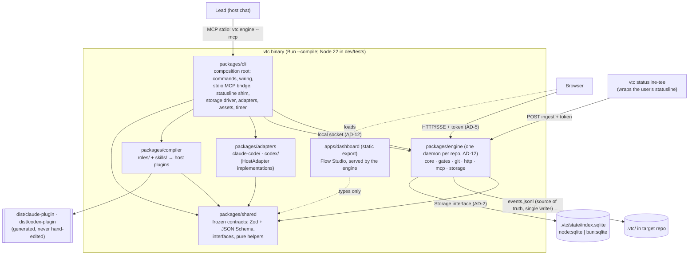

# VTC architecture spine (VTC's own code)

- **Status:** Phase 1 foundation, fix round 1. Frozen for the parallel build of sub-projects
  **1, 2, 3 and 6** (spec §19: 2 and 3 build on 1, 6 needs only 1's events; this spine freezes the
  contracts between them so all four can start together). Sub-projects 4, 5 and 7–9 follow §19's
  order and extend these contracts through the change process (§6 below).
- **Date:** 2026-10-13
- **Source of truth:** `docs/superpowers/specs/2026-10-12-vtc-system-design.md` (the spec). Section
  numbers (§n) below refer to it. Where this document and the spec disagree, the spec wins, and
  this document gets fixed. Where the spec is silent or ambiguous, §5 records the reading used.
- **Scope:** the architecture of **VTC's own code**. It does not describe the spine that VTC's
  Architect role writes for a _target_ project (spec §8), although it uses the same format.
- **Format:** C4 L1/L2, then decisions `AD-n`, each with **Binds / Prevents / Rule / Check**
  (spec §8.5). Every Check is automated: a dependency-cruiser rule, a lint rule, or a test.

Run every Check locally with:

```sh
pnpm install && pnpm verify   # typecheck, lint, deps:check, test, format:check, then build
```

---

## 1. C4 Level 1: system context


VTC never handles credentials (D2, §12.5). The model providers are reached only through the
user's own, unmodified host CLI.

## 2. C4 Level 2: containers



| Container                     | Responsibility (§4.1)                                                                                                                                                | May depend on                                   |
| ----------------------------- | -------------------------------------------------------------------------------------------------------------------------------------------------------------------- | ----------------------------------------------- |
| `packages/shared`             | Contracts (§16), interfaces, pure helpers. Runtime-agnostic, browser-safe.                                                                                           | Nothing internal; `zod`, `@noble/hashes`        |
| `packages/engine`             | Modules (AD-13): `core` (state, events, scheduler, loops, budgets, triage, escalation, merge queue, tracing), `gates` (Gate Runner), `git`, `http`, `mcp`, `storage` | `shared` only                                   |
| `packages/adapters`           | `claude-code/`, `codex/`: install, spawn, parse events, resume, sandbox, usage                                                                                       | `shared` only                                   |
| `packages/compiler`           | Neutral role/skill sources → Claude agent `.md`, Codex TOML + SKILL.md                                                                                               | `shared` only                                   |
| `packages/cli`                | `vtc` commands (§4.1, §4.4); wires everything (AD-1 rule 4)                                                                                                          | `shared`, `engine`, `adapters`, `compiler`      |
| `apps/dashboard`              | Read-only Flow Studio (§17) plus design-review pins                                                                                                                  | `shared` (contracts only); engine over HTTP/SSE |
| `tooling/arch-tests`          | Proves every architecture Check fires (planted violations)                                                                                                           | dev tooling only                                |
| `fixtures/golden-run`         | Recorded run + expected API responses (AD-5, AD-7)                                                                                                                   | data only                                       |
| `roles/`, `skills/`, `gates/` | Sources and pins, no code                                                                                                                                            | n/a                                             |

---

## 3. Decisions

### AD-1 Package boundaries and dependency direction

- **Binds:** every file under `packages/` and `apps/`.
- **Prevents:** the engine growing host-specific code; adapters reaching into engine state; the
  dashboard bypassing the localhost security checks by importing engine code; cycles between
  packages; deep imports that freeze another package's internals.
- **Rule:**
  1. `shared` imports no other VTC package or app.
  2. `adapters` and `compiler` import `shared` only. `adapters/claude-code` and `adapters/codex`
     never import each other.
  3. `engine` imports `shared` only. It sees hosts through the `HostAdapter` **interface** in
     `shared`; the cli injects the concrete adapters.
  4. `cli` is the composition root. Nothing imports `cli`.
  5. `apps/dashboard` may import `shared` contracts and nothing else from `packages/`. It talks to
     the engine only over HTTP/SSE (AD-5).
  6. Packages never import from `apps/`.
  7. Imports into another package, from `packages/` or `apps/`, go through its entry
     (`src/index.ts`), never deep paths.
  8. No dependency cycles. Every npm import is declared in the importing package's `package.json`.
  9. dependency-cruiser resolves `.ts`, `.tsx`, `.js`, `.jsx`, `.mjs`, `.cjs`, `.json` and the
     dashboard's `@/` alias (`apps/dashboard/src/*`), so the Next.js app is checked from its first
     commit without weakening any rule.
- **Check:** `pnpm deps:check` (`.dependency-cruiser.cjs`), rules
  `AD1-shared-has-no-internal-deps`, `AD1-adapters-depend-only-on-shared`,
  `AD1-adapter-families-are-isolated`, `AD1-engine-uses-adapter-interfaces-only`,
  `AD1-compiler-depends-only-on-shared`, `AD1-nothing-imports-the-cli`,
  `AD1-dashboard-talks-to-engine-over-http-only`, `AD1-no-package-imports-apps`,
  `AD1-no-deep-imports-across-packages`, `no-circular`, `no-undeclared-deps`,
  `not-to-unresolvable`. Blocking. `tooling/arch-tests` plants one violation per rule (including
  `.tsx` files and an `apps/` deep import) and fails if any rule stops firing or if a rule exists
  without a planted violation.

### AD-2 Runtime, storage and asset abstraction

- **Binds:** `packages/shared`, `packages/engine/src/storage/`, the cli's driver and asset wiring.
- **Prevents:** a dev/test dependency on Bun (not installed in phase 1); a native SQLite addon
  that breaks the single-file binary (§4.4); `shared` code that cannot run in the browser; code
  that runs on Node but not inside the Bun binary.
- **Rule:**
  1. Development and tests run on **Node ≥ 22.13** (`.nvmrc` = 22). The shipped binary runs on
     **Bun** (`bun build --compile`). Nothing in phase 1 requires Bun.
  2. The engine uses SQLite only through the `Storage` interface in `@vtc/shared`: synchronous,
     positional `?` parameters, rows as plain objects, non-re-entrant synchronous transactions,
     "no row" = `undefined` (the Bun driver maps Bun's `null`). It is the common subset of
     `node:sqlite` and `bun:sqlite`.
  3. `node:sqlite` is imported only by `engine/src/storage/node-sqlite.ts`; `bun:*` only by
     `engine/src/storage/bun-sqlite.ts`. The Bun driver typechecks under Node through a minimal
     ambient declaration (`bun-sqlite-module.d.ts`, referenced by path). Drivers are loaded
     **lazily** by the engine entry only (`loadNodeSqliteStorage()`, `loadBunSqliteStorage()`); the
     cli picks one with `loadStorage()` (`"Bun" in globalThis`). A runtime never evaluates the
     other runtime's driver.
  4. The SQLite index (`.vtc/state/index.sqlite`) is a **cache** rebuildable from the event log
     (AD-7). Losing it loses nothing.
  5. `packages/shared` uses no Node or Bun built-ins **or globals** (`Buffer`, `process`,
     `__dirname`, `setImmediate`…); hashing uses `@noble/hashes`.
  6. Engine, cli, adapters and compiler import only Node built-ins Bun also implements
     (`RUNTIME_SAFE_BUILTINS` in `.dependency-cruiser.cjs`: fs, path, os, child_process, http, net,
     crypto, url, events, stream, readline, timers, util, zlib, assert, buffer, process,
     string_decoder). Anything else goes behind an interface like `Storage`.
  7. Embedded files (the dashboard's static export, the compiled plugin templates) reach packages
     only through the `AssetBundle` interface (`@vtc/shared`), which the cli builds: from disk in
     development, from Bun-embedded files in the binary. Packages never import `apps/` or `dist/`.
- **Check:** dependency-cruiser `AD2-shared-is-runtime-agnostic`, `AD2-runtime-builtins-allowlist`,
  `AD2-node-sqlite-only-in-its-driver`, `AD2-bun-builtins-only-in-bun-driver`,
  `AD2-storage-drivers-loaded-by-the-entry-only`; ESLint `no-restricted-globals` /
  `no-restricted-properties` on `packages/shared/src` (proven by `tooling/arch-tests`); the
  storage contract suite `packages/engine/test/storage-contract.ts` (`runStorageContract`), which
  **every driver must pass unchanged** (node:sqlite now; bun:sqlite in the binary's own test job,
  sub-project 0); `cli.test.ts` asserts Node selects `node:sqlite`.

### AD-3 Frozen contracts live in `@vtc/shared`

- **Binds:** every data shape that crosses a package, process, file or host boundary. The full list
  is `CONTRACT_SCHEMAS` (`json-schema.ts`): Run, Task, TaskDraft, PlanFileFrontmatter, Feature,
  Finding, FindingDraft, Question, Escalation, Event, EventPayloads, RoleResult, RoleContract,
  AssertionProvenance, ProjectConfig, GatesConfig, ScannerPins, GateRunRequest, GateResult,
  GateReport, WriteScopeReport, UsageSnapshot, UsageReport, StatuslineIngest, WorkflowNode/Edge/
  Graph, HostOutcome, SubagentInstruction, EngineDiscovery, every MCP tool input and output
  (AD-4) and every HTTP request and response (AD-5). Interfaces: `HostAdapter`, `Storage`,
  `GateRunner`, `AssetBundle`, `AutoResumeScheduler`.
- **Prevents:** parallel teams drifting apart; hand-written JSON Schemas diverging from runtime
  validation; AI output accepted without validation (§3 principle 3).
- **Rule:**
  1. **Zod is the single source.** TypeScript types are `z.infer`; JSON Schemas (draft 2020-12)
     come from `jsonSchemas()` / `jsonSchemaFor(name)`. Never hand-write either.
  2. Contracts are **strict objects** (`additionalProperties: false`): unknown keys are errors.
     Persisted and wire data use **snake_case**; TypeScript APIs (interfaces, functions) use
     camelCase. Example: spec `spawn_role` = `HostAdapter.spawnRole`.
  3. Cross-field rules use `superRefine`. JSON Schema cannot express them, so after a host returns
     structured output the engine **always re-validates with Zod** (`fromStructuredOutput`).
  4. `CONTRACTS_VERSION` is semver. Adding an optional field or an enum value that consumers may
     ignore is MINOR. Anything else is MAJOR and needs an architecture review and every consumer
     updated in the same change. (2.0.0 = fix round 1; nothing consumed 1.x.)
  5. Open vocabularies stay open on purpose: event `type` (pattern `<entity>.<verb>`; the core
     set has typed payloads, AD-7), role ids, artifact types, stack packs. Consumers ignore unknown
     values.
  6. Pure helpers that define shared semantics live here too: `fingerprintFinding`,
     `normalizeSeverity`, `weightedSeverity`, `estimateTokens` (summary cap 1,500 tokens =
     6,000 chars), `findUnguardedCycle`, `remainingPct`, `windowKindFromMinutes`,
     `usageFromStatuslineIngest`, `gateReportVerdict`, `escalationFromQuestion`,
     `resolveRoleMode`, `agentNameFor`, `splitRolePrompt`, `formatReqTag` / `parseReqTags`,
     `formatProvenance` / `parseProvenance`, `sseEventId` / `parseSseEventId`, `engineRepoKey`,
     `findForbiddenHostArgs`.
  7. Spine extensions to §16 are named here: the finding route `out_of_scope` (an Engineer
     `out_of_scope_fault` whose guards passed, §6.3 step 3); `RequirementRef` (`REQ-3.AC-2`)
     in `Finding.req_ids`; the Visual QA verdict `unchecked` (§7.5).
  8. Hosts receive the **structured-output** form, `jsonSchemaFor(name, { target:
"structured-output" })`: object root (a root union is merged into one object with a
     discriminator enum), every property required with optional ones nullable, no `default`.
     Sub-project 0 verifies it against `claude -p --json-schema` and `codex exec --output-schema`.
- **Check:** `packages/shared/test/*.test.ts` (valid and invalid examples for every schema and
  helper); the JSON Schema **file snapshot** `packages/shared/schemas/contracts.json`
  (`json-schema.test.ts`): any contract change fails the test until the snapshot is deliberately
  updated together with `CONTRACTS_VERSION`; `json-schema.test.ts` also asserts the
  structured-output shape and that structured-output contracts have no nullable field (so `null`
  always means "absent").

### AD-4 Engine MCP tool surface

- **Binds:** `packages/engine/src/mcp`, the stdio bridge, host plugins (`/vtc …` commands), the
  Lead prompt.
- **Prevents:** the flow drifting because the Lead improvises (§4.2); agents setting state the
  engine owns (`done`, caps, budgets); teams negotiating tool output shapes.
- **Rule:** the Lead reaches the engine through `vtc engine --mcp`, a **stdio** MCP server
  registered by each host plugin that bridges to the repo's engine daemon (AD-12). The official
  MCP TypeScript SDK, pinned. Lead-facing tools (frozen in `ENGINE_MCP_TOOLS`, each with an
  `input` and `output` contract):

  | Tool             | Purpose                                                                         | Input → output                               |
  | ---------------- | ------------------------------------------------------------------------------- | -------------------------------------------- |
  | `start`          | Start a run with the Lead's INTAKE classification (track, repo, UI, risk hints) | `StartInput` → `StartResult`                 |
  | `next`           | Next actions: `spawn_role`, `ask_human`, `approve_gate`, `wait`, `done`         | `RunScopedInput` → `NextResult`              |
  | `submit`         | A role result, or why the run did not finish (`limit`/`auth`/`error`)           | `SubmitInput` → `SubmitResult`               |
  | `status`         | Run summary: phase, tasks by state, parked items, budget, usage                 | `RunScopedInput` → `StatusResult`            |
  | `escalations`    | Open escalations (batched) with evidence and options                            | `RunScopedInput` → `EscalationList`          |
  | `answer`         | Record the human's answer (incl. `who_should_have_caught`) and resume           | `AnswerInput` → `NextResult`                 |
  | `approve`        | G1 / G2 decision; freezes each shown artifact at its own hash                   | `ApproveInput` → `NextResult`                |
  | `change_request` | Open a CR against a frozen spec, architecture or design (becomes an escalation) | `ChangeRequestInput` → `ChangeRequestResult` |
  | `pause`          | Kill switch: stop dispatching and merging                                       | `RunScopedInput` → `RunControlResult`        |
  | `resume`         | Resume a paused/interrupted run, rebuilding state from the event log            | `RunScopedInput` → `RunControlResult`        |
  1. The Lead dispatches **only** actions returned by `next`. `submit` must echo the `action_id`;
     unknown, stale, duplicate or out-of-order results are rejected with a `RejectReason`
     (§4.2 step 4).
  2. Tool results are compact (§11: coarse tools, ≤ 1.5k-token returns).
  3. Role-facing tools (repo map, research fetchers, fact lookups) are added by the sub-projects
     that own them (3, 4) as a MINOR contract change.
  4. **Dispatch:** `spawn_role` is always a subagent spawn the Lead performs with the action's
     `agent`, `prompt`, `background` and optional `resume` session. Headless runs (no subagent
     support, auto-resume after a limit, cross-family review) are **launched by the engine**
     through `HostAdapter.spawnRole`, are never Lead actions, and show as `wait` to the Lead.
  5. A subagent that hit a limit, lost auth or crashed is reported with `submit` `kind: failure`
     and the normalised outcome, so limit parking (§6.9) and spend capture (§11) cover subagent
     runs too. Successful runs report `usage` (model, tokens, cost) alongside the result.

- **Check:** `engine-api.test.ts` in shared: tool names unique and include the §4.2 loop; every
  tool names existing input and output contracts; valid and invalid cases for every input and
  output. Sub-project 1 adds a tool-level contract test per tool (valid input accepted, invalid
  input rejected with a schema error, out-of-order `submit` rejected).

### AD-5 Engine HTTP/SSE API (localhost hardening)

- **Binds:** `packages/engine/src/http`, `apps/dashboard`, `vtc statusline-tee`.
- **Prevents:** other websites or DNS-rebinding pages reading run data or injecting data (§15);
  the dashboard becoming a control surface (it is read-only, D7); the dashboard team inventing
  response shapes.
- **Rule:**
  1. Bind **127.0.0.1 only**. Built on `node:http` (implemented by both Node and Bun); no web
     framework.
  2. A **per-install token**: 256 random bits, stored in `~/.vtc/token` with mode 0600, never in a
     repo or a discovery file. Every route requires `Authorization: Bearer <token>` or the
     `vtc_session` cookie (`HttpOnly; SameSite=Strict; Path=/`), which `vtc dashboard` obtains
     through a one-time `?token=` exchange followed by a redirect that strips it from the URL.
  3. **Host** must be `127.0.0.1:<port>` or `localhost:<port>`; **Origin**, when present, must equal
     the server's own origin. Otherwise `403`. No CORS headers are ever sent.
  4. Routes are frozen in `ENGINE_HTTP`, each with its response contract (errors use `HttpError`):

     | Route                                   | Response             |
     | --------------------------------------- | -------------------- |
     | `GET /api/health`                       | `HealthResult`       |
     | `GET /api/status`                       | `StatusResult`       |
     | `GET /api/runs`                         | `RunList`            |
     | `GET /api/runs/:run/events?after&limit` | `EventPage`          |
     | `GET /api/runs/:run/tasks`              | `TaskList`           |
     | `GET /api/runs/:run/tasks/:task`        | `TaskDetail`         |
     | `GET /api/runs/:run/graph?scope&task`   | `WorkflowGraph`      |
     | `GET /api/runs/:run/escalations`        | `EscalationList`     |
     | `GET /api/usage`                        | `UsageReport`        |
     | `GET /api/stream` (SSE)                 | `Event` messages     |
     | `POST /api/ingest/claude-statusline`    | `IngestResult`       |
     | `POST /api/design/reviews`              | `DesignReviewResult` |

     plus the static dashboard at `/`, served from the injected `AssetBundle` (AD-2 rule 7).

  5. Exactly **two writes**, both size-limited (`maxBodyBytes`) and validated (`request`
     contract), and neither can execute anything: the statusline ingest (`StatuslineIngest`,
     usage data only) and design-review pins (`DesignReviewCommentInput`, spec §17), which the
     engine appends to `.vtc/design/reviews/<screen>.jsonl` and nowhere else. Approval still
     happens in the Lead chat.
  6. SSE: each message is one `Event` (AD-7) as JSON; `id: <run>:<seq>` (`sseEventId`);
     reconnects resume from `Last-Event-ID` (`parseSseEventId`).
  7. **Snapshot mode.** When no engine runs for the repo, `vtc dashboard` serves the **same
     routes** read-only from the committed `.vtc/` snapshot, built by the engine's own replay code
     (`HealthResult.mode = "snapshot"`). It takes no lock, writes no event, publishes no discovery
     file, and answers the statusline ingest with `snapshot_mode` (design pins still append).
  8. **Dashboard development.** The dashboard team builds against `fixtures/golden-run/` (recorded
     `events.jsonl` + the expected response of every read route). Against a live engine,
     `next dev` uses a dev-only proxy for `/api/*` that injects the token, sets `Host` and drops
     `Origin`, so the browser sees one origin and the engine's checks stay unchanged.
- **Check:** `engine-api.test.ts` (loopback bind host; every route under `/api/`; exactly two
  writes, both with a request contract and a body limit; every route names an existing response
  contract; design-review results confined to `.vtc/design/reviews/`); `golden-run.test.ts`
  (every snapshot validates as its route's response and agrees with the log). Sub-project 1 adds
  HTTP tests that must pass before the server ships: the listening address is `127.0.0.1`;
  requests with a missing/wrong token, a foreign `Host`, or a foreign `Origin` get `403`;
  responses carry no `Access-Control-Allow-*` headers; oversized bodies get `413`; a design-review
  write with a path-escaping screen id is rejected; snapshot mode refuses the ingest.

### AD-6 Host adapter interface

- **Binds:** `packages/adapters/*`, the engine's dispatcher, the cli's adapter wiring.
- **Prevents:** host differences leaking into engine logic; enforcement that only works on one
  host (§3 principle 8, §12.2); orphaned host processes (§15).
- **Rule:** both adapters implement `HostAdapter` (`@vtc/shared`), mapping spec §4.1 names:

  | Spec              | TypeScript                              | Notes                                                                                                         |
  | ----------------- | --------------------------------------- | ------------------------------------------------------------------------------------------------------------- |
  | `install`         | `install(InstallRequest)`               | Plugin/agents/MCP registration; Codex also writes `.codex/agents/*.toml`; Claude wires `vtc statusline-tee`   |
  | `spawn_role`      | `spawnRole(SpawnRoleRequest)`           | `SubagentInstruction` for the Lead, or an engine-launched `HeadlessRun` with a hard timeout and kill (§15)    |
  | `parse_events`    | `parseEvents(lines)`                    | **Pure.** Normalises any stream to `HostOutcome`: `done \| limit \| auth \| error` (with partial spend)       |
  | `resume`          | `resume(SessionRef, SpawnRoleRequest)`  | Same session + worktree, new input (§6.5, §6.9)                                                               |
  | `sandbox_profile` | `sandboxProfile(SandboxProfileRequest)` | **Pure.** Host settings + what the host itself enforces                                                       |
  | `read_usage`      | `readUsage?()`, `watchUsage?(cb)`       | Optional: hosts with an adapter-owned source (Codex `codex app-server`). Unknown stays `null`, never 0 (§6.9) |
  | (lifecycle)       | `dispose()`                             | Stops every child process and subscription the adapter owns. The cli calls it on shutdown.                    |
  1. `capabilities` declares what the host enforces (§12.1). Write scope, caps, budgets, gate
     order, schema validation and limit parking are **always** enforced by the engine, whatever
     the host claims (§12.2).
  2. Model ids come from the engine (role tier/effort + project overrides): `SpawnRoleRequest.model`
     is a `ResolvedModel` with a concrete `model` id. Adapters do not pick models.
  3. Adapters never read credentials and never pass permission-bypass flags (AD-9).
  4. **Usage ownership.** The engine owns the usage store (`UsageReport`). Claude usage arrives
     as a push: `vtc statusline-tee` turns the statusline JSON into a `StatuslineIngest` body with
     the adapter's pure `statuslineIngestFromClaude` and POSTs it; the engine stores
     `usageFromStatuslineIngest(body)` and merges SDK events from runs it launched. Codex usage
     comes from the adapter's managed `codex app-server` child (`watchUsage`, stopped by
     `dispose`). The auto-resume timer is the `AutoResumeScheduler` interface: the engine decides
     when; the cli implements it (launchd on macOS, installed by `vtc install`).

- **Check:** dependency-cruiser AD-1 rules (engine cannot import adapters);
  `packages/adapters/test/adapters.test.ts` (capabilities for every host, Codex gaps recorded,
  the recorded Claude statusline payload in `test/fixtures/claude-code/statusline.json`, the
  bypass detector). The reusable safety contract `test/host-adapter-contract.ts`
  (`runHostAdapterSafetyContract`: `sandboxProfile().cliArgs` and settings never contain an AD-9
  marker, for every tool profile) is a per-host todo until sub-project 3 implements
  `sandboxProfile`, then it must run for both hosts. Sub-project 3 also adds **contract tests
  against recorded host streams** in `packages/adapters/test/fixtures/<host>/*.jsonl`, including
  limit hits and auth errors (§18), validated with `HostOutcomeSchema`.

### AD-7 Event log and file layout

- **Binds:** everything that reads or writes `.vtc/`; replay; the dashboard's snapshot mode.
- **Prevents:** state that only lives in memory or SQLite; teammates unable to see a run from
  their clone (D8); silent corruption after a crash; a second source of truth.
- **Rule:**
  1. Every state change is an `Event` appended to `.vtc/runs/<run>/events.jsonl`: one JSON object
     per line, `v` (schema version, now 1), per-run `seq` starting at 1 and strictly increasing,
     `ts`, `run`, `type`, `actor`, `data`, plus optional `task`, `feature`, `role`, `prompt_sha`,
     `host`, `model`, `tokens`, `cost_usd` (`null` = unpriced model, an error, never $0).
  2. Only the engine writes the log, through one append path (`openEventLog(...).append`, which
     requires the engine lock, AD-12). The log is append-only and is committed at milestones (§6.8).
  3. Every core event type has a **typed payload** (`EVENT_PAYLOAD_SCHEMAS`, exported as
     `EventPayloads`): `EventSchema` rejects a core event whose `data` or required envelope field
     (`task`, `feature`, `role`) is wrong. Unknown types stay free-form. Read payloads with
     `isEventOfType` + `readEventData`.
  4. Replay uses `parseEventLog`: invalid lines and a torn final line are **reported**, never
     thrown, and become an incident report (§15). The writer fences off a torn tail with a newline
     and continues the `seq`.
  5. On start the engine rebuilds state from the log; SQLite is only an index (AD-2).
  6. File layout is §4.3: `.vtc/project.yaml`, `gates.yml`, `defaults.toml`, `research/`, `spec/`,
     `architecture/`, `design/` (incl. `reviews/`), `tasks/T-n.md`, `evidence/T-n/` and
     `evidence/<feature>/`, `runs/<run>/events.jsonl`, `lookback/` are git-tracked. `.vtc/state/`
     (SQLite index, engine lock, worktrees, packs, transcripts, blobs, raw unredacted output) is
     gitignored. `~/.vtc/` holds hidden tests, the research cache (per client), the token, pinned
     scanners and engine discovery files.
  7. Roles write only inside their declared scope (`RoleContract.tools.write_paths`, per mode, or
     the task's `files_scope`); the engine verifies every write (§6.3 step 4, AD-13).
  8. **Plan-file frontmatter is a projection.** `.vtc/tasks/T-n.md` frontmatter
     (`PlanFileFrontmatter`) is written by the engine from the event log and **never read back as
     input**; an edit to it changes nothing and is overwritten. The `<intent-contract>` block is
     written once at PLAN from the Planner's `TaskDraft.intent` and is immutable.
  9. Run ids are path-safe (`RunIdSchema`); every path in a contract is repo-relative with no
     `..` (`RelPathSchema`), including `Task.worktree`; git ids are full SHAs.
- **Check:** `event.test.ts` and `event-payloads.test.ts` (schema, a valid example of every core
  type, invalid payloads, envelope rules, line round-trip, invalid and torn lines, unsafe run ids);
  `engine/test/instance.test.ts` (single writer, `seq` continuity across restarts, torn tail);
  `golden-run.test.ts`; `.gitignore` contains `.vtc/state/`. Sub-project 1 adds **golden replay
  tests** (§18): `fixtures/golden-run/events.jsonl` replays to exactly the `api/*.json` snapshots,
  and a replay with tampered plan-file frontmatter produces the same state.

### AD-8 The engine decides; agents act

- **Binds:** `packages/engine`, role prompts, host plugins and hooks.
- **Prevents:** flow, caps, counters, budgets or state transitions living in prompts (§3
  principle 1); a worker setting `done` (§6.4); an agent merging its own work (§15).
- **Rule:**
  1. Every state transition (§6.4, §6.7a), cap (§6.3 step 9), budget rule (§11), router rule
     (§5.3, §7.6) and triage route (§6.3 step 8) is engine code with a unit test.
  2. Deterministic first (D11): if code can decide it, code decides it. AI verdicts must cite
     evidence the engine resolves; unresolved evidence → finding `discarded`.
  3. Host hooks are an extra layer of defence only, never the enforcement point.
  4. Merges happen only through the engine's merge queue.
  5. Planners submit `TaskDraft`s: engine-owned task fields (status, cap, budget, round, spend,
     worktree, branch, session) are rejected at the schema; the engine derives them.
- **Check:** engine unit tests per transition/cap/budget/route (sub-project 1); property tests
  for scheduler and DAG invariants; `WorkflowGraphSchema` rejects any back-edge without a
  `loop_guard` (`usage-workflow.test.ts`); `RoleContractSchema` rejects a role reviewing itself
  and `code_sandboxed` outside the Engineer family, also inside modes (`role.test.ts`);
  `TaskDraftSchema` rejects every engine-owned field (`task.test.ts`).

### AD-9 No credentials, no permission bypass

- **Binds:** all source under `packages/` and `apps/`.
- **Prevents:** violating vendor terms or user trust (§12.5, §15).
- **Rule:** never read, copy or store host credentials (`~/.claude/.credentials.json`, the
  `Claude Code-credentials` keychain item, `~/.codex/auth.json`); never use
  `--dangerously-skip-permissions`, `bypassPermissions`,
  `--dangerously-bypass-approvals-and-sandbox`, `--yolo` or `danger-full-access`. Use explicit
  allow rules plus the sandbox. Git and `gh` use the user's existing auth. The markers live in one
  list, `AD9_FORBIDDEN_MARKERS` (`@vtc/shared`), mirrored by `AD9_MARKERS` in `eslint.config.js`.
- **Check:** ESLint `no-restricted-syntax` fails on any string or template literal containing a
  marker (case-insensitive) in non-test source; only `shared/src/helpers/compliance.ts`, which
  defines the list, is exempt. `tooling/arch-tests` plants each form (incl. path-joined credential
  files and the keychain call) and asserts the two lists are equal. A literal split across a
  concatenation is out of a lint rule's reach; review and the runtime check cover it:
  `findForbiddenHostArgs` runs on every argv in the adapter safety contract (AD-6).

### AD-10 Toolchain, build and merge gate

- **Binds:** repo root config and every package.
- **Prevents:** tests or typecheck depending on a prior build; unpinned dependencies; config drift
  between packages; a red branch merged because nobody ran the Checks.
- **Rule:**
  1. pnpm workspaces (`packages/*`, `apps/*`, `tooling/*`) + turbo (`build`, `typecheck`, `lint`,
     `test`). Dependencies are pinned to exact versions. TypeScript 6.0 (the newest line
     typescript-eslint supports), strict, ESM, `NodeNext`, `exactOptionalPropertyTypes`,
     `noUncheckedIndexedAccess`.
  2. Each package exports `{"@vtc/source": src/index.ts, types: dist/index.d.ts, default:
dist/index.js}`. Typecheck (`customConditions`), tests (Vitest aliases) and
     dependency-cruiser resolve workspace packages **to source**; `tsc -p tsconfig.build.json`
     emits `dist/` in dependency order (`^build`).
  3. ESLint flat config with `typescript-eslint` `strictTypeChecked`; Prettier for formatting.
  4. The single-file binary is built later with `bun build --compile` (sub-project 0 spike, then
     1); the engine serves the dashboard's static export from the cli-provided `AssetBundle`.
  5. `turbo.json` sets `agentGuidance: false`, so turbo does not write an `AGENTS.md` into the
     repo.
  6. **Merge gate.** `pnpm verify` (= `pnpm check && pnpm build`) must be green before any branch
     merges into an integration branch or `main`. The orchestrator runs it as a required merge
     step for every team branch; locally, `pnpm hooks:install` enables `.githooks/pre-push`,
     which runs it on every push. A CI workflow runs it once the repo has a remote.
- **Check:** `pnpm check` = `typecheck` + `lint` + `deps:check` + `test` + `format:check`, all
  blocking; `pnpm build` must succeed; `pnpm verify` runs both.

### AD-11 Testing strategy (§18)

- **Binds:** all packages.
- **Prevents:** untested state logic; tests coupled to build output; test code shipped in the
  binary.
- **Rule:**
  1. Vitest everywhere; tests live in `<pkg>/test/**/*.test.ts` and resolve workspace packages to
     source (`vitest.shared.ts`). Unit tests have no network.
  2. **Engine:** a unit test for every state transition, cap, budget rule, router rule, triage
     route and parser (JUnit, SARIF, stream events for both hosts); property tests for the
     scheduler and DAG invariants; golden tests for event replay (`fixtures/golden-run`).
  3. **Adapters:** contract tests against recorded host event streams, including limit hits and
     auth errors; the safety contract (AD-6).
  4. **Storage drivers:** the shared storage contract suite (AD-2).
  5. **Contracts:** valid and invalid examples for every schema; the JSON Schema snapshot (AD-3).
  6. **Architecture Checks:** `tooling/arch-tests` proves each dependency rule and lint rule fires.
  7. **Roles:** eval suites per role and per host on a fixed reference-task set, pass^k reporting
     (sub-project 7).
  8. **End-to-end:** 5 reference projects (two greenfield; three brownfield in TS, Python, Go) on
     both hosts.
  9. Production code (packages and apps) never imports test code or devDependencies.
- **Check:** `pnpm test`; dependency-cruiser `AD11-no-test-code-in-production`,
  `AD11-no-dev-deps-in-production`.

### AD-12 Engine instance model and discovery

- **Binds:** `packages/engine/src/core` (lock, log writer, discovery), `packages/cli` (`vtc engine`,
  `vtc dashboard`, `vtc statusline-tee`, the timer), host plugins' MCP registration.
- **Prevents:** two engines appending to one `events.jsonl` (breaking AD-7's single writer and
  strictly increasing `seq`); clients unable to find the engine's port; auto-resume dying with the
  Lead session (§6.9: "only the engine" must be alive).
- **Rule:**
  1. **One engine daemon per repo.** It holds the exclusive lock `.vtc/state/engine.lock`
     (`acquireEngineLock`; exclusive create; a lock whose holder pid is dead is taken over once and
     recorded as an `incident.recorded` `stale_lock`). Only the lock holder can open or append to a
     run's log.
  2. **Discovery:** the daemon writes `~/.vtc/engines/<repo-key>.json` (`EngineDiscovery`: pid,
     HTTP port, local MCP socket, repo root, versions; mode 0600, atomic write; no token) and
     removes it on a clean exit. `repo-key` = `engineRepoKey(absolute repo root)`.
  3. **`vtc engine --mcp`** (what host plugins run) is a stdio MCP bridge. It reads the discovery
     file; if no live daemon answers, it starts `vtc engine --daemon` detached and waits for the
     file; then it relays MCP to the daemon's local socket (a Unix socket in `.vtc/state/`, mode
     0600, or a per-user named pipe on Windows). Any number of host sessions share one daemon. A
     second `vtc engine --daemon` for the same repo fails on the lock and exits.
  4. **Lifetime:** the daemon is not a child of any host session. It stays up while a run has
     work, a bridge is connected or an auto-resume is scheduled, and exits after
     `ENGINE_INSTANCE.idleExitMs` (30 min) otherwise. The auto-resume timer starts
     `vtc engine --daemon --wake` at the reset time (§6.9 step 4).
  5. The HTTP API (AD-5) is served by the daemon on `127.0.0.1:<port>`; the MCP socket is never
     exposed over HTTP, so a browser cannot reach a mutating tool.
- **Check:** `engine/test/instance.test.ts` (a second instance cannot take the lock or append; a
  writer that lost its lock stops appending; stale-lock takeover is reported; `seq` continues
  after a restart; the discovery file's path, contents and mode); `engine-instance.test.ts` in
  shared (repo key, discovery schema has no token). Sub-project 1 adds a two-process test of the
  bridge sharing one daemon.

### AD-13 Engine modules and the Gate Runner seam

- **Binds:** `packages/engine/src/{core,gates,git,http,mcp,storage}`, `GateRunner` in `@vtc/shared`.
- **Prevents:** the engine-core and gate-runner teams editing the same files and state; untyped
  gate output; split ownership of the write-scope check and of git code.
- **Rule:**
  1. `core/` (engine-core team, sub-project 1) owns state, events, scheduling, loops, budgets,
     triage, escalation, merge queue and tracing. It calls the Gate Runner only through the
     `GateRunner` interface (`run`, `checkWriteScope`), injected at wiring time, and never imports
     `gates/`.
  2. `gates/` (gate-runner team, sub-project 2) implements `GateRunner`: calibration, baseline,
     layers L0–L5, hidden tests, the pinned scanner store, and the **L5 write-scope and
     test-integrity check**. It returns `GateReport` / `WriteScopeReport`, classifies every
     failure (`FailureClass`), and never imports `core/`, `http/` or `mcp/`.
  3. Write-scope ownership: the gate-runner team **implements** the check; engine core
     **invokes** it on every `submit` (§4.2 step 3, §6.3 step 4) and the Gate Runner runs it again
     as layer L5 (§19 sub-project 2). One implementation, two call sites.
  4. `git/` (engine-core team) owns worktrees, branches, clean verification checkouts, diffs and
     merges. It is a leaf: it imports no other engine module. `gates/` uses it through its index.
  5. `http/` and `mcp/` are transports: they call `core/` through its index; `core/`, `gates/` and
     `git/` never import them.
  6. Engine modules import each other only through the other module's `index.ts`; only the engine
     entry loads storage drivers (AD-2). The `gate.result` event carries one `GateReport`.
- **Check:** dependency-cruiser `AD13-engine-modules-use-each-others-entry`,
  `AD13-core-uses-the-gate-runner-interface`, `AD13-gates-never-import-engine-core`,
  `AD13-git-imports-no-engine-module`, `AD13-core-does-not-import-transports`,
  `AD2-storage-drivers-loaded-by-the-entry-only` (each proven by `tooling/arch-tests`);
  `gate-result.test.ts` (results, the deterministic `gateReportVerdict`, requests, write-scope
  reports).

### AD-14 Role sources, compiled agents and prompts

- **Binds:** `roles/`, `packages/compiler`, the engine's dispatcher, Lookback.
- **Prevents:** the compiler and the engine naming agents differently; Lookback and the compiler
  disagreeing on what is editable; mode-specific tools that cannot be compiled or enforced.
- **Rule:**
  1. One agent per role, or per **mode** when the role declares `modes` (QA `author`/`judge`,
     Security `design`/`verify`). Name: `agentNameFor(role, mode?)` = `vtc-<role>[-<mode>]`
     (hyphens only), the same base name on both hosts. A host that namespaces plugin agents adds
     its namespace inside its adapter.
  2. A mode overrides the base contract field by field (`inputs`, `output`, `exits`, `tools`,
     `models`); `resolveRoleMode` gives the effective contract. A role with modes must be
     dispatched, and must submit results, with a declared mode (`RejectReason`
     `undeclared_mode`).
  3. `roles/<role>/prompt.md` starts with `<!-- vtc:locked -->` (the locked core, human-only,
     MAJOR) and has exactly one `<!-- vtc:editable -->` line, after which the editable section
     runs to the end of the file (MINOR). `splitRolePrompt` enforces it; the compiler rejects
     anything else.
  4. Lookback never writes `roles/`. Its proposals go to
     `.vtc/lookback/proposals/<role>/editable.md` (spec §5.2's `prompts/*/editable.md`, read
     relative to `.vtc/lookback/`); a human-approved proposal replaces the editable section of
     `roles/<role>/prompt.md`.
- **Check:** `traceability.test.ts` in shared (`agentNameFor`, `splitRolePrompt` incl. malformed
  prompts); `role.test.ts` (modes, `resolveRoleMode`); `compiler.test.ts` (`checkRolePrompt`
  rejects a prompt without markers, `compiledAgentNames` per mode).

### AD-15 Teams, ownership and integration

- **Binds:** every path in the repo; the six build teams; the orchestrator.
- **Prevents:** guaranteed merge conflicts on shared files; two teams changing one contract in
  different ways; an unowned path.
- **Rule:** each team owns the globs below and changes nothing else without the owner's review.

  | Team (sub-project)               | Scope (spec §19)                                                                                                      | Owns                                                                                                                                                         |
  | -------------------------------- | --------------------------------------------------------------------------------------------------------------------- | ------------------------------------------------------------------------------------------------------------------------------------------------------------ |
  | Engine core (1)                  | State/events, scheduler, pipeline, loops, triage, escalation, budgets, merge queue L1–2, MCP + HTTP                   | `packages/engine/src/{core,git,http,mcp,storage}/**`, `packages/engine/test/**` (except `test/gates/**`), `fixtures/golden-run/**` (with the dashboard team) |
  | Gate runner (2)                  | Calibration, baseline, L0–L5, write-scope check, hidden tests, scanner store                                          | `packages/engine/src/gates/**`, `packages/engine/test/gates/**`, `gates/**`, `packages/cli/src/commands/calibrate.ts`                                        |
  | Roles + compiler (3)             | Neutral role sources, compiler, Claude/Codex plugin output                                                            | `roles/**`, `skills/**`, `packages/compiler/**`                                                                                                              |
  | Adapters + usage (3)             | `HostAdapter` for both hosts, stream parsers, sandbox profiles, usage sources (statusline parser, `codex app-server`) | `packages/adapters/**`                                                                                                                                       |
  | Dashboard (6)                    | Flow Studio                                                                                                           | `apps/dashboard/**`                                                                                                                                          |
  | Cli + binary (0 binary parts, 1) | `vtc` commands and wiring, stdio bridge, statusline shim, timer, assets, Bun build and storage wiring                 | `packages/cli/**` (each other command file belongs to the team named in its header), the Bun build config (sub-project 0/1)                                  |
  1. **Integrator.** One integrator (the architect role of the orchestration) owns
     `packages/shared/**` (incl. `CONTRACTS_VERSION` and `schemas/contracts.json`),
     `docs/architecture/**`, `.dependency-cruiser.cjs`, `eslint.config.js`, `tsconfig*.json`,
     `turbo.json`, `vitest*.ts`, root `package.json`, `pnpm-workspace.yaml`, `pnpm-lock.yaml` and
     `tooling/**`. Teams send contract changes as a proposal (the diff plus the reason); the
     integrator merges them through the change process (§6), one contract change at a time.
  2. **Lockfile.** Teams add dependencies only in their own `package.json`; the integrator
     regenerates `pnpm-lock.yaml` on the integration branch. A team branch never resolves a
     lockfile conflict by hand.
  3. **Shared entry files are pre-split.** `packages/engine/src/index.ts` re-exports every module
     index, and `packages/cli/src/commands/index.ts` has one import line per command file, so
     teams add code in their own files. Adding a new command file adds one line, owned by the
     cli+binary team.
  4. Ordering follows §19: engine core lands first on the integration branch; gate-runner,
     roles/compiler and adapters rebase on it; the dashboard builds against `fixtures/golden-run`
     and the frozen contracts from day one.

- **Check:** the AD-1/AD-13 dependency rules keep each team's code behind its entry; the merge
  gate (AD-10 rule 6) runs `pnpm verify` on every team branch; the integrator's review is
  required for any change under the integrator-owned paths.

---

## 4. Explicitly out of scope for v1

From the spec (§1.2, §20) and applied to VTC's own code. Any of these needs a change request.

- A hosted or cloud service, multi-tenant SaaS, a VTC-run server, a LAN view of the dashboard.
- Our own AI chat UI; a visual flow **editor** (the dashboard is read-only apart from
  design-review pins, AD-5 rule 5).
- Running in Claude Code web/cloud sessions, or under WSL.
- Native mobile and canvas/WebGL visual QA.
- Figma or Penpot as the source of truth (optional mirror only).
- Model providers other than Anthropic via Claude Code and OpenAI via Codex; VTC calling model
  APIs directly or handling API keys.
- Laya / Jev typed-decision models (Laya is a v2 option, §20.1).
- GEPA-style prompt optimisation (v2); mutation testing (v1.1).
- A shared theme/UI package between Flow Studio and `bs-job-agents` (copy in v1); a desktop
  wrapper for the dashboard.
- A web framework or ORM in the engine (`node:http` and the `Storage` interface are enough);
  any database other than embedded SQLite.
- Auto-updating scanners or dependencies.
- Bundling CodeQL, Semgrep-maintained rules, or GPL/AGPL tools.

## 5. Spec readings recorded here

Points where the spec is silent or ambiguous, and the reading this spine uses. Each needs human
confirmation before it is written back into the spec.

1. **Write-scope check ownership** (§4.2 step 3 vs §19 sub-project 2): one implementation in
   the Gate Runner, invoked by engine core on submit and by the Gate Runner as L5 (AD-13 rule 3).
2. **Lookback's editable-section proposals** (§5.2 `prompts/*/editable.md` vs §5.1/§4.4
   `roles/<role>/prompt.md`): proposals in `.vtc/lookback/proposals/<role>/editable.md`, applied
   to the editable section of `roles/<role>/prompt.md` after approval (AD-14 rule 4).
3. **Engine lifetime** (§4.4 "the plugin's MCP entry runs `vtc engine --mcp`" and §6.9 "only the
   engine" must be alive): a per-repo daemon plus a stdio bridge (AD-12).
4. **Headless dispatch** (§4.2 step 2 "otherwise they run headless"): headless runs are always
   engine-launched; the Lead sees `wait` (AD-4 rule 4), consistent with §6.9 and §12.4.
5. **Scanner pins** (§4.3 `gates.yml` vs §4.4 `gates/` + pinned store): product data in
   `gates/scanners.json` with per-platform checksums; `.vtc/gates.yml` holds only the project's
   calibrated gates and baseline.
6. **The statusline shim** (§6.9 "the plugin installs a statusline tee shim"): the shim is
   `vtc statusline-tee`; the Claude adapter's `install` wires it into the user's statusline.
7. **The `out_of_scope` finding route** (§16 lists six routes): a seventh route for guarded
   `out_of_scope_fault` exits (AD-3 rule 7).

## 6. Change process for this spine

- Changing an AD, adding one, or changing a frozen contract (AD-3) needs an architecture review
  before merge, by the integrator (AD-15). The Check of each AD must stay automated and blocking.
- Boundary changes update `.dependency-cruiser.cjs` in the same change, with the rule name
  prefixed by the AD it enforces, and add a planted violation to `tooling/arch-tests`.
