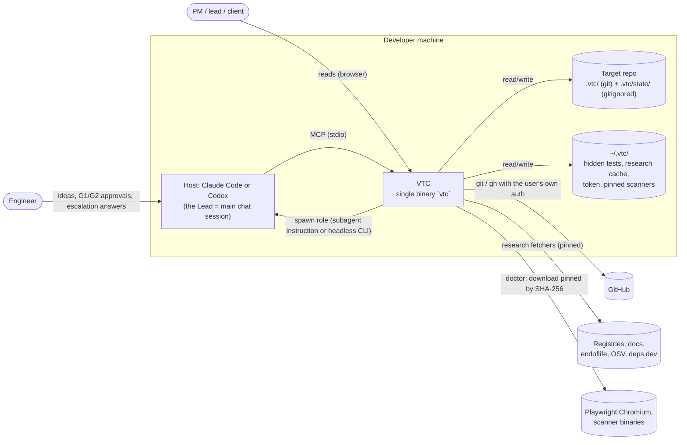
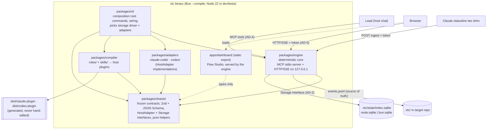

# VTC architecture spine (VTC's own code)

- **Status:** Phase 1 foundation. Frozen for parallel build of sub-projects 1–6.
- **Date:** 2026-10-13
- **Source of truth:** `docs/superpowers/specs/2026-10-12-vtc-system-design.md` (the spec). Section
  numbers (§n) below refer to it. Where this document and the spec disagree, the spec wins, and
  this document gets fixed.
- **Scope:** the architecture of **VTC's own code**. It does not describe the spine that VTC's
  Architect role writes for a _target_ project (spec §8), although it uses the same format.
- **Format:** C4 L1/L2, then decisions `AD-n`, each with **Binds / Prevents / Rule / Check**
  (spec §8.5). Every Check is automated: a dependency-cruiser rule, a lint rule, or a test.

Run every Check locally with:

```sh
pnpm install && pnpm check   # typecheck, lint, deps:check, test, format:check
```

---

## 1. C4 Level 1: system context



VTC never handles credentials (D2, §12.5). The model providers are reached only through the
user's own, unmodified host CLI.

## 2. C4 Level 2: containers



| Container                     | Responsibility (§4.1)                                                                                     | May depend on                                   |
| ----------------------------- | --------------------------------------------------------------------------------------------------------- | ----------------------------------------------- |
| `packages/shared`             | Contracts (§16), interfaces, pure helpers. Runtime-agnostic.                                              | Nothing internal; `zod`, `@noble/hashes`        |
| `packages/engine`             | State, events, scheduler, loops, budgets, gates, triage, escalation, merge queue, tracing; MCP + HTTP/SSE | `shared` only                                   |
| `packages/adapters`           | `claude-code/`, `codex/`: install, spawn, parse events, resume, sandbox, usage                            | `shared` only                                   |
| `packages/compiler`           | Neutral role/skill sources → Claude agent `.md`, Codex TOML + SKILL.md                                    | `shared` only                                   |
| `packages/cli`                | `vtc` commands (§4.1, §4.4); wires everything                                                             | `shared`, `engine`, `adapters`, `compiler`      |
| `apps/dashboard`              | Read-only Flow Studio (§17)                                                                               | `shared` (contracts only); engine over HTTP/SSE |
| `roles/`, `skills/`, `gates/` | Sources and pins, no code                                                                                 | n/a                                             |

---

## 3. Decisions

### AD-1 Package boundaries and dependency direction

- **Binds:** every file under `packages/` and `apps/`.
- **Prevents:** the engine growing host-specific code; adapters reaching into engine state; the
  dashboard bypassing the localhost security checks by importing engine code; cycles between
  packages; deep imports that freeze another package's internals.
- **Rule:**
  1. `shared` imports no other VTC package or app.
  2. `adapters` and `compiler` import `shared` only. `adapters/claude-code` and `adapters/codex`
     never import each other.
  3. `engine` imports `shared` only. It sees hosts through the `HostAdapter` **interface** in
     `shared`; the cli injects the concrete adapters.
  4. `cli` is the composition root. Nothing imports `cli`.
  5. `apps/dashboard` may import `shared` contracts and nothing else from `packages/`. It talks to
     the engine only over HTTP/SSE (AD-5).
  6. Packages never import from `apps/`.
  7. Cross-package imports go through the package entry (`src/index.ts`), never deep paths.
  8. No dependency cycles. Every npm import is declared in the importing package's `package.json`.
- **Check:** `pnpm deps:check` (dependency-cruiser, `.dependency-cruiser.cjs`), rules
  `AD1-shared-has-no-internal-deps`, `AD1-adapters-depend-only-on-shared`,
  `AD1-adapter-families-are-isolated`, `AD1-engine-uses-adapter-interfaces-only`,
  `AD1-compiler-depends-only-on-shared`, `AD1-nothing-imports-the-cli`,
  `AD1-dashboard-talks-to-engine-over-http-only`, `AD1-no-package-imports-apps`,
  `AD1-no-deep-imports-across-packages`, `no-circular`, `no-undeclared-deps`,
  `not-to-unresolvable`. Blocking. Each rule was verified to fire by planting a violation.

### AD-2 Runtime and storage abstraction

- **Binds:** `packages/shared`, `packages/engine/src/storage/`, the cli's driver selection.
- **Prevents:** a dev/test dependency on Bun (not installed in phase 1); a native SQLite addon
  that breaks the single-file binary (§4.4); `shared` code that cannot run in the browser.
- **Rule:**
  1. Development and tests run on **Node ≥ 22.13** (`.nvmrc` = 22). The shipped binary runs on
     **Bun** (`bun build --compile`). Nothing in phase 1 requires Bun.
  2. The engine uses SQLite only through the `Storage` interface in `@vtc/shared`: synchronous,
     positional `?` parameters, rows as plain objects, non-re-entrant synchronous transactions.
     It is the common subset of `node:sqlite` and `bun:sqlite`.
  3. `node:sqlite` is imported only by `packages/engine/src/storage/node-sqlite.ts`; `bun:*` only
     by `packages/engine/src/storage/bun-sqlite.ts` (added with the binary build, sub-project 0/1).
     Drivers are loaded **lazily** (`loadNodeSqliteStorage()`), so a runtime never evaluates the
     other runtime's driver.
  4. The SQLite index (`.vtc/state/index.sqlite`) is a **cache** rebuildable from the event log
     (AD-7). Losing it loses nothing.
  5. `packages/shared` imports no Node or Bun built-ins (hashing uses `@noble/hashes`).
  6. Other runtime-sensitive code uses APIs that both runtimes implement (`node:http`,
     `node:child_process`, `node:fs`); anything else goes behind an interface like `Storage`.
- **Check:** dependency-cruiser rules `AD2-shared-is-runtime-agnostic`,
  `AD2-shared-forbids-bun-builtins`, `AD2-node-sqlite-only-in-its-driver`,
  `AD2-bun-builtins-only-in-bun-driver`; the reusable storage contract suite
  `packages/engine/test/storage-contract.ts` (`runStorageContract`), which **every driver must pass
  unchanged** (node:sqlite now; bun:sqlite in the binary's own test job).

### AD-3 Frozen contracts live in `@vtc/shared`

- **Binds:** every data shape that crosses a package, process, file or host boundary: Task,
  Feature, Finding, FindingDraft, Escalation, Event, RoleResult, RoleContract (`role.yaml`),
  ProjectConfig (`.vtc/project.yaml`), GatesConfig (`.vtc/gates.yml`), UsageSnapshot,
  WorkflowNode/Edge/Graph, HostOutcome, the MCP tool inputs/outputs, plus the `HostAdapter` and
  `Storage` interfaces.
- **Prevents:** parallel teams drifting apart; hand-written JSON Schemas diverging from runtime
  validation; AI output accepted without validation (§3 principle 3).
- **Rule:**
  1. **Zod is the single source.** TypeScript types are `z.infer`; JSON Schemas (draft 2020-12)
     come from `jsonSchemas()` / `jsonSchemaFor(name)`. Never hand-write either.
  2. Contracts are **strict objects** (`additionalProperties: false`): unknown keys are errors.
     Persisted and wire data use **snake_case**; TypeScript APIs (interfaces, functions) use
     camelCase. Example: spec `spawn_role` = `HostAdapter.spawnRole`.
  3. Cross-field rules use `superRefine`. JSON Schema cannot express them, so after a host returns
     structured output (`--output-schema`, `--json-schema`) the engine **always re-validates with
     Zod**.
  4. `CONTRACTS_VERSION` is semver. Adding an optional field or an enum value that consumers may
     ignore is MINOR. Anything else is MAJOR and needs an architecture review and every consumer
     updated in the same change.
  5. Open vocabularies stay open on purpose: event `type` (pattern `<entity>.<verb>`, known set in
     `CORE_EVENT_TYPES`), role ids, artifact types, stack packs. Consumers ignore unknown values.
  6. Pure helpers that define shared semantics live here too: `fingerprintFinding`
     (rule + normalised path + symbol + whitespace-normalised snippet; line only as a last
     resort), `normalizeSeverity` (tool score → label → SARIF level → `medium`; role findings by
     category; reviewer claims ignored), `weightedSeverity`, `estimateTokens` (summary cap
     1,500 tokens), `findUnguardedCycle`, `remainingPct`.
- **Check:** `packages/shared/test/*.test.ts` (valid and invalid examples for every schema and
  helper); the JSON Schema **file snapshot** `packages/shared/schemas/contracts.json`
  (`json-schema.test.ts`): any contract change fails the test until the snapshot is deliberately
  updated together with `CONTRACTS_VERSION`.

### AD-4 Engine MCP tool surface

- **Binds:** `packages/engine` (MCP server), host plugins (`/vtc …` commands), the Lead prompt.
- **Prevents:** the flow drifting because the Lead improvises (§4.2); agents setting state the
  engine owns (`done`, caps, budgets).
- **Rule:** the engine runs as an MCP **stdio** server (`vtc engine --mcp`, registered by each host
  plugin) using the official MCP TypeScript SDK, pinned. Lead-facing tools (names frozen in
  `ENGINE_MCP_TOOLS`):

  | Tool             | Purpose                                                                               | Input / output schema                      |
  | ---------------- | ------------------------------------------------------------------------------------- | ------------------------------------------ |
  | `start`          | Start a run from an idea or change request; the engine classifies the track           | `StartInput`                               |
  | `next`           | Return the next actions: `spawn_role`, `ask_human`, `approve_gate`, `wait`, `done`    | → `NextResult` (`LeadAction[]`)            |
  | `submit`         | Submit a role result for a dispatched action; validated, claim-checked, scope-checked | `SubmitInput` (`action_id` + `RoleResult`) |
  | `status`         | Summarise the run: phase, tasks by state, parked items, budget, usage                 | run id                                     |
  | `escalations`    | List open escalations (batched) with evidence and options                             | run id → `Escalation[]`                    |
  | `answer`         | Record the human's answer (incl. `who_should_have_caught`) and resume the task        | `AnswerInput`                              |
  | `approve`        | Record the G1 / G2 decision on a content hash (freezes the artifact)                  | `ApproveInput`                             |
  | `change_request` | Open a CR against a frozen spec, architecture or design                               | `ChangeRequestInput`                       |
  | `pause`          | Kill switch: stop dispatching and merging                                             | run id                                     |
  | `resume`         | Resume a paused/interrupted run, rebuilding state from the event log                  | run id                                     |
  1. The Lead dispatches **only** actions returned by `next`. `submit` must echo the `action_id`;
     unknown, stale, duplicate or out-of-order results are rejected (§4.2 step 4).
  2. Tool results are compact (§11: coarse tools, ≤ 1.5k-token returns).
  3. Role-facing tools (repo map, research fetchers, fact lookups) are added by the sub-projects
     that own them (3, 4) as a MINOR contract change.

- **Check:** `engine-api.test.ts` in shared asserts the tool names are unique and include the
  §4.2 loop (`next`, `submit`, `status`, `escalations`, `answer`) and validates every input and
  action schema; `packages/engine/test/engine.test.ts` asserts the engine serves them.
  Sub-project 1 adds a tool-level contract test per tool (valid input accepted, invalid input
  rejected with a schema error, out-of-order `submit` rejected).

### AD-5 Engine HTTP/SSE API for the dashboard (localhost hardening)

- **Binds:** the engine's HTTP server, `apps/dashboard`, the Claude statusline tee shim.
- **Prevents:** other websites or DNS-rebinding pages reading run data or injecting usage data
  (§15); the dashboard becoming a control surface (it is read-only, D7).
- **Rule:**
  1. Bind **127.0.0.1 only**. Built on `node:http` (implemented by both Node and Bun); no web
     framework.
  2. A **per-install token**: 256 random bits, stored in `~/.vtc/token` with mode 0600, never in a
     repo. Requests carry `Authorization: Bearer <token>` or the `vtc_session` cookie
     (`HttpOnly; SameSite=Strict; Path=/`), which `vtc dashboard` obtains through a one-time
     `?token=` exchange followed by a redirect that strips it from the URL.
  3. **Host** must be `127.0.0.1:<port>` or `localhost:<port>`; **Origin**, when present, must equal
     the server's own origin. Otherwise `403`. No CORS headers are ever sent.
  4. All routes are `GET` and read-only, except `POST /api/ingest/claude-statusline` (size-limited
     body, validated). No route can trigger command execution.
  5. Routes are frozen in `ENGINE_HTTP` (`@vtc/shared`): `/api/health`, `/api/status`,
     `/api/runs`, `/api/runs/:run/events`, `/api/runs/:run/tasks[/:task]`,
     `/api/runs/:run/graph`, `/api/runs/:run/escalations`, `/api/usage`, `/api/stream` (SSE), plus
     the static dashboard at `/`.
  6. SSE: each message is one `Event` (AD-7) as JSON; `id: <run>:<seq>`; reconnects resume from
     `Last-Event-ID`. When no engine is running, the dashboard reads the committed `.vtc/`
     snapshot instead (§17).
- **Check:** `engine-api.test.ts` (loopback bind host; every route under `/api/`; the statusline
  ingest is the only non-GET). Sub-project 1/6 adds HTTP tests that must pass before the server
  ships: the listening address is `127.0.0.1`; requests with a missing/wrong token, a foreign
  `Host`, or a foreign `Origin` get `403`; responses carry no `Access-Control-Allow-*` headers.

### AD-6 Host adapter interface

- **Binds:** `packages/adapters/*`, the engine's dispatcher, the cli's adapter wiring.
- **Prevents:** host differences leaking into engine logic; enforcement that only works on one
  host (§3 principle 8, §12.2).
- **Rule:** both adapters implement `HostAdapter` (`@vtc/shared`), mapping spec §4.1 names:

  | Spec              | TypeScript                              | Notes                                                                                               |
  | ----------------- | --------------------------------------- | --------------------------------------------------------------------------------------------------- |
  | `install`         | `install(InstallRequest)`               | Plugin/agents/MCP registration; Codex also writes `.codex/agents/*.toml`                            |
  | `spawn_role`      | `spawnRole(SpawnRoleRequest)`           | Returns a `SubagentInstruction` for the Lead, or a `HeadlessRun` with a hard timeout and kill (§15) |
  | `parse_events`    | `parseEvents(lines)`                    | **Pure.** Normalises any stream to `HostOutcome`: `done \| limit \| auth \| error`                  |
  | `resume`          | `resume(SessionRef, SpawnRoleRequest)`  | Same session + worktree, new input (§6.5, §6.9)                                                     |
  | `sandbox_profile` | `sandboxProfile(SandboxProfileRequest)` | **Pure.** Host settings + what the host itself enforces                                             |
  | `read_usage`      | `readUsage()`                           | Sanctioned sources only; unknown stays `null`, never 0 (§6.9)                                       |
  1. `capabilities` declares what the host enforces (§12.1). Write scope, caps, budgets, gate
     order, schema validation and limit parking are **always** enforced by the engine, whatever
     the host claims (§12.2).
  2. Model ids come from the engine (role tier/effort + project overrides); adapters do not pick
     models.
  3. Adapters never read credentials and never pass permission-bypass flags (AD-9).

- **Check:** dependency-cruiser AD-1 rules (engine cannot import adapters);
  `packages/adapters/test/adapters.test.ts` (capabilities for every host, Codex gaps recorded).
  Sub-project 3 adds **contract tests against recorded host streams** in
  `packages/adapters/test/fixtures/<host>/*.jsonl`, including limit hits and auth errors (§18),
  validated with `HostOutcomeSchema`.

### AD-7 Event log and file layout

- **Binds:** everything that reads or writes `.vtc/`; replay; the dashboard's offline mode.
- **Prevents:** state that only lives in memory or SQLite; teammates unable to see a run from
  their clone (D8); silent corruption after a crash.
- **Rule:**
  1. Every state change is an `Event` appended to `.vtc/runs/<run>/events.jsonl`: one JSON object
     per line, `v` (schema version, now 1), per-run `seq` starting at 1 and strictly increasing,
     `ts`, `run`, `type`, `actor`, `data`, plus optional `task`, `feature`, `role`, `prompt_sha`,
     `host`, `model`, `tokens`, `cost_usd` (`null` = unpriced model, an error, never $0).
  2. Only the engine writes the log, through one append path (`toEventLine`). The log is
     append-only and is committed at milestones (§6.8).
  3. Replay uses `parseEventLog`: invalid lines and a torn final line are **reported**, never
     thrown, and become an incident report (§15).
  4. On start the engine rebuilds state from the log; SQLite is only an index (AD-2).
  5. File layout is §4.3: `.vtc/project.yaml`, `gates.yml`, `defaults.toml`, `research/`, `spec/`,
     `architecture/`, `design/`, `tasks/T-n.md`, `evidence/T-n/` and `evidence/<feature>/`,
     `runs/<run>/events.jsonl`, `lookback/` are git-tracked. `.vtc/state/` (SQLite index,
     transcripts, blobs, raw unredacted output) is gitignored. `~/.vtc/` holds hidden tests, the
     research cache (per client), the token and pinned scanners.
  6. Roles write only inside their declared scope (`RoleContract.tools.write_paths` or the task's
     `files_scope`); the engine verifies every write (§6.3 step 4).
  7. Run ids are path-safe (`RunIdSchema`); every path in a contract is repo-relative with no
     `..` (`RelPathSchema`).
- **Check:** `event.test.ts` (schema, line round-trip, invalid and torn lines, unsafe run ids);
  `.gitignore` contains `.vtc/state/`. Sub-project 1 adds **golden replay tests** (§18): a recorded
  `events.jsonl` replays to an expected state snapshot.

### AD-8 The engine decides; agents act

- **Binds:** `packages/engine`, role prompts, host plugins and hooks.
- **Prevents:** flow, caps, counters, budgets or state transitions living in prompts (§3
  principle 1); a worker setting `done` (§6.4); an agent merging its own work (§15).
- **Rule:**
  1. Every state transition (§6.4, §6.7a), cap (§6.3 step 9), budget rule (§11), router rule
     (§5.3, §7.6) and triage route (§6.3 step 8) is engine code with a unit test.
  2. Deterministic first (D11): if code can decide it, code decides it. AI verdicts must cite
     evidence the engine resolves; unresolved evidence → finding `discarded`.
  3. Host hooks are an extra layer of defence only, never the enforcement point.
  4. Merges happen only through the engine's merge queue.
- **Check:** engine unit tests per transition/cap/budget/route (sub-project 1); property tests
  for scheduler and DAG invariants; `WorkflowGraphSchema` rejects any back-edge without a
  `loop_guard` (`usage-workflow.test.ts`); `RoleContractSchema` rejects a role reviewing itself
  and `code_sandboxed` outside the Engineer family (`role.test.ts`).

### AD-9 No credentials, no permission bypass

- **Binds:** all source under `packages/`.
- **Prevents:** violating vendor terms or user trust (§12.5, §15).
- **Rule:** never read, copy or store host credentials (`~/.claude` credentials, keychain,
  `~/.codex/auth.json`); never use `--dangerously-skip-permissions` or `bypassPermissions`. Use
  explicit allow rules plus the sandbox. Git and `gh` use the user's existing auth.
- **Check:** ESLint `no-restricted-syntax` in `eslint.config.js` fails on any string or template
  literal containing `dangerously-skip-permissions`, `bypassPermissions`, `auth.json` or
  `.claude/.credentials` in non-test source. Sub-project 3 adds an adapter test asserting
  `sandboxProfile().cliArgs` never contains a bypass flag.

### AD-10 Toolchain and build

- **Binds:** repo root config and every package.
- **Prevents:** tests or typecheck depending on a prior build; unpinned dependencies; config drift
  between packages.
- **Rule:**
  1. pnpm workspaces + turbo (`build`, `typecheck`, `lint`, `test`). Dependencies are pinned to
     exact versions. TypeScript 6.0 (the newest line typescript-eslint supports), strict, ESM,
     `NodeNext`, `exactOptionalPropertyTypes`, `noUncheckedIndexedAccess`.
  2. Each package exports `{"@vtc/source": src/index.ts, types: dist/index.d.ts, default:
dist/index.js}`. Typecheck (`customConditions`), tests (Vitest aliases) and
     dependency-cruiser resolve workspace packages **to source**; `tsc -p tsconfig.build.json`
     emits `dist/` in dependency order (`^build`).
  3. ESLint flat config with `typescript-eslint` `strictTypeChecked`; Prettier for formatting.
  4. The single-file binary is built later with `bun build --compile` (sub-project 0 spike, then
     1); the engine serves the dashboard's static export.
  5. `turbo.json` sets `agentGuidance: false`, so turbo does not write an `AGENTS.md` into the
     repo.
- **Check:** `pnpm check` = `typecheck` + `lint` + `deps:check` + `test` + `format:check`, all
  blocking; `pnpm build` must succeed.

### AD-11 Testing strategy (§18)

- **Binds:** all packages.
- **Prevents:** untested state logic; tests coupled to build output; test code shipped in the
  binary.
- **Rule:**
  1. Vitest everywhere; tests live in `packages/<pkg>/test/**/*.test.ts` and resolve workspace
     packages to source (`vitest.shared.ts`). Unit tests have no network.
  2. **Engine:** a unit test for every state transition, cap, budget rule, router rule, triage
     route and parser (JUnit, SARIF, stream events for both hosts); property tests for the
     scheduler and DAG invariants; golden tests for event replay.
  3. **Adapters:** contract tests against recorded host event streams, including limit hits and
     auth errors.
  4. **Storage drivers:** the shared storage contract suite (AD-2).
  5. **Contracts:** valid and invalid examples for every schema; the JSON Schema snapshot (AD-3).
  6. **Roles:** eval suites per role and per host on a fixed reference-task set, pass^k reporting
     (sub-project 7).
  7. **End-to-end:** 5 reference projects (two greenfield; three brownfield in TS, Python, Go) on
     both hosts.
  8. Production code never imports test code or devDependencies.
- **Check:** `pnpm test`; dependency-cruiser `AD11-no-test-code-in-production`,
  `AD11-no-dev-deps-in-production`.

---

## 4. Explicitly out of scope for v1

From the spec (§1.2, §20) and applied to VTC's own code. Any of these needs a change request.

- A hosted or cloud service, multi-tenant SaaS, a VTC-run server, a LAN view of the dashboard.
- Our own AI chat UI; a visual flow **editor** (the dashboard is read-only).
- Running in Claude Code web/cloud sessions, or under WSL.
- Native mobile and canvas/WebGL visual QA.
- Figma or Penpot as the source of truth (optional mirror only).
- Model providers other than Anthropic via Claude Code and OpenAI via Codex; VTC calling model
  APIs directly or handling API keys.
- Laya / Jev typed-decision models (Laya is a v2 option, §20.1).
- GEPA-style prompt optimisation (v2); mutation testing (v1.1).
- A shared theme/UI package between Flow Studio and `bs-job-agents` (copy in v1); a desktop
  wrapper for the dashboard.
- A web framework or ORM in the engine (`node:http` and the `Storage` interface are enough);
  any database other than embedded SQLite.
- Auto-updating scanners or dependencies.
- Bundling CodeQL, Semgrep-maintained rules, or GPL/AGPL tools.

## 5. Change process for this spine

- Changing an AD, adding one, or changing a frozen contract (AD-3) needs an architecture review
  before merge. The Check of each AD must stay automated and blocking.
- Boundary changes update `.dependency-cruiser.cjs` in the same change, with the rule name
  prefixed by the AD it enforces.
