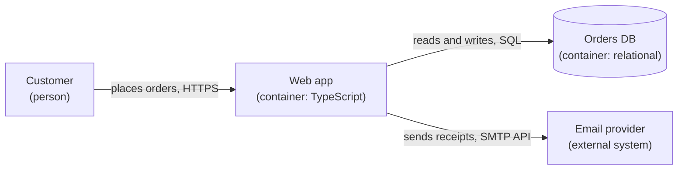

# C4 diagrams and the arc42 skeleton

Paraphrased from and linked to the C4 model (c4model.com, Simon Brown) and arc42
(arc42.org, Gernot Starke and Peter Hruschka). VTC's architecture artifact uses
the C4 levels for its diagrams and a reduced arc42 outline for its sections.

## C4 levels

1. **System context (level 1).** The system as one box; the people who use it; the external
   systems it talks to. One diagram, readable by a non-engineer.
2. **Containers (level 2).** The separately deployable or runnable units: web app, API, worker,
   database, queue, mobile app. Each with its technology and responsibility, and each arrow with
   its protocol and purpose.
3. **Components (level 3).** Inside one container, only when a decision needs it.
4. **Code (level 4).** Almost never; generate it from the code if needed.

Notation rules: every box has a name, a type, a technology and a one-line responsibility; every
arrow has a direction and a label saying what flows ("reads orders, JSON over HTTPS"); a key
explains shapes and colours; the diagram has a title and scope.

## Mermaid skeletons

Keep level 1 and level 2 as separate diagrams. Mark external systems visibly (a label or a
dashed border) so trust boundaries are clear.

## arc42 skeleton, reduced for VTC

1. **Introduction and goals:** the driving scenarios (quality goals) and the stakeholders.
2. **Constraints:** technical, organisational, conventions; the team defaults.
3. **Context and scope:** the C4 level 1 diagram; business and technical context.
4. **Solution strategy:** the recommendation and the scorecard summary in a few sentences.
5. **Building block view:** the C4 level 2 diagram and the requirement-to-component map.
6. **Runtime view:** only the scenarios whose flow is not obvious (a sequence diagram each).
7. **Deployment view:** where containers run; environments.
8. **Cross-cutting concepts:** security, persistence, error handling, observability.
9. **Architecture decisions:** the AD-n spine (Binds, Prevents, Rule, Check).
10. **Quality requirements:** the full scenario list with measures.
11. **Risks and technical debt:** red flags, UNVERIFIED claims, close calls.
12. **Glossary:** domain terms, aligned with the specification.

Omit a section that would be empty rather than filling it with boilerplate.
